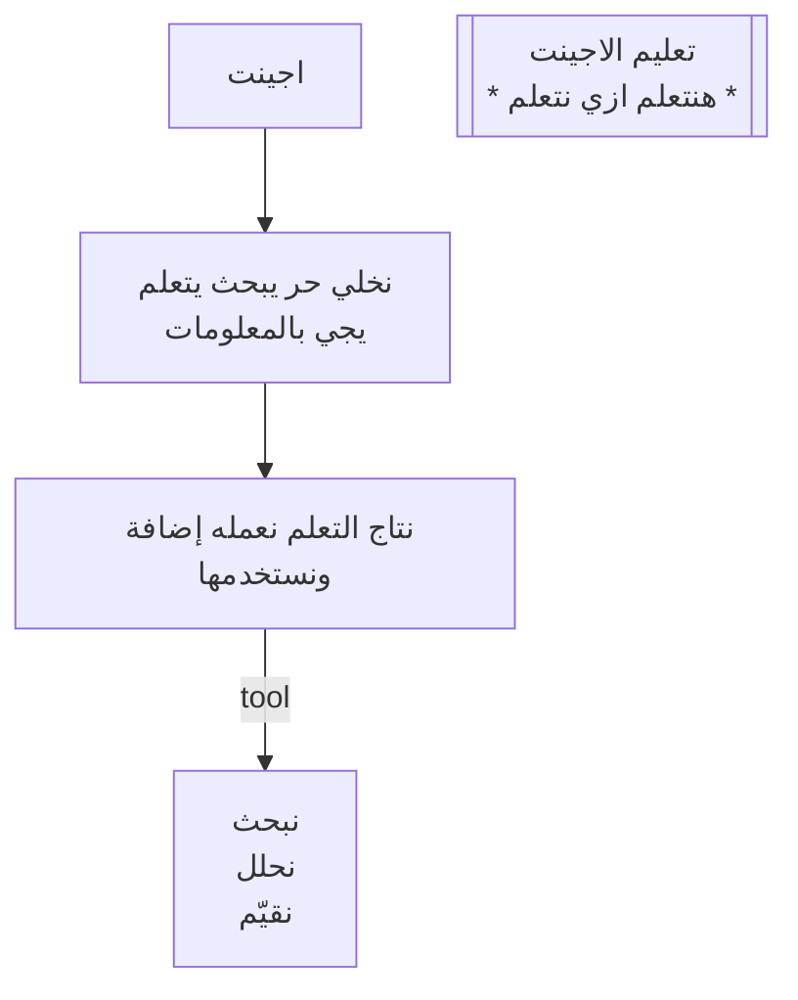

# قراءة ورقة «تعليم الإجينت»: 19/10/2026

الأصل: [note.jpg](note.jpg). تقارير الإجينتس في [runs/](runs/).

## النص النهائي

| # | المكان | النوع | النص | المصدر |
|---|---|---|---|---|
| 1 | أعلى شمال | صندوق | `monos` | الاتنين متفقين |
| 2 | أعلى وسط | تاريخ تحته خط | `19/10/2026` | الاتنين متفقين |
| 3 | أعلى يمين | كلمة تحتها خط | `mon` (يوم الإثنين) | الاتنين متفقين |
| 4 | يمين | عنوان تحته خط | **تعليم الاجينت** | المراجع، وراجعتها على الصورة المتكبّرة |
| 5 | تحت العنوان | سطر بين نجمتين | **\* هنتعلم ازي نتعلم \*** | الصورة المتكبّرة: آخر كلمة «نتعلم» مش «يتعلم» |
| 6 | فوق وسط | صندوق | **اجينت** | الاتنين متفقين |
| 7 | ↓ | سهم نازل | | |
| 8 | وسط | سطر حر | **نخلي حر يبحث يتعلم** | **مؤكدة من صاحب الورقة** («حر») |
| 9 | وسط | سطر حر | **يجي بـ المعلومات** | الاتنين متفقين |
| 10 | ↓ | سهم نازل | | |
| 11 | تحت | صندوق عريض | **نتاج التعلم نعمل(ه) إضافة ونستخدمها** | المراجع، وراجعتها على الصورة المتكبّرة. «أداة» عند القارئ الأول غلط |
| 12 | → | سهم لليمين، وجنبه كلمة | `tool` | الاتنين متفقين |
| 13 | يمين | صندوق، 3 سطور | **نبحث / نحلل / نقيّم** | الاتنين متفقين |

- مافيش أي سهم راجع لورا. الطريق مرسوم في اتجاه واحد.
- العنوان (4 و5) على جنب، ومش مربوط بسهم. هو اسم الفكرة كلها.

## الأخطاء اللي اتصلحت

| النقطة | إجينت القراءة (Grok 4.7) | إجينت المراجعة (Composer 2.5) | الحكم |
|---|---|---|---|
| الصندوق العريض | «نعمله **أداة**» | «بنعمل **إضافة**» | **إضافة**. الـ«ض» بنقطتها باينة |
| السطر الوسط | «نخلي **حر**» | «نخليه هو» أو «يخلي حد» | **حر**، صاحب الورقة أكدها |
| سطر النجمتين | «نتعلم ازاي **نتعلم**» | «متخيله/متعلم ازاي **يتعلم**» | **هنتعلم ازي نتعلم**. القارئ الأول أقرب للصح |
| العنوان | «تعليم الـ agent» | «تعليم الاجينت» | **الاجينت** بالعربي |

النتيجة: الشكل والأسهم كانوا مظبوطين عند الاتنين، والكلمات اتلخبطت عند كل واحد في مكان مختلف. المراجعة بموديل مختلف هي اللي كشفت أهم غلطة («أداة» بدل «إضافة»).

## الفكرة في سطور (من غير إضافات)
1. الهدف: **نعلّم الإجينت**. والمعنى الأعمق: **نتعلم إزاي نتعلم**.
2. الإجينت يتساب **حر**: يبحث ويتعلم بنفسه، ويرجع بالمعلومات.
3. اللي اتعلمه ما يضيعش. **بيتحوّل لإضافة** ونستخدمها.
4. الإضافة دي هي الـ **tool**، والـ tool بتعمل تلات حاجات: **نبحث، نحلل، نقيّم**.
