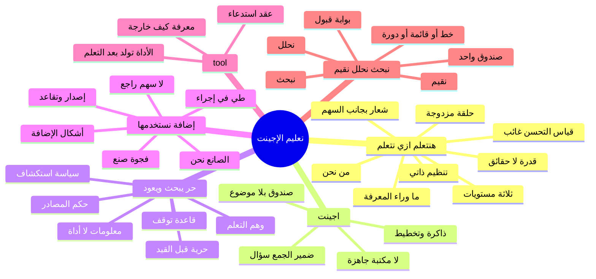

# الخريطة الكاملة: تعليم الإجينت

الدمج مبني على عناصر الصفحة في `idea.md` والصورة، لا على ترتيب أي خريطة. العلامات: [الورقة] نص الصفحة أو توضيح صاحبها، [استنتاج] قراءة من عنصر مرسوم، [بحث: URL] مصدر، [تخمين] امتداد لم تثبته الصفحة ولا المصدر، [ربط] صلة بين فروع لم تجمعها خريطة واحدة (القسم 5 فقط). مصدر الفرع: (م1) تعلم كيف نتعلم، (م2) حرية البحث والعودة، (م3) التقطير إلى إضافة، (م4) عين الناقد على البحث والتحليل والتقييم.

تصحيحات المنسّق مُطبَّقة في الشجرة: RARR ومسح meta-learning وEricsson وInformation Foraging وSatisficing وOptimal stopping وReflexion وMAML تشير إلى المصادر المصححة. فرع «تقارير بحث متعددة الوكلاء» وفرع «اكتساب مهارة مقابل نقل معرفة» بلا رابط، وعلامتهما [استنتاج].

## 1. الفكرة في 3 جمل

«تعليم الإجينت» عنوان على جنب التدفق، وشعاره «هنتعلم ازي نتعلم»: المطلوب تكوين قدرة على التعلم والبحث، لا حشو حقائق في موضوع واحد.

نترك إجينتاً حراً يبحث ويتعلم بنفسه، ثم يعود بمعلومات هي حصيلة الحلقة ووسيطها، لا غاية الشعار.

نتاج ذلك التعلم نجعله إضافة ثابتة على هيئة tool نستخدمها لنبحث ونحلل ونقيّم، والرسم سهم واحد إلى الأمام بلا رجوع إلى صندوق الإجينت.

## 2. الهيكل الأساسي

1. E4/E5 — العنوان «تعليم الإجينت» والشعار «هنتعلم ازي نتعلم» على جنب الرسم، وهما اسم الفكرة لا خطوة داخل السهم.
2. E6 — صندوق «اجينت» في رأس المسار، بلا موضوع بحث مكتوب.
3. E8/E9 — سهم نازل إلى «نخلي حر يبحث يتعلم» ثم «يجي بـ المعلومات».
4. E11 — صندوق عريض: «نتاج التعلم نعمله إضافة ونستخدمها».
5. E12 — سهم لليمين مكتوب عنده tool.
6. E13 — صندوق: «نبحث / نحلل / نقيّم».

## 3. الخريطة الكاملة

- **تعليم الإجينت** — اسم الفكرة كلها، والعنوان موضوع بجانب التدفق لا خطوة داخل السهم [الورقة] (م1)(م2)(م3)(م4)
  - التعليم صيغة سببية: طرف يُنشئ عند الإجينت قدرة، والمقصود البحث نفسه لا درس موضوع [الورقة] (م1)(م3)
  - التعليم = تكوين قدرة على التعلم الذاتي لا تلقين حقائق [استنتاج] (م2)
    - في الأدب يُقابل ذلك اكتساب مهارة مقابل نقل معرفة؛ الصفحة لا تستشهد بورقة لهذا التقابل، والرابط الذي وُضع هنا لا يقول هذا الكلام [استنتاج] (م2)
  - الشعار يطلب أن مادة هذه القدرة هي طريقة التعلم لا بند المعلومات [الورقة] (م1)(م3)(م4)
  - في الرسم يتبدل الضمير: «نخلي» لنا، «يبحث / يجي» للإجينت، «نعمله إضافة ونستخدمها» و«نبحث / نحلل / نقيّم» لنا [الورقة] (م1)(م3)
    - الإجينت هو من يبحث ويعود [استنتاج] (م1)
    - نحن من نحرّره ونصفّي نتاجه ونستخدم الأداة [استنتاج] (م1)
    - صاحب الرحلة هو الوكيل، وصانع الثبات في السطر التالي ضمير آخر [الورقة] (م3)
    - التعليم هنا تربية عضو باحث ثم حصاد طريقته، وتعلّم البشر الذين يعلّمونه يجري في فعل الحصاد نفسه [استنتاج] (م1)
  - **علاقة العنوان بالتدفق** [استنتاج] (م2)
    - E4/E5 على جنب بلا سهم يدخلانه، فالتعليم إطار مراقبة لا خطوة داخل الحلقة [استنتاج] (م2)
    - الرسم نفسه منهج من خمس محطات: وكيل، حرية، معلومات، إضافة، أداة، باتجاه واحد [الورقة] (م3)
  - **من المدرّب في كلمة «تعليم»** [استنتاج] (م4)
    - إنسان يضبط الحرية والمعايير [تخمين] (م4)
    - نظام تقييم آلي يُسلَّط من E13 على الوكيل [تخمين] (م4)
    - تعليم ذاتي بالكامل فيصير العنوان مجازاً [استنتاج] (م4)
  - **ما يتعلّمه من يعلّم** [استنتاج] (م1)
    - أن يميّز معلومة الحلقة من طريقة تصلح لإعادة الاستعمال [استنتاج] (م1)
    - أن الحرية شرط، وأن معيار قبول الإضافة هو التدريس الحقيقي [استنتاج] (م1)
      - أثناء الحرية لا تظهر نمذجة ولا تلميح ولا سؤال سقراطي [الورقة] (م1)
      - لحظة التعليم المرسومة هي تحويل النتاج إلى شيء يُستخدم [استنتاج] (م1)
    - معايير قبول الإضافة هي نظريته العملية في «البحث الجيد»، وتظهر حين يُبقي إضافة ويرفض أخرى [استنتاج] (م1)
      - تغيير هذه المعايير تعلّم للمستوى الأعلى: كيف تُصنع طرق التعلم [استنتاج] (م1)
      - هذا تعلم مزدوج الحلقة: الفعل يتغير في الحلقة الواحدة، والمتغير الحاكم يتغير في المزدوجة [بحث: https://hbr.org/1977/09/double-loop-learning-in-organizations] (م1)(م3)
    - استخدام الأداة يمتحنه: إن عجزت عن بحث وتحليل وتقييم لاحق، فتجميع النتاج لم يُنتج طريقة [استنتاج] (م1)
    - البوابة نفسها تتكرر في حقول متباعدة والشكل واحد [استنتاج] (م1)
      - مختبر يحوّل تجوال باحث إلى بروتوكول يُعاد: جمع، تحليل، حكم [استنتاج] (م1)
      - غرفة أخبار تحوّل مسار تحقيق إلى أداة تحقق على تحقيق تالٍ [استنتاج] (م1)
      - عيادة تحوّل حالة صعبة إلى تسلسل تشخيص: جمع، فروقات، رجحان [استنتاج] (م1)
      - أرشيف يحوّل طريقة قراءة رصيد إلى إجراء نقد مصادر [استنتاج] (م1)
      - قاعة تدريب تحوّل مأزق بحث إلى أداة «كيف نفحص دعوى» [استنتاج] (م1)
  - **فشل المشروع ككل إن بقيت الكلمات بلا معيار** [استنتاج] (م4)
    - إضافات بلا تقييم أضرّ من وكيل بلا ذاكرة [استنتاج] (م4)
    - حلقة مغلقة خاطئة: الإضافة تعزّز تحيز حرية البحث [استنتاج] (م4)
    - الشعار يبقى بلا قياس لتعلم التعلم [استنتاج] (م4)
    - ثلاث كلمات في E13 بلا سلالم حكم تنتج أداة لا تُحسَّن [استنتاج] (م4)
    - لا إدارة لإصدارات الإضافات فتصير فوضى معرفية [استنتاج] (م4)

- **هنتعلم ازي نتعلم** — السطر بين نجمتين تحت العنوان وعلى جنب التدفق [الورقة] (م1)(م2)(م3)(م4)
  - النجمات تعزله عن خطوات السهم، فصورته شعار للفكرة كلها [استنتاج] (م1)
  - صاحب الورقة: الفكرة بحث في طريقة تعليم الإجينت أن يبحث، أي تعلم طريقة التعلم، والمعلومات مادة لهذه الطريقة لا غاية [الورقة] (م1)(م3)
  - **ثلاثة مستويات متراكبة داخل الشعار** [استنتاج] (م1)
    - مستوى المعلومة: ما يعود به الإجينت من الحلقة [الورقة] (م1)
      - عند باتسون هذا Learning I: تغيّر الاختيار داخل بدائل معطاة [بحث: https://en.wikipedia.org/wiki/Double-loop_learning] (م1)
    - مستوى الطريقة: أداة تنفّذ بحثاً وتحليلاً وتقييماً [الورقة] (م1)
      - Learning II أو deutero-learning: تغيّر مجموعة البدائل التي يُختار منها التعلم التالي، أي سياق التعلم لا بند المعرفة [بحث: https://en.wikipedia.org/wiki/Double-loop_learning] (م1)(م3)
    - مستوى صنع الطريقة: نحن نتعلم أي نتاج يستحق أن يصير إضافة [استنتاج] (م1)
      - في تعلم الآلة الحلقة الداخلية تتعلم مهمة، والخارجية تتعلم خوارزمية التعلم عبر توزيع مهام [بحث: https://arxiv.org/abs/2004.05439] (م1)(م2)
      - الرسم يُري تنفيذاً واحداً لقالب الحلقة الخارجية [استنتاج] (م1)
      - صيغة «نعمله / نستخدمها» صيغة ممارسة، فالقالب قابل للتكرار وتراكم الإضافات قراءة طبيعية [استنتاج] (م1)
  - **قراءة تقنية للجملة: meta-learning** [بحث: https://arxiv.org/abs/2004.05439] (م2)
    - تعلم سياسة بحث تتعمم عبر مواضيع [استنتاج] (م2)
    - تعلم معيار إيقاف ومعيار جودة للعودة [استنتاج] (م2)
    - الميتا-هدف: تحسين استراتيجية البحث والتحليل والتقييم عبر دورات [استنتاج] (م4)
    - التعلم بناء إجراءات قابلة للنقل لا تراكم حقائق فقط [استنتاج] (م4)
    - المعلومات وحدها حلقة داخلية؛ بلا كتابة على طريقة التعلم تبقى Learning I [بحث: https://arxiv.org/abs/1703.03400] (م1)
      - MAML يتعلم تهيئة تجعل التكيّف مع مهمة جديدة سريعاً: المتعلَّم في المستوى الأعلى نقطة بدء لا حل المهمة [بحث: https://arxiv.org/abs/1703.03400] (م1)
      - قياس هذا المستوى أداء على مهام جديدة بنفس الميزانية، لا إعادة المهمة نفسها [بحث: https://arxiv.org/abs/1703.03400] (م4)
  - **مستويات «نتعلم كيف نتعلم» في النظام** [استنتاج] (م2)
    - مستوى 1: الإنسان يصمم حلقة الحرية حتى الإضافة [استنتاج] (م2)
    - مستوى 2: الإجينت يحسّن استراتيجيته ويخزنها في الإضافة [استنتاج] (م2)
    - مستوى 3: الإضافات تتكاثر وتُختبر بعضها ببعض [تخمين] (م2)
  - **خطر: الشعار يعلّق على العملية ولا عنصر على الصفحة يقيس «هل تحسنت قدرتنا على التعلم؟»** [استنتاج] (م4)
    - مستوى الإضافة: نجاح الاستدعاء، الزمن، تغطية المصادر [استنتاج] (م4)
    - مستوى الأفعال الثلاثة: جودة المخرجات على محك ثابت [استنتاج] (م4)
    - مستوى الشعار: مهام جديدة بنفس الميزانية [استنتاج] (م4)
    - مستوى المقارنة الزمنية: إصدار لاحق يتفوق على سابق بلا تدخل بشري كبير [استنتاج] (م4)
    - مؤشرات فشل التحسن: دقة ترتفع على رحلة الحرية فقط، أو الإضافة تطول بلا قرارات أفضل، أو تباين عالٍ بين الجلسات فلا مهارة مستقرة [استنتاج] (م4)
  - **من «نحن» في الشعار** [استنتاج] (م1)
    - قراءة أولى: البشر يتعلمون كيف يُتعلَّم، والإجينت أداة هذا الدرس [استنتاج] (م1)
    - قراءة ثانية: الإجينت داخل «نحن»، والشعار وعد بتكوينه [استنتاج] (م1)
    - قراءة ثالثة: الطرفان يتعلمان شيئين مختلفين في المرور الواحد [استنتاج] (م1)
      - الإجينت يمارس بحثاً ويعود بمعلومات [الورقة] (م1)
      - نحن نخرج بطريقة مجسدة في أداة [استنتاج] (م1)
      - الصفحة ترسم النتاج ولا ترسم تغيراً داخل صندوق الإجينت [استنتاج] (م1)
    - احتمال أن الإنسان والوكيل يتشاركان الأداة بعد التجميد [تخمين] (م4)
    - احتمال أن الوكيل بعد التعلم يصبح «نحن» عبر الإضافة [تخمين] (م4)
  - **تعلم البشر «كيف يتعلمون» كنظير للشعار** [بحث: https://doi.org/10.1037/0033-295X.100.3.363] (م2)
    - إعادة الصياغة وكشف الفجوات: شرح ما تُعلِّم، لا نسخه، قد يكون شرطاً للعودة بالمعلومات [تخمين] (م2)
    - **خلاف في موضع التدريب المتعمّد من الصفحة**
      - (م1) الحرية استكشاف، والتدريب المتعمد شيء آخر: ممارسة على الحافة مع تغذية راجعة ومعيار واضح، والصفحة ترسم حرية بلا معيار أثناء الطريق، والمعيار يظهر عند بوابة الإضافة [بحث: https://doi.org/10.1037/0033-295X.100.3.363] (م1)
      - (م2) التدريب المتعمد نفسه نظير للإجينت: حلقات بحث مع تقييم، لأن فيه تغذية راجعة ومهاماً على حافة القدرة [بحث: https://doi.org/10.1037/0033-295X.100.3.363] (م2)
  - **المعرفة الفوقية** [بحث: https://doi.org/10.1037/0003-066X.34.10.906] (م1)
    - عند فلافيل: معرفة بالشخص والمهمة والاستراتيجية، وخبرة مراقبة، واستراتيجيات تُمارَس [بحث: https://doi.org/10.1037/0003-066X.34.10.906] (م1)
    - ما يُكتسب في «تعلم التعلم» معرفة مشروطة: أي استراتيجية تصلح لأي نوع مهمة [بحث: https://doi.org/10.1037/0003-066X.34.10.906] (م1)
    - «كيف يتعلم الناس»: مقاربة فوق-معرفية تُمسك زمام التعلم، والكفاءة إطار يُسترجع في الموقف المناسب [بحث: https://nap.nationalacademies.org/catalog/9853/how-people-learn-brain-mind-experience-and-school-expanded-edition] (م1)
    - مراقبة الذات أثناء التعلم اسم آخر للشعار عند الإنسان [بحث: https://en.wikipedia.org/wiki/Metacognition] (م3)(م4)
    - ما وراء المعرفة معرفة عن المعرفة وتنظيم بالتخطيط والمراقبة والتقييم، ويجيب: متى أبحث، كيف أعرف أني فهمت، أي حكم يكفي [بحث: https://en.wikipedia.org/wiki/Metacognition] (م3)
    - نيلسون ونارينز: مستوى الموضوع ومستوى أعلى يراقبه ويتحكم فيه؛ الأداة في الرسم هذا المستوى وقد أُخرج من الرأس إلى شيء يُستدعى [بحث: https://en.wikipedia.org/wiki/Metacognition] (م3)
    - «نبحث / نحلل / نقيّم» هي هذا التنظيم وقد صار عمليات أداة، لا وصفاً لشعور الوكيل [استنتاج] (م3)
  - **التعلم المنظم ذاتياً: تمهيد، فأداء، فتأمل** [بحث: https://doi.org/10.1207/s15430421tip4102_2] (م1)
    - الصفحة تُظهر الأداء: حر يبحث ويتعلم [الورقة] (م1)
    - الصفحة تُظهر تأملاً مؤجلاً داخل أداة التقييم لا داخل الإجينت أثناء البحث [استنتاج] (م1)
    - صندوق التمهيد غائب: لا هدف مرسوم قبل الحرية [استنتاج] (م1)
      - الغاية قد تكون داخل الإجينت الحر وغير مرسومة [تخمين] (م1)
      - أو الحرية نفسها استبدال للتمهيد: المتعلم يعيّن ما يستحق البحث [استنتاج] (م1)
    - الدورة عند الإنسان بين هذه الثلاثة، والأداة تُخرجها من الشخص إلى إجراء يُعاد [بحث: https://en.wikipedia.org/wiki/Self-regulated_learning] (م3)
    - التصدير بيت القصيد: ما كان تنظيماً داخلياً أثناء الحرية يستخدمه غير من عاش الرحلة [استنتاج] (م3)
  - **ماذا يُتعلَّم حين يُتعلَّم البحث** — الأركان التي تستقر في أدب الاستقصاء، وكل ركن يتتبع إلى الحرية أو إلى فعل الأداة [استنتاج] (م1)
    - تكوين السؤال: صنعة البحث تبدأ بجعل الموقف سؤالاً [استنتاج] (م1)
    - البحث استقصاء وتلمّس استراتيجي يتطور أثناء الطريق لا استعلام واحد [بحث: https://www.ala.org/acrl/standards/ilframework] (م1)
    - النقل: صاحب الورقة أخرج الفكرة من أي موضوع بعينه [الورقة] (م1)
      - امتحان أن الأداة طريقة لا مخزن حلقة: أن تبحث وتحلل وتقيّم في موقف لم تُجمع معلوماته في الحرية [استنتاج] (م1)
      - النقل هو الشكل الذي يكشف به التعلم أنه صار قدرة لا حفظاً [بحث: https://nap.nationalacademies.org/catalog/9853/how-people-learn-brain-mind-experience-and-school-expanded-edition] (م1)
      - معيار ناقد: التعلم الحقيقي يظهر تحت توزيع مهام جديدة لا بإعادة المهمة نفسها [استنتاج] (م4)
      - النجاح على الرحلة نفسها يثبت إعادة عرض لا أداة [استنتاج] (م3)
      - التعلم من مثال واحد بلا نظرية تفسر النجاح يعطي قاعدة هشة عند النقل [بحث: https://en.wikipedia.org/wiki/Explanation-based_learning] (م3)
  - **خبرة روتينية وخبرة متكيفة** [بحث: https://nap.nationalacademies.org/catalog/9853/how-people-learn-brain-mind-experience-and-school-expanded-edition] (م1)
    - الروتينية إجراء كفء في بيئة ثابتة، والمتكيفة إعادة تركيب الإجراء حين يتغير الموقف [بحث: https://nap.nationalacademies.org/catalog/9853/how-people-learn-brain-mind-experience-and-school-expanded-edition] (م1)
    - الشعار يطلب الثانية [استنتاج] (م1)
    - تجميد الثلاثي في أداة ثابتة يصنع الأولى [استنتاج] (م1)
    - شكل الإضافة هو ما يحسم أي الخبرتين بقيت من الحرية [استنتاج] (م1)
    - عند الخبير انتقال من قواعد صريحة إلى أنماط ضمنية [بحث: https://en.wikipedia.org/wiki/Dreyfus_model_of_skill_acquisition] (م4)
  - **دورة كولب كما تُسقط على الرسم** [بحث: https://en.wikipedia.org/wiki/Experiential_learning] (م1)(م3)(م4)
    - **خلاف في الإسقاط**
      - (م1) في الصفحة تجربة الحرية، وتجريد الإضافة، واستعمال لاحق؛ السهم الذي يغلق الدورة غير مرسوم [استنتاج] (م1)
      - (م3) E8 تجربة، E9 ملاحظة ما وُجد، E11 تصور مجرد صار إضافة، والاستخدام تجريب نشط؛ الصفحة تقف قبل قوس العودة إلى تجربة تالية للوكيل [استنتاج] (م3)
      - (م4) تجربة E8 ثم تأمل غائب ثم تجريد E11 ثم تجربة جديدة غائبة لأن لا سهم يرجع إلى الوكيل؛ بلا التأمل والتجربة الثانية يبقى الشعار بلا آلية [استنتاج] (م4)

- **اجينت** — صندوق البداية [الورقة] (م1)(م2)(م3)(م4)
  - صندوق ثم سهم نازل إلى الحرية؛ أول المرسوم بعد الصندوق أن يُترك [الورقة] (م1)(م3)
  - نقطة البداية بلا موضوع مكتوب، والموضوع ليس على الصفحة [الورقة] (م2)
    - الموضوع يُولَّد من سياق المهمة أو من فجوة معرفية لا من الورقة [استنتاج] (م2)
  - كيان واحد يمر بالمسار، بينما أفعال الأداة بصيغة الجمع [استنتاج] (م4)
  - **ماذا يُفترض أن يملك قبل الحرية** [استنتاج] (م2)
    - أدوات وصول: ويب، ملفات، واجهات [تخمين] (م2)
    - ذاكرة عملية للجلسة [استنتاج] (م2)
    - لا مكتبة مهارات جاهزة؛ تلك ناتج الإضافة لا مقدمة الصندوق [استنتاج] (م2)
  - **معمارية معروفة كمرآة للصندوق لا كنص الصفحة** [بحث] (م2)
    - ReAct: تفكير متناوب مع فعل [بحث: https://arxiv.org/abs/2210.03629] (م2)
    - وكلاء توليديون: ذاكرة وتخطيط وفعل [بحث: https://arxiv.org/abs/2304.03442] (م2)
  - «يتعلم» أثناء البحث قد يعني تحديث نموذج عالم عما يعتقد أنه صحيح، أو تحديث استراتيجية البحث، لا أوزان النموذج [استنتاج] (م2)
    - قراءة ممكنة لكلمة «يتعلم» كتحديث أوزان، وهي غير مذكورة [تخمين] (م4)
    - قراءة ككتابة ذاكرة أو مهارة أو كود من جنس مكتبة مهارات [بحث: https://arxiv.org/abs/2305.16291] (م4)
    - قراءة كتجميع موجّه أو وحدة خط معالجة [بحث: https://arxiv.org/abs/2310.03714] (م4)

- **نخلي حر يبحث يتعلم** [الورقة] (م1)(م2)(م3)(م4)
  - «حر»: يُساب بنفسه يبحث ويتعلم، كما فسّرها صاحب الورقة [الورقة] (م1)(م2)(م3)
  - الحرية سابقة على الإضافة؛ التقييد يأتي بعدها لا قبلها، فلا قالب يملي ماذا يُتعلَّم هذه المرة [الورقة] (م3)
  - العودة حدث على الصفحة، فالحرية ليست دوراناً بلا نهاية [الورقة] (م1)
  - **الحرية شرط المستوى الأعلى لأنها تلزمه باختيار ما يُتعلَّم** [استنتاج] (م1)
    - بحث داخل موضوع محدد سلفاً يدرّب اختياراً داخل بدائل جاهزة [استنتاج] (م1)
    - بحث بلا موضوع، كما أراد صاحب الورقة، يدرّب تعيين مجال البدائل [الورقة] (م1)
    - في التعلم الفوقي توزيع المهام جزء من تعريف الحلقة الخارجية؛ «حر» يدفع اقتراح المهمة إلى الإجينت [بحث: https://arxiv.org/abs/2004.05439] (م1)
  - **أبعاد الحرية: ما يُحرَّر وما يبقى مقيداً** [استنتاج] (م2)
    - حرية الهدف: اختيار فرع الاستكشاف التالي [استنتاج] (م2)
    - حرية الوسيلة: أي مصدر، أي أداة، أي ترتيب خطوات [استنتاج] (م2)
    - حرية الزمن: متى يكفي [استنتاج] (م2)
    - قيود ضمنية حتى مع «حر»: ميزانية، أخلاقيات، صلاحيات [تخمين] (م2)
    - حرية الصفحة لا تعني غياب موارد أو زمن أو سياسات أمان، لكن هذه ليست عنصراً مرسوماً [استنتاج] (م4)
    - حتى البحث الحر يحتاج تعريفاً لنطاق ما يُسمح أن يُسأل [استنتاج] (م4)
  - **كيف يختار ماذا يستكشف** [استنتاج] (م2)
    - البحث عن المعلومات كاقتناص: يتبع رائحة الربح المعلوماتي في الروابط والمراجع، ويترك المسار حين ينخفض العائد المتوقع [بحث: https://doi.org/10.1037/0033-295X.106.4.643] (م2)
    - استكشاف مقابل استغلال: بداية الجلسة أوسع استكشافاً، وقبل العودة استغلال لملء الفجوات [بحث: https://en.wikipedia.org/wiki/Exploration–exploitation_dilemma] (م2)
    - فضول ودافع داخلي: مكافأة للحالات غير المتوقعة أو عالية التباين، فـ«حر» لا يعني عشوائياً بل محركاً داخلياً [بحث: https://arxiv.org/abs/1705.05363] (م2)
    - تعلم نشط: اختيار الاستعلام الذي يقلل عدم اليقين، وسؤال محكم قد يغنينا عن مئة صفحة [بحث: https://burrsettles.com/pub/settles.activelearning.pdf] (م2)
    - بحث يسوقه فرض: يولّد فرضيات ثم يبحث لإبطالها أو تأكيدها [استنتاج] (م2)
  - **كيف يحكم المصادر أثناء الحرية** [استنتاج] (م2)
    - طبقات ثقة: أصل المصدر (من كتب، متى، أين)، وتوافق مصادر مستقلة [استنتاج] (م2)
    - تواضع معرفي: تسجيل «غير متأكد» جزء من التعلم [تخمين] (م2)
    - تصفح يتعلم من تغذية راجعة بشرية على ما يختاره [بحث: https://arxiv.org/abs/2112.09332] (م2)
    - استرجاع ثم تحقق من الدعوى وتصحيحها، لا الاكتفاء بالجلب [بحث: https://arxiv.org/abs/2210.08726] (م2)
    - فشل الحكم: انحياز التأكيد في اختيار المصادر [تخمين] (م2)(م4)
    - مصادر متقنة الشكل ضعيفة المحتوى [استنتاج] (م2)
    - إذن «نقيّم» ليس اختيارياً بعد العودة [استنتاج] (م2)
    - وهم التعلم: يملأ وقت البحث بمصادر مريحة، يتعلم من محتوى غير موثوق، ثم يُجمَّد ذلك في الإضافة، فيحفظ مساراً واحداً لا طريقة تعلم [استنتاج] (م4)
  - **متى يتوقف ويعود** [استنتاج] (م1)(م2)
    - «يجي بـ المعلومات» يعني أن البحث ينتهي؛ تعلم البحث يتضمن تعلم متى تكفي العودة [الورقة] (م1)
    - كل خطوة إضافية لها كلفة والعائد يتناقص، وهذا قرار توقف أمثل [بحث: https://en.wikipedia.org/wiki/Optimal_stopping] (م2)
    - الاكتفاء بعتبة «جيد بما يكفي» لا باستنفاد العالم [بحث: https://doi.org/10.2307/1884852] (م2)
    - العتبة المرضية نفسها شرط حتى تثبت أداة البحث؛ من غيرها يعود البروتوكول حرية مقنّعة [بحث: https://en.wikipedia.org/wiki/Satisficing] (م3)
    - عتبات صريحة ممكنة: تغطية أسئلة قائمة [استنتاج] (م2)، ثقة فوق عتبة [تخمين] (م2)، ميزانية زمن أو رموز منتهية [تخمين] (م2)
    - توقف بعد دورة تفكير وتقييم ذاتي [بحث: https://arxiv.org/abs/2303.11366] (م2)
    - خطر التوقف المبكر مقابل التعمق اللانهائي؛ بلا تثبيت الإضافة قد يضيع ما جُمع عند التوقف [استنتاج] (م2)
  - **الحرية استكشاف، والتوجيه الأدنى له حد** [بحث: https://doi.org/10.1207/s15326985ep4102_1] (م1)
    - اكتشاف بلا إرشاد يثقل على المبتدئ لأن مساحة البحث أوسع من ذاكرته العاملة [بحث: https://doi.org/10.1207/s15326985ep4102_1] (م1)
    - التلمذة المعرفية تعالج ذلك بنمذجة ثم تدريب ثم سقالة ثم انسحاب [استنتاج] (م1)
    - الصفحة تبدأ عند الانسحاب: الحرية أول ما يُرسم بعد الصندوق [الورقة] (م1)
      - قراءة: الإجينت يُفترض قادراً على بحث أول، والتعليم ليس شرح خطوات البحث [استنتاج] (م1)
      - قراءة: المعلم يتعلم حدود الحرية بأن يراها تفشل ثم يضبط البوابة [تخمين] (م1)
    - التلمذة تسمي لحظة الحرية استكشافاً: المتعلم يطرح مسائله والمعلم لا يلقّن الوجهة، وهذا يطابق «نخلي حر» [بحث: https://en.wikipedia.org/wiki/Cognitive_apprenticeship] (م3)
    - الإفصاح والتأمل في التلمذة اللحظة التي يصير فيها التفكير مرئياً وقابلاً للنقل، أي «نعمله إضافة» [بحث: https://en.wikipedia.org/wiki/Cognitive_apprenticeship] (م3)
  - **نظام فضولي بلا مهمة خارجية قريب من هذه الحرية، لكن منهجه قيد غير مرسوم** [بحث: https://arxiv.org/abs/2305.16291] (م1)
    - يولّد منهجاً تلقائياً من فجوة المهارة ثم يخزن مهارات تنفيذية [بحث: https://arxiv.org/abs/2305.16291] (م1)(م3)
    - المنهج التلقائي قيد على الحرية ليست على الصفحة [استنتاج] (م1)
    - الإبقاء على الحرية يعني أن مكتبة الإضافات قد تجيء فيها فجوات وتكرار، لأن أحداً لم يملأ خريطة النقص سلفاً [استنتاج] (م3)
    - الصفحة تترك القيد لمرحلة «ونستخدمها»: ما لا يصير أداة بحث وتحليل وتقييم لا يُحفظ [استنتاج] (م1)
  - **المعرفة السلبية** [استنتاج] (م1)
    - المسارات التي أُغلقت جزء من خبرة الحرية [استنتاج] (م1)
    - إضافة لا تحفظ إلا المسار الناجح تُسقط نصف النتاج الذي تعلم به أن يبحث [تخمين] (م1)
  - **«يبحث» هنا فعل تعلم لا فعل الأداة بعد** [استنتاج] (م4)
    - **خلاف: هل هو نفس «نبحث» في الصندوق الأخير**
      - (م1) نعم بمعنى التحويل: الفعل الذي مارسه حراً صار وظيفة قابلة لإعادة التشغيل [استنتاج] (م1)
      - (م3) الصورة الثابتة لحرية البحث بعد نزع الحرية: البحث يبقى، والتعيين الحر للوجهة يُستبدل بشرط إطلاق وقاعدة توقف [استنتاج] (م3)
      - (م4) إن اختلفا فالتعلم اكتشاف كيف تبحث والإضافة أتمتة ذلك؛ وإن تماثلا فالخطر تجميد استكشاف خام قبل أن يُقيَّم [استنتاج] (م4)
  - وكلاء يتعلمون متى يستدعون أداة موجودة؛ اتجاه الورقة عكس ذلك، فهي تبني الأداة بعد التعلم [بحث: https://arxiv.org/abs/2302.04761] (م4)

- **يجي بـ المعلومات** [الورقة] (م1)(م2)(م3)(م4)
  - المعلومات حصيلة الحلقة ووسيطها، والكلمة على الصفحة «المعلومات» لا «الأداة» ولا «الدرس» [الورقة] (م1)(م3)
  - الشعار يطلب طريقة، فالمعلومة مادة خام للتحويل لا غاية [استنتاج] (م1)
  - المعلومات ناتج الرحلة، والإضافة تُصنع منها في المحطة التالية؛ بينهما سهم [الورقة] (م3)
  - «يجي» عودة إلى نقطة إسناد: معلم أو نظام أو جلسة أم؛ الصفحة لا ترسم سهم رجوع لكن السطر يفترض مستقبِلاً للمعلومات [استنتاج] (م2)
  - **معرفة-أن في هذه الخانة** [بحث: https://plato.stanford.edu/entries/knowledge-how/] (م1)
    - معرفة-كيف ليست كومة قضايا تُستظهر [بحث: https://plato.stanford.edu/entries/knowledge-how/] (م1)
    - العودة بالمعلومات إنجاز معرفة-أن، والأداة لاحقاً محاولة لتجسيد معرفة-كيف [استنتاج] (م1)
  - **وهم الكفاءة** [استنتاج] (م1)
    - حيازة المعلومات في السياق إحساس قوي بأن التعلم تم [استنتاج] (م1)
    - الكفاءة تظهر عند الاسترجاع والاستعمال لا عند حضور المادة [بحث: https://nap.nationalacademies.org/catalog/9853/how-people-learn-brain-mind-experience-and-school-expanded-edition] (م1)
    - الصفحة تضع بعد المعلومات اختباراً عملياً: تصير إضافة ثم تُستخدم [الورقة] (م1)
  - شكل المعلومة العائدة قد يكون أعلى من الخام [تخمين] (م1)
    - تأملات تُكثّف الذكريات إلى قضايا أعم قبل إعادة الاستعمال [بحث: https://arxiv.org/abs/2304.03442] (م1)
    - حتى القضية المعممة تبقى معلومة إلى أن تُجعل أداة تنفذ الثلاثي [استنتاج] (م1)
    - حفظ تأمل لفظي في ذاكرة تُحقن في المحاولة التالية: الناتج نص خبرة لا أداة بوظائف مستقلة [بحث: https://arxiv.org/abs/2303.11366] (م3)
    - رفع الذكريات إلى انعكاسات أعلى ما زال ذاكرة مكتوبة [بحث: https://arxiv.org/abs/2304.03442] (م3)
    - استخراج رؤى لغوية عابرة للمهام وإعادة جلبها جسر بين المعلومة والأداة، ولا يبلغ رسم الصفحة لأن الورقة تشترط أداة لا فقرة [بحث: https://arxiv.org/abs/2308.10144] (م1)(م3)
  - **شكل العودة ليس كومة خام** [استنتاج] (م2)
    - حزمة منظمة: دعاوى وأدلة ودرجات ثقة، ومصادر بروابط، وفجوات وخطوات مقترحة [استنتاج] (م2)
    - تقارير بحث ذات شكل معياري، ومنها تقارير بحث متعددة الوكلاء؛ لا مصدر يُثبَّت تحت هذا المثال [استنتاج] (م2)
    - برامج ومهارات كمعلومات قابلة للتنفيذ: العودة بمكتبة مهارات أقرب إلى الإضافة من سجل المحادثة [بحث: https://voyager.minedojo.org/] (م2)
  - **ما الذي يجب أن يعود مع المعلومات حتى تخدم الأفعال الثلاثة، والصفحة لا تذكره** [استنتاج] (م4)
    - أصل المصدر لفعل البحث اللاحق [استنتاج] (م4)
    - افتراضات صريحة لفعل التحليل [استنتاج] (م4)
    - حدود الثقة ونقاط الضعف لفعل التقييم [استنتاج] (م4)
    - الصفحة لا تذكر إلا كلمة «المعلومات» [الورقة] (م4)
  - **جودة العودة: معايير قبول** [استنتاج] (م2)
    - الصلة: تخدم قراراً أو سؤالاً [استنتاج] (م2)
    - السلامة: الأدلة تدعم الادعاء [استنتاج] (م2)
    - القابلية للفعل: يمكن أن تتحول إضافة [استنتاج] (م2)
    - الضغط: معرفة مكثفة لا تكرار [استنتاج] (م2)
  - **فصل «ما تعلمه» عن «ما جمعه»** [استنتاج] (م2)
    - الجمع نسخ حقائق، والتعلم نماذج وقواعد وإجراءات وأدوات، والإضافة يجب أن تحمل الثاني [استنتاج] (م2)
    - فشل: تخزين ملخصات طويلة واعتبارها إضافة [استنتاج] (م4)
  - **صيغة العودة** [استنتاج] (م2)(م4)
    - قراءة السطر الواحد عودة واحدة لا تدفقاً جزئياً [استنتاج] (م2)
    - دفعة نهائية مقابل تحديثات جزئية، والصفحة صامتة [تخمين] (م2)
    - نصوص أو رسوم أو كود أو جداول قرار أو سلالم حكم كلها مرشحة، وبلا صيغة قابلة للتنفيذ تبقى الإضافة مجازاً [استنتاج] (م4)
  - الفجوة بين هذه الخانة والإضافة عملية تجميع وتقطير لا نقل حرفي [استنتاج] (م4)

- **نتاج التعلم نعمله إضافة ونستخدمها** — قلب التحويل على الصفحة [الورقة] (م1)(م2)(م3)(م4)
  - الصيغة كاملة: النتاج يُعمل إضافة، والإضافة تُستخدم [الورقة] (م1)
  - «إضافة» بشرح صاحبها: شيء ثابت يُضاف ويُستخدم تاني؛ الثبات شرط والإعادة شرط [الورقة] (م1)(م2)(م3)
  - ليس كل ما مر في السجل، بل المنتج المستقر بعد الحرية والعودة [استنتاج] (م2)
  - بين المعلومات والإضافة فجوة صنع لا فجوة نقل: «يجي» وصول و«نعمله» تشكيل [الورقة] (م3)
  - من يصنع هو «نحن»؛ الصفحة لا تقول إن الوكيل يُخرج الأداة جاهزة [الورقة] (م3)
  - **الاستعارة اقتناء: للتعلم ثمرة تُمتلك** [بحث: https://doi.org/10.3102/0013189X027002004] (م1)
    - استعارة الاقتناء تجعل التعلم حيازة معرفة، واستعارة المشاركة تجعله صيرورة داخل ممارسة [بحث: https://doi.org/10.3102/0013189X027002004] (م1)
    - الصفحة تقف في الاقتناء: نتاج، إضافة، استخدام [الورقة] (م1)
    - الشعار صيغته صيرورة والرسم ثمرة؛ الثمرة الشكل الذي رضيت به الصفحة للصيرورة [استنتاج] (م1)
  - **معماريتان للصنع** [استنتاج] (م3)
    - معمارية الصفحة: العائد معلومات والصانع نحن، والوكيل في محطة أسبق [استنتاج] (م3)
    - معمارية الوكيل الذي يكتب مهارته بنفسه [استنتاج] (م3)
      - مهارة لا تدخل المكتبة إلا بعد إتمام المهمة في البيئة، والقبول تابع للنجاح لا لجمال الكود [بحث: https://arxiv.org/abs/2305.16291] (م3)
      - صانع أداة يكتب دالة، ومستخدم يستدعيها؛ ثمن الصنع يُدفع مرة والاستعمال يتكرر [بحث: https://arxiv.org/abs/2305.17126] (م3)
      - خلق الأداة، ثم قرار استخدامها، ثم التنفيذ، ثم تعرّف الموضع المناسب [بحث: https://arxiv.org/abs/2305.14318] (م3)
      - الصفحة تجمع الصنع والاستعمال في ضمير واحد وتترك الوكيل قبل هذه اللحظات [استنتاج] (م3)
    - عنق اكتساب المعرفة: أصعب ما في الأنظمة الخبيرة استخراج ما يفعله الخبير الحر وتحويله إلى قواعد تُستدعى [بحث: https://en.wikipedia.org/wiki/Knowledge_acquisition] (م3)
      - الصفحة تبقي الاستخراج عند «نحن»؛ الثمن بطء الصنع، والعائد أن الإضافة ملك من سيستخدمها لا ذاكرة خاصة بالوكيل [استنتاج] (م3)
      - نقل الصنع إلى الوكيل يخفف العنق ويعيد مشكلة: الأداة قد تُفهم لصانعها أكثر مما تُفهم لمن تُرسم لهم «نستخدمها» [استنتاج] (م3)
  - **التجميع: من مسار متعدد الخطوات إلى مشغّل واحد** [بحث: https://doi.org/10.1007/BF00116249] (م1)
    - تقطيع سلسلة الاستدلال إلى إنتاج يُستدعى لاحقاً قطعة واحدة [بحث: https://doi.org/10.1007/BF00116249] (م1)
    - معرفة تصريحية تصير مع الممارسة قواعد إجرائية [بحث: https://doi.org/10.1037/0033-295X.89.4.369] (م1)(م3)
    - التطوي: الواقعة تُطوى داخل قاعدة، ثم التركيب يدمج القواعد المتتالية في قاعدة واحدة [بحث: https://doi.org/10.1037/0033-295X.89.4.369] (م3)
    - بعد التطوي تُستعمل المهارة من غير إعادة جلب الدرس الأصلي؛ هذا تعريف تشغيلي لـ«ثابتة» [بحث: https://doi.org/10.1037/0033-295X.89.4.369] (م3)
    - الصفحة تقفز من معلومات إلى أداة؛ الممارسة الطويلة غير مرسومة، والقفزة قرار تجميع [استنتاج] (م1)
    - ما يضيع غالباً في التجميع مبرر الخطوة وحدودها [استنتاج] (م1)
    - لذلك شروط الانطباق جزء من الإضافة إن أُريد لها أن تبقى طريقة لا عادة عمياء [بحث: https://nap.nationalacademies.org/catalog/9853/how-people-learn-brain-mind-experience-and-school-expanded-edition] (م1)
    - مراحل المهارة الحركية: معرفية تتكلم فيها الخطوات، ثم ارتباطية، ثم ذاتية تعمل بلا استحضار الشرح؛ الأداة المرحلة الذاتية خارج الرأس [بحث: https://en.wikipedia.org/wiki/Motor_learning] (م3)
    - التعميم من حادثة الرحلة إلى إجراء يغطّي حالات لم تُرَ، إذا وُجدت نظرية مجال تفسر نجاح المثال [بحث: https://en.wikipedia.org/wiki/Explanation-based_learning] (م3)
    - عند المأزق يُبحث، فإذا حُلّ تُحفظ قطعة تختصر البحث في المرة القادمة [بحث: https://en.wikipedia.org/wiki/Soar_(cognitive_architecture)] (م3)
    - الصفحة ترسم عودة واحدة؛ التعميم هو ما يجعل من تلك العودة أداة لا أرشيفها [استنتاج] (م3)
    - الناتج يحتاج اسماً وموضع استدعاء وإلا بقي معلومة في دفتر، وكلمة tool هي هذا الموضع [استنتاج] (م3)
    - شكل الناتج محصور في الوظائف الثلاث، فالصفاء شرط قبول لا تحسين لاحق؛ ناتج لا يبحث ولا يحلل ولا يقيّم لا يطابق الصندوق الذي يشير إليه السهم [استنتاج] (م3)
    - لا يدخل المكتبة قبل أن يُظهر أنه يعمل؛ الصفحة تقول «ونستخدمها» بلا محطة اختبار مرسومة، فالاختبار استنتاج من فعل الاستعمال ومن أدب لا يحفظ المهارة قبل نجاحها [بحث: https://arxiv.org/abs/2305.16291] (م3)
  - **ماذا يضيع في الصنع، ولماذا الضياع جزء من الفكرة** [بحث: https://en.wikipedia.org/wiki/Tacit_knowledge] (م3)
    - نعرف أكثر مما نستطيع أن نقول؛ جزء من حرية الوكيل لن يدخل أي إضافة [بحث: https://en.wikipedia.org/wiki/Tacit_knowledge] (م3)
    - التثبيت يعطي المشاركة الحية شكلاً (إجراء، أداة، وثيقة) فيصير قابلاً للمشاركة، وقد ينفصل الشكل عن الممارسة التي ولدته [بحث: https://en.wikipedia.org/wiki/Communities_of_practice] (م3)
    - المبتدئ يتبع قواعد والخبير يتصرف بلا تفكيك موقفه إلى قواعد؛ أداة على هيئة قواعد قد تبقي مستخدمها في طور التتبع [بحث: https://en.wikipedia.org/wiki/Dreyfus_model_of_skill_acquisition] (م3)
    - الضياع مقبول لأن الحرية والإضافة محطتان معاً: الحرية تبقى مصدراً والإضافة شيئاً ثابتاً، ولا واحدة تُلغى [استنتاج] (م3)
  - **الإضافة موضوع حدودي** [بحث: https://en.wikipedia.org/wiki/Boundary_object] (م3)
    - يسافر بين جماعتين من غير أن يملكه طرف واحد [بحث: https://en.wikipedia.org/wiki/Boundary_object] (م3)
    - على الصفحة الطرفان موجودان: وكيل تعلم، ونحن نصنع ونستخدم [الورقة] (م3)
    - إن صُنعت بلغة الوكيل فقط صارت ذاكرة له؛ وإن صُنعت بلغة الاستعمال فقط انقطعت عن الرحلة التي تبررها [استنتاج] (م3)
  - الإخراج ينقل ما كان ضمنياً في البحث الحر إلى شكل صريح، والدمج يركّب الصريح في نظام واحد؛ الصندوق ذو الوظائف الثلاث لحظة الدمج [بحث: https://en.wikipedia.org/wiki/SECI_model_of_knowledge_dimensions] (م3)
  - أداة الفكر تزيد المستعمل إذا بقيت بيده لا إذا حلّت محل قدرته على البحث؛ «نستخدمها» تتسع لهذه القراءة، والوكيل الحر يبقى مصدراً لا قطعة غيار [بحث: https://www.dougengelbart.org/pubs/augment-3906.html] (م3)
  - التأمل بعد انقضاء الفعل، لا أثناء التجوال، هو لحظة الصنع؛ الحرية تبقى فعلاً والإضافة تأملاً مجسداً [بحث: https://en.wikipedia.org/wiki/Reflective_practice] (م3)
    - **خلاف مع قراءة شون الأخرى:** التأمل أثناء الفعل غائب بين العودة والصنع، لا أن الصنع نفسه هو التأمل البعدي [بحث: https://en.wikipedia.org/wiki/Donald_Schön] (م4)
  - **مكتبة مهارات تنفيذية أقرب شكل منفَّذ لهذه الخانة، مع فرق الجهة** [بحث: https://arxiv.org/abs/2305.16291] (م1)(م2)(م4)
    - المهارة برنامج يُستدعى ويُركَّب، لا فقرة تُلصق في السياق [بحث: https://arxiv.org/abs/2305.16291] (م1)
    - الرؤى اللغوية المستخرجة من النجاح والفشل أقرب إلى معلومة معممة، والصفحة تشترط أداة [بحث: https://arxiv.org/abs/2308.10144] (م1)
    - ذاكرة لغوية من تجارب فاشلة إضافة أخف من الكود [بحث: https://arxiv.org/abs/2303.11366] (م4)
  - **«ونستخدمها»** [الورقة] (م1)(م2)
    - ما لا يُستخدم لا يكمل جملة الخانة [الورقة] (م1)
    - الاستخدام المطلوب في بحث وتحليل وتقييم، فدالة اللياقة ضيقة وسط حرية واسعة: يُحفظ ما يعين الاستقصاء [الورقة] (م1)
    - الاستخدام في جلسات لاحقة بلا إعادة بحث كامل [استنتاج] (م2)
    - الاستخدام بذرة استكشاف في حرية تالية [استنتاج] (م2)
    - استخدام لاحق من الوكيل نفسه أو من وكيل آخر أو من إنسان [استنتاج] (م4)
    - الاسترجاع المتكرر يغيّر ما يُحفظ؛ «نستخدمها» ليست استهلاكاً بعد التعلم بل جزءاً من تثبيت الإضافة [بحث: https://bjorklab.psych.ucla.edu/research/] (م3)
    - فشل أثناء الاستعمال الإشارة الوحيدة التي تملكها الصفحة لتحسين لاحق، لأن سهماً راجعاً غير مرسوم [استنتاج] (م3)
  - **الإضافة قد تتراكم** [استنتاج] (م1)(م2)
    - الصفحة ترسم صندوق إضافة واحداً [الورقة] (م1)(م3)
    - الصيغة المضارعة تسمح بقراءته كقالب يُعاد، فمكتبة طرق لا بطاقة واحدة [استنتاج] (م1)
    - دورة حياة: إنشاء، تسجيل، استدعاء، مراجعة، نسخة جديدة [استنتاج] (م2)
    - ترقيم نسخ حين يتعلم الإجينت مجدداً [استنتاج] (م2)
    - بلا سياسة نسخ تتضارب الإضافات [استنتاج] (م4)
  - **مخاطر التثبيت** [تخمين] (م2)(م4)
    - إضافة صارت قديمة أو خاطئة [تخمين] (م2)
    - تراكم إضافات متعارضة [تخمين] (م2)
    - فيلزم تقييم الإضافة نفسها لا موضوع البحث فقط [استنتاج] (م2)(م3)
    - تجميد معرفة قديمة يمنع التعلم الجديد ما دام لا رجوع إلى الحرية [استنتاج] (م4)
    - قانون غودهارت: الإضافة تُحسَّن لمقياس التقييم لا للغرض [بحث: https://en.wikipedia.org/wiki/Goodhart%27s_law] (م4)
    - بوابة جودة غائبة قبل التجميد: لا عنصر يقول «لا تُجمّد حتى يمر التقييم» [استنتاج] (م4)
    - اقتراح ناقد: الأفعال الثلاثة تسبق التثبيت في الدورة التالية حتى لو الرسم خطي [استنتاج] (م4)
  - **أشكال الإضافة، بشرط أن تبلغ رتبة الأداة وتعمل الوظائف الثلاث** [استنتاج] (م2)(م3)
    - أداة أو دالة مسجّلة في وقت التشغيل: اسم ووصف ومدخلات ومخرجات [استنتاج] (م2)
    - كود قابل للتشغيل له مدخل ومخرج [بحث: https://arxiv.org/abs/2305.17126] (م3)
      - كل مهارة برنامج، ووصفها يُضمَّن في متجه، والاسترجاع بالشبه الدلالي للوصف لا بنص الرحلة [بحث: https://arxiv.org/abs/2305.16291] (م3)
      - المهارة المركبة تستدعي مهارات أبسط؛ العلاقة استدعاء لا تكديس فقط [بحث: https://arxiv.org/abs/2305.16291] (م2)(م3)
      - الشكل يخدم الثلاثي إذا كان فيه إجراء بحث وتحليل وحكم، لا إذا كان سكربت مهمة واحدة في مجال [استنتاج] (م3)
      - مثال محايد المجال: دالة تجمع مصادر وتقارنها وترجع حكماً، في مختبر أو أرشيف أو ورشة [تخمين] (م3)
    - وحدة موجَّه أو كراسة بحث [استنتاج] (م2)
    - وثيقة مهارة تُحمَّل عند تطابق القصد: متى تُستخدم وكيف تبحث وتحلل وتقيّم؛ بلا شرط إطلاق تبقى معلومات [استنتاج] (م3)
      - الرؤى اللغوية تُجلب؛ الوثيقة-المهارة تزيد بنية استدعاء دائمة [بحث: https://arxiv.org/abs/2308.10144] (م3)
    - ذاكرة دلالية مفهرسة [بحث: https://arxiv.org/abs/2310.08560] (م2)
    - فهرس مصادر موثوق لمجال [استنتاج] (م2)
    - قالب تقرير مع قوائم تحقق [استنتاج] (م2)
    - قاعدة إنتاج: إذا ظهر هذا النمط فافعل هذا البحث أو هذا الحكم [بحث: https://en.wikipedia.org/wiki/ACT-R] (م3)
      - أصغر إضافة يمكن حفظها، والأداة الكبيرة مجموعة قواعد مُدمجة [بحث: https://doi.org/10.1037/0033-295X.89.4.369] (م3)
      - القطعة التي تختصر بحث مأزق سابق من هذا الشكل [بحث: https://en.wikipedia.org/wiki/Soar_(cognitive_architecture)] (م3)
      - خطرها الإطلاق خارج نمطها، فيصير الثبات تعميماً زائداً [بحث: https://en.wikipedia.org/wiki/Explanation-based_learning] (م3)
    - بروتوكول بحث: أين ننظر، ما الذي يُعد مصدراً، متى نتوقف؛ هذه وظيفة «نبحث» وقد تبلورت [استنتاج] (م3)
      - بروتوكول مراجعة منهجية جاهز: سؤال، مصادر، معايير إدراج، تركيب؛ تعلم الجماعة كيف تبحث وقد صار أداة [بحث: https://www.prisma-statement.org/] (م3)
      - أمثلة الشكل لا المجال: العثور على سابقة، مسح أدب، جمع روايات شفهية [تخمين] (م3)
    - إطار تحليل: تمييزات تُسلَّط على ما عاد به البحث؛ من غيره يكون التحليل بحثاً ثانياً [استنتاج] (م3)
      - أمثلة الشكل: نقد مصدر تاريخي خارجي ثم داخلي، تفكيك قطعة إلى عناصر، تفكيك تصميم تجربة إلى متغيرات [تخمين] (م3)
    - معيار تقييم أو قائمة تحقق: سلّم ومراسي وشروط فشل؛ هذه وظيفة «نقيّم» وقد استقلت [استنتاج] (م3)
      - قائمة سلامة جراحية مقطّرة من ممارسة، تُراجع وتُكيَّف وتبقى قصيرة عمداً [بحث: https://www.who.int/teams/integrated-health-services/patient-safety/research/safe-surgery] (م3)
      - الخبرة تُضغط في قائمة لأن الذاكرة والانتباه يخونان تحت الحمل؛ الثبات هنا فضيلة لا نقص [بحث: https://en.wikipedia.org/wiki/The_Checklist_Manifesto] (م3)
      - أمثلة الشكل: سلّم تحكيم، نموذج تحكيم أقران، معيار نضج يقرره من يتذوق [تخمين] (م3)
    - حالة محفوظة ومعها إجراء تكييف لا الحالة وحدها: استرجاع، إعادة استخدام، مراجعة، إبقاء [بحث: https://en.wikipedia.org/wiki/Case-based_reasoning] (م3)
      - الإبقاء هو لحظة الإضافة؛ بلا مراجعة وتكييف تبقى الحالة معلومة [استنتاج] (م3)
      - الحالة تخدم التقييم حين يكون الحكم «هذا يشبه ما فشل» وتخدم البحث حين تدل أين ننظر [استنتاج] (م3)
    - مجموعة اختبارات: ما يُعد نجاحاً محفوظ كفحوص تُشغَّل، وهذا يخدم «نقيّم» خاصة [استنتاج] (م3)
    - خط أنابيب مُصرَّف: الوحدات مصرَّحة، والتصريف يكتب شكلها الدائم بعد تحسين على مقياس؛ الناتج القابل لإعادة التشغيل هو الإضافة لا سجل التدريب [بحث: https://arxiv.org/abs/2310.03714] (م3)(م4)
      - هذا أقرب أشكال الأدب إلى صندوق واحد فيه بحث ثم تحليل ثم تقييم [استنتاج] (م3)
      - المقياس الذي نُحسّن عليه قد يصير هو نفسه أداة التقييم [بحث: https://arxiv.org/abs/2310.03714] (م3)
    - أثر خارج جلسة الوكيل: ملف، أو مهارة، أو أداة بروتوكول، أو قاعدة [استنتاج] (م4)
    - **ما يبقى دون رتبة الأداة وإن جاء من التعلم** [استنتاج] (م3)
      - كومة المعلومات في خانة العودة [الورقة] (م3)
      - تأمل يُحقن في السياق ولا وظيفة مستقرة له [بحث: https://arxiv.org/abs/2303.11366] (م3)
      - سلوك يُطوى داخل الأوزان إذا حسّن نداءُ أداةٍ التنبؤ بالنص؛ ذلك عادة داخل النموذج لا إضافة تُفتح، والرسم يضع tool في صندوق منفصل [بحث: https://arxiv.org/abs/2302.04761] (م1)(م3)
  - **اختبار الإضافة، والمحطة نفسها غير مرسومة** [استنتاج] (م3)(م4)
    - اختباران لا يُخلطان: هل الأداة تبحث وتحلل وتقيّم كما وُعد في العقد، مقابل وظيفة التقييم التي داخلها وهي حكمها على موضوعها [استنتاج] (م3)
    - لا تُسمى «نتاج تعلم» ما لم تمر الأفعال الثلاثة بمعايير؛ «نستخدمها» خطر إن لم يُقيَّم أولاً [استنتاج] (م4)
    - كل قدرة تُختبر وحدها ثم السلسلة: هل توقف البحث عند العتبة ومن الجنس الذي سمّاه البروتوكول؛ هل التمييزات تنتج بنية يعيد غيرنا بناءها؛ هل المراسي تلزم حكماً واحداً بين مستعملين أم يعود الحكم ذوقاً [استنتاج] (م3)
    - التنفيذ في البيئة، وادعاء انتقال المكتبة إلى عالم جديد، فيصل قبول في الأدب لا نص على الصفحة [بحث: https://arxiv.org/abs/2305.16291] (م3)
    - من يختبر: «نحن» الذين نصنع ونستخدم، لا الوكيل في لحظة حريته [استنتاج] (م3)
    - إن كان المستعمل غير الصانع ظهر أن الأداة قائمة بذاتها؛ إن لم يستطع غير صانع الرحلة أن يناديها فما زلنا داخل المعلومات [بحث: https://arxiv.org/abs/2305.17126] (م3)
  - **إصدار وتحسين: تكرار «نعمله» على ناتج استعمال لاحق، والرسم يُري الصنع مرة** [استنتاج] (م3)
    - الإصدار أثر مكتوب لتغيّر الإضافة مع بقاء اسم الاستدعاء [استنتاج] (م3)
    - تفريق ما يكسر العقد عما يضيف بتوافق عما يُصلح بلا مساس بالمعنى [بحث: https://semver.org/] (م3)
    - إصلاح صياغة أو مرساة بلا تغيير الوظائف: أثر صغير [استنتاج] (م3)
    - مصدر جديد أو تمييز تحليلي جديد مع بقاء معنى الحكم: أثر وسط [استنتاج] (م3)
    - تغيير ما يُعد تقييماً مقبولاً: أثر كبير، وهو الحلقة المزدوجة داخل الأداة لا ترقيع ناتج [بحث: https://hbr.org/1977/09/double-loop-learning-in-organizations] (م3)
    - النسب: كل إصدار يقدر أن يشير إلى المعلومات التي صُنع منها [استنتاج] (م3)
      - بعد التطوي تُستعمل القاعدة بلا جلب الأصل، فتصير الأداة سريعة ويصعب تدقيقها [بحث: https://doi.org/10.1037/0033-295X.89.4.369] (م3)
      - إبقاء معلومات العودة بجانب الأداة يحفظ النسب ولا يلغي التقطير؛ إذابتها تجعل الأداة كل ما تبقّى [استنتاج] (م3)
      - البروتوكول العلمي يحفظ المادة والطريقة معاً حتى يُعاد الحكم [استنتاج] (م3)
    - التحسين تعديل إضافة قائمة؛ الإضافة الجديدة جسم آخر بجانبها [استنتاج] (م3)
    - لفظ «إضافة» يميل إلى الجوار لا إلى المسح [استنتاج] (م3)
    - الصفحة ترسم صندوقاً واحداً؛ الاختيار بين تعديله وبين صندوق ثانٍ غير مكتوب [الورقة] (م3)
  - **إحالة إلى التقاعد حتى يبقى «نستخدمها» استعمالاً لا تكديساً** [استنتاج] (م3)
    - مشكلة المنفعة: القاعدة المتعلَّمة قد تكلف مطابقتها أكثر مما توفره من بحث، فتُحذف إن كان توفيرها المتوقع أقل من كلفة إطلاقها [بحث: https://en.wikipedia.org/wiki/Explanation-based_learning] (م3)
    - إضافة لا تُستدعى، أو تُستدعى فتؤخر الثلاثي، لم تعد تحقق «نستخدمها» [استنتاج] (م3)
    - التعميم الزائد يطلقها في موقف ليست له فيفسد التقييم خاصة [بحث: https://en.wikipedia.org/wiki/Explanation-based_learning] (م3)
    - القدم: العالم أو معيار الحسن تغيّر والأداة ثابتة كما طُلب منها [استنتاج] (م3)
      - الثبات الذي اشترطه صاحب الورقة يتعارض مع عالم يتحرك؛ التقاعد أو الإصدار الكبير مصالحة هذا التعارض لا نقض للثبات [استنتاج] (م3)
      - قوائم التقييم تُحدَّث لأن بقاءها الحرفي بعد تغيّر الممارسة ينتج طمأنينة كاذبة [بحث: https://www.who.int/teams/integrated-health-services/patient-safety/research/safe-surgery] (م3)
    - الاستبدال: أداة مركبة تغطي عمل القديمة فتفقد القديمة سبب بقائها [بحث: https://arxiv.org/abs/2305.16291] (م3)
    - من يحيل إلى التقاعد: من يستخدم، لأن فشل الاستعمال الإشارة المتاحة؛ الصفحة لا تسمي حارس مكتبة [استنتاج] (م3)
  - **علاقة إضافة بإضافة، والصفحة ترسم واحدة** [استنتاج] (م3)
    - تمهيد داخلي في الأداة الواحدة: البحث ينتج مادة التحليل، والتحليل ينتج موضوع التقييم، وهذا مضمون بوحدة الصندوق لا بين صناديق [الورقة] (م3)
    - تكديس: شيء يُضاف إلى ما يُستخدم [استنتاج] (م3)
      - التكديس بلا استرجاع بالوصف يعيد مشكلة المنفعة [بحث: https://en.wikipedia.org/wiki/Explanation-based_learning] (م3)
      - الاسترجاع بالشبه يجعل التكديس مكتبة لا قبوً [بحث: https://arxiv.org/abs/2305.16291] (م3)
    - تركيب: اللاحقة تستدعي السابقة كقدرة داخلها، وهذا يحقق الشعار أجود من التكديس، بشرط عقد استدعاء ثابت [بحث: https://arxiv.org/abs/2305.16291] (م3)
    - تخصيص: أداة عامة تتفرع إلى أداة أضيق تبقي العقد وتضيّق شرط الإطلاق [تخمين] (م3)
    - تعارض: إضافتان تصدران حكمين مختلفين [استنتاج] (م2)(م3)(م4)
      - إما أن تُسلَّط قدرة التقييم على الحكمين، وإما أن يُحسم التعارض عند من يستخدم [استنتاج] (م3)
      - الصفحة لا ترسم تعارض أدوات؛ وجوده تابع لوجود أكثر من إضافة [استنتاج] (م3)
    - سلالة: الإضافة التالية ابنة معلومات جديدة لا ابنة الأداة السابقة، ما دام السهم لا يرجع [الورقة] (م3)
      - إن صارت التالية ابنة السابقة فقد أُضيف سهم راجع ليس على الصفحة [استنتاج] (م3)
      - الصلة المباحة بلا سهم راجع: عند صنع ثانٍ نستخدم الأداة القائمة كما تُستعمل أي أداة، فيدخل أثرها من باب الاستعمال لا من باب تغذية الوكيل [استنتاج] (م3)
  - **الحرية بعد أن وُجدت الإضافة: يعيشان في رسم واحد بلا قوس** [الورقة] (م3)
    - الترتيب المكتوب يحمي الحرية: لا أداة قبل التجوال [الورقة] (م3)
    - **خلاف لم يحسمه الرسم: هل التجوال التالي يرى المكتبة**
      - (م2) الاستخدام بذرة استكشاف تالٍ، أي أن الإضافة تدخل الجولة التالية [استنتاج] (م2)
      - (م3) إن رآها ضاقت الحرية وصارت المكتبة منهجاً خفياً [استنتاج] (م3)
      - (م3) إن لم يرها بقيت الإضافة لنا لا له، وانفصل تعليم الوكيل عن استعمالنا، وهذه قراءة ممكنة لضمير «نستخدمها» [استنتاج] (م3)
      - (م4) تجميد معرفة قديمة يمنع التعلم الجديد لأن الحرية لا تعود [استنتاج] (م4)
    - طرفا السؤال: الأداة إما تبقي المستخدم مبتدئاً تابعاً للقواعد، وإما تزيد من ما زال قادراً على البحث الحر [بحث: https://en.wikipedia.org/wiki/Dreyfus_model_of_skill_acquisition] (م3)

- **tool** — سهم لليمين من صندوق الإضافة إلى صندوق الأفعال [الورقة] (م1)(م2)(م3)(م4)
  - الوسم إنجليزي داخل ورقة عربية: الإضافة تُسمى بجنسها التشغيلي [الورقة] (م1)
  - الإضافة تُعرَض كأداة للنظام: اسم، وصف، مدخلات، مخرجات [استنتاج] (م2)
  - فصل المعنى عن الشكل: الإضافة «ماذا نحتفظ»، والأداة «كيف يُستدعى» [استنتاج] (م4)
  - اتجاه السهم من النتاج إلى الوظائف؛ الأداة هيئة استعمال الإضافة لا مرحلة مستقلة عن النتاج [الورقة] (م3)
  - الإضافة ليست الإجينت الخام: الصندوق حر ومتغير، والأداة محددة وقابلة للاستدعاء [استنتاج] (م2)
  - **الأداة معرفة-كيف موضوعة خارج العقل الذي أنتجها** [استنتاج] (م1)
    - معرفة-كيف في تصرّف العارف، والصفحة تضعها في شيء يُستخدم، فتملك المنظومة الطريقة ويبقى الشخص مشغّل أداة [بحث: https://plato.stanford.edu/entries/knowledge-how/] (م1)
    - الثقافات تفعل ذلك بأدوات نفسية: خارطة، اختبار إحصائي، بروتوكول، فهرس [استنتاج] (م1)
    - نجاح «تعليم الإجينت» على الرسم يُقاس بالأداة الباقية لا بتغيّر الصندوق [استنتاج] (م1)
    - هذا الشكل أقرب إلى ثقافة أدوات منه إلى تحديث أوزان: تحديث الأوزان يغيّر الإجينت، والصفحة تغيّر ما بيد المستخدم [استنتاج] (م1)
  - الأداة تنفّذ والوثيقة تصف؛ اختيار كلمة tool يعني أن النتاج يعمل أفعال الاستقصاء لا أنه يُروى [استنتاج] (م1)(م3)
  - **عقد الاستدعاء الأدنى حتى يحق إطلاق الكلمة** [استنتاج] (م3)(م4)
    - اسم يُنادى به [استنتاج] (م3)
    - شرط إطلاق: في أي موقف تُستدعى ولا تُستدعى [استنتاج] (م3)
    - مدخل: سؤال، أو مادة، أو الاثنان [استنتاج] (م3)
    - ثلاث عمليات تقابل المكتوب في الصندوق الأخير [الورقة] (م3)
    - مخرج يُستعمل من غير إعادة فتح الرحلة الحرة [استنتاج] (م3)
    - فشل العقد: مدخلات ومخرجات غير معرّفة فيصير «نحلل» شيئاً مختلفاً كل مرة [استنتاج] (م4)
    - أداة لا تسجّل قراراتها فلا يمكن إعادة «نقيّم» [استنتاج] (م4)
    - استدعاء دالة أو سكربت أو بروتوكول أدوات عند الطلب [تخمين] (م4)
  - **موضع معيار الحكم داخل العقد لم تحسمه الصفحة** [تخمين] (م3)
    - إن خيط المعيار داخل الأداة حملت قيمة «ما التعلم الحسن» وصلحت لحلقة مزدوجة [تخمين] (م3)
    - إن كان المعيار مدخلاً في كل استدعاء فالأداة أعمّ، ونحن نعيد تحديد الحسن كل مرة [تخمين] (م3)
  - **ما تحمله أداة وُلدت من تعلم البحث** [استنتاج] (م1)
    - سياسة بحث: صياغة الطلب، اختيار المصدر، قاعدة التوقف [استنتاج] (م1)
    - مخطط تحليل: كيف تُفك الدعوى وكيف تُقارن [استنتاج] (م1)
    - معيار تقييم: ماذا يُحسب دليلاً كافياً، وما الذي يقلب الحكم [استنتاج] (م1)
    - حدود الانطباق مكتوبة مع السياسة [بحث: https://nap.nationalacademies.org/catalog/9853/how-people-learn-brain-mind-experience-and-school-expanded-edition] (م1)
    - آثار الفشل إن بقيت [تخمين] (م1)
    - أداة بلا حدود انطباق مطرقة: تنفّذ الثلاثي في كل مقام [تخمين] (م1)
  - النموذج يتعلم متى يستدعي أداة موجودة بمعيار تحسن التوقع [بحث: https://arxiv.org/abs/2302.04761] (م1)(م2)
    - الصفحة تعكس الاتجاه: التعلم يلد الأداة، والأداة لم تكن في الصندوق قبل النتاج [الورقة] (م1)(م4)
    - معيار الإبقاء عندهم آلي؛ معيار الصفحة أن نستخدمها نحن [استنتاج] (م1)
  - تكوين الأداة من نتاج البحث: استخراج إجراء متكرر من السجل، وتغليف خط جلب ثم تحليل ثم تركيب [استنتاج] (م2)
  - **أداة مقابل وكيل فرعي** [تخمين] (م4)
    - إن كانت الإضافة وكيلاً مصغّراً تكاثر صندوق البداية واحتاج تنسيقاً [تخمين] (م4)

- **نبحث / نحلل / نقيّم** — ثلاثة أفعال في صندوق واحد تتصل به الأداة [الورقة] (م1)(م2)(م3)(م4)
  - الإضافة مفردة والأفعال ثلاثة: أداة واحدة بوظيفة ثلاثية، لا ثلاث إضافات مرسومة، وهي هيئة منهج استقصاء [استنتاج] (م1)(م3)
  - **خلاف في هيئة الثلاثة: خط، أو قائمة، أو دورة**
    - (م1) الترتيب الرأسي يوحي بتتالٍ: بحث ثم تحليل ثم تقييم، وقراءة ثانية أنها قائمة وظائف لا خط زمني [استنتاج] (م1)
    - (م2) ثلاثية كدورة: بحث يغذي تحليلاً يغذي تقييماً يوجّه بحثاً جديداً [استنتاج] (م2)
    - (م3) الصفحة لا ترسم أسهماً بين الأسطر؛ الترتيب استنتاج من تكديسها، وقراءة مباحة أن ثلاث جهات تُستدعى مستقلة [الورقة] (م3)
    - (م4) بلا حلقة يكون «نقيّم» نهاية مسار، وهذا يتعارض مع شعار تعلم مستمر [استنتاج] (م4)
  - لماذا ثلاثة لا فعل واحد: التحليل غير التقييم، والتقييم يحتاج معايير وقضاء [بحث: https://cft.vanderbilt.edu/guides-sub-pages/blooms-taxonomy/] (م4)
  - حلقة علمية: ملاحظة ثم تفسير ثم حكم [استنتاج] (م4)
  - حلقة لاحظ–وجّه–قرّر مقابلة مرنة للأفعال الثلاثة لا نص الصفحة [بحث: https://en.wikipedia.org/wiki/OODA_loop] (م4)
  - أفعال الأداة بصيغة «نحن»: المستخدِم داخل الفعل، والأداة ليست خلفية صامتة [استنتاج] (م1)
    - الإنسان والإجينت والأداة كفريق [استنتاج] (م2)
    - أو الأداة تنطق بخطوات الثلاثة كمنهجية [استنتاج] (م2)
  - الثلاثي معاً دورة استقصاء دنيا: بحث بلا تحليل يُغرق، وتحليل بلا معيار يرتّب بلا حكم، وتقييم بلا تحليل حكم بلا أسباب [استنتاج] (م1)
  - «تعلم كيف نتعلم» على هذه الصفحة هو حيازة هذا الثلاثي أداة عاملة [استنتاج] (م1)
  - موضوع الوظائف هو التعلم عن التعلم لأن الشعار عنوان الفكرة والصندوق لا يسمي مجالاً [استنتاج] (م3)
    - قراءة ضيقة: الأداة تبحث في كيف نعرف، وتحلل طريقة معرفة، وتقيّم إن كانت الطريقة تعلّم [استنتاج] (م3)
    - قراءة أوسع: منهج عام لأي مادة، وُلد لأننا تعلمنا كيف نتعلم [استنتاج] (م3)
    - القراءتان بلا مجال مسمّى؛ تعيين المجال زيادة لا سند لها [الورقة] (م3)
    - «نتعلم إزاي نتعلم» قد يعني تحليل عملية التعلم نفسها [استنتاج] (م4)
  - تقييم الإضافات الأخرى بالأداة نفسها التفاف ممكن: الطريقة تُسلَّط على أدواتنا؛ الصفحة لا ترسم الأداة وهي تشير إلى مكتبة [استنتاج] (م3)
  - **نبحث** [الورقة] (م1)(م2)(م3)(م4)
    - إعادة استخدام الحرية عبر الأداة: بحث منضبط بغرض لا تجوال [استنتاج] (م2)
    - تجلب ما ليس في اليد وتتوقف عند عتبة مكتوبة فيها [استنتاج] (م3)
    - ناتجها معلومات من جنس العودة، لكن حسب بروتوكول لا حسب تجوال [استنتاج] (م3)
    - إطار الإلمام المعلوماتي: البحث استقصاء، والبحث محادثة، وإنشاء المعلومات عملية، والبحث استكشاف استراتيجي [بحث: https://www.ala.org/acrl/standards/ilframework] (م1)
    - قطف الثمر: الاستعلام يتغيّر مع ما يُلتقط، والتصفح جزء من البحث، فلا يُختزل «نبحث» في طلب واحد يعيد قائمة [بحث: https://doi.org/10.1108/eb024320] (م1)
    - السلطة تُبنى وسياقها جزء من معنى المصدر [بحث: https://www.ala.org/acrl/standards/ilframework] (م1)
    - عند المؤرخين المهرة نقد المصدر لحظة مقابلة الوثيقة: من كتب، لأي غرض، مقابل ماذا [بحث: https://doi.org/10.1037/0022-0663.83.1.73] (م1)
    - سؤال بحث قابل للرفض [استنتاج] (م4)
    - استراتيجية مصادر: أولية وثانوية، تاريخية، خبيرة [استنتاج] (م4)
    - إيقاف: متى الكفاية، وإلا لا تنتهي الحرية [استنتاج] (م4)
    - تتبع: كل ادعاء يعود إلى مصدر [استنتاج] (م4)
    - استرجاع، واستعلامات، وتجارب، ومقابلات محاكاة [استنتاج] (م2)
    - فشل البحث: جلب بلا توليف [استنتاج] (م4)
    - تضخيم إجماع ضعيف [استنتاج] (م4)
    - إضافة تعيد البحث بالخطأ نفسه لأن التثبيت جمّد استراتيجية سيئة [استنتاج] (م4)
    - أمثلة محايدة المجال: مسح أدلة بمعايير شمول، تتبع سوابق بسلسلة استشهاد، قراءة مواصفات ومسائل قبل تصميم [تخمين] (م4)
  - **نحلل** [الورقة] (م1)(م2)(م3)(م4)
    - التحليل إخراج البنية: أجزاء، وعلاقات، وإسناد [استنتاج] (م1)
    - تفكيك، ومقارنة، ونمذجة، وسببية، وتوليف [استنتاج] (م2)
    - إطار يفسّر لا يصف فقط، وفصل إشارة عن ضجيج [استنتاج] (م4)
    - بلا تحليل يبقى البحث كومة معلومات، وهي خانة العودة؛ التحليل مقابل التلخيص [استنتاج] (م1)(م4)
    - يحوّل معلومات العودة إلى هيكل جاهز للإضافة [استنتاج] (م2)
    - تُسلَّط تمييزات ثابتة على ناتج البحث؛ تغيير التمييزات تغيير في الإضافة نفسها [استنتاج] (م3)
    - من غير هذه المحطة تقفز الأداة من كومة مصادر إلى حكم فيصير التقييم ذوقاً [استنتاج] (م3)
    - فشل التحليل: إيهام سببية بعد وقوع الحدث [استنتاج] (م4)
    - ملاءمة زائدة لقصة واحدة جاءت من رحلة الحرية [استنتاج] (م4)
    - تحليل بلا حدود: لا يقول ما ليس صحيحاً [استنتاج] (م4)
  - **نقيّم** [الورقة] (م1)(م2)(م3)(م4)
    - التقييم حكم بمعيار بعد أن صارت المادة ذات بنية [استنتاج] (م1)
    - جودة الأدلة، وصلاحية الاستنتاج، ومخاطر الخطأ [استنتاج] (م2)
    - معايير صريحة قبل الحكم، وأوزان: دقة واكتمال وكلفة وأخلاقيات [استنتاج] (م4)
    - مقارنة ببدائل وخطوط أساس ونسخ سابقة من الإضافة [استنتاج] (م4)
    - عدم اليقين: تقدير ثقة لا نعم أو لا فقط [استنتاج] (م4)
    - تقييم ذاتي مقابل خارجي: من يملك الحقيقة، والصفحة صامتة [استنتاج] (م4)
    - المعايير التي يصنعها خبير بحث: المصداقية، والصلة، والكفاية، والتماسك [استنتاج] (م1)
    - حكم يفحص ما يخالف الفرض أيضاً، وإلا صار التقييم جمع مؤيدات [تخمين] (م1)
    - مرآة التحقق بعد الاسترجاع والتقييم الذاتي الدوري [بحث: https://arxiv.org/abs/2210.08726] (م2)
    - هو الفعل الوحيد بين الثلاثة الذي يستطيع أن يأخذ الطريقة نفسها موضوعاً [استنتاج] (م1)
      - تقييم مصدر أو دعوى يسرّع حلقة المعلومات [استنتاج] (م1)
      - تقييم سياسة البحث ومعيار الإضافة يفتح حلقة الطريقة [بحث: https://hbr.org/1977/09/double-loop-learning-in-organizations] (م1)
      - الصفحة لا تسمي مفعول «نقيّم» [الورقة] (م1)
    - تقييم الإضافة بعد النشر: هل ما زالت صحيحة [استنتاج] (م2)
    - عند الماهر يتشابك التقييم مع البحث لا يُؤجَّل إلى آخر الخط [بحث: https://doi.org/10.1037/0022-0663.83.1.73] (م1)
      - أداة تفصل الثلاثة فصلاً جامداً تحمل شكل المبتدئ [استنتاج] (م1)
      - أداة تتعلم متى تتداخل الأفعال تحمل شكل الخبرة المتكيفة [استنتاج] (م1)
    - أخطر القدرات عند الاستعمال لأن الحكم يغلق قراراً؛ بحث ناقص يظهر نقصه، وحكم واثق قديم لا يظهر قدمه [استنتاج] (م3)
    - معيار السلامة إن جمد صار ثقة في غير موضعها، لذلك تُراجع قوائم الحكم [بحث: https://www.who.int/teams/integrated-health-services/patient-safety/research/safe-surgery] (م3)
    - فشل التقييم: سلّم ضيق يغفل ما لم يُدرج [استنتاج] (م4)
    - تقييم لمرة واحدة ثم تجميد، فلا تحسين [استنتاج] (م4)
    - اختراق مكافأة ذاتية عند الوكلاء؛ الربط هنا تخمين، والمصدر نقد مخرجات بمبادئ مكتوبة [بحث: https://arxiv.org/abs/2212.08073] [تخمين] (م4)
    - أمثلة محايدة المجال: تقييم حلول بمعيار نقل، تقييم فرضيات بسيناريوهات، تقييم إصلاح بمعدل عودة العطل [تخمين] (م4)
  - **الأفعال الثلاثة كاختبار قبول للتثبيت** [استنتاج] (م4)
    - ما لم تُعرَّف بمعايير قابلة للقياس، تحويل المعلومات إلى إضافة يجمّد ضجيجاً باسم تعلم [استنتاج] (م4)

- **السهم في اتجاه واحد** — الشكل من الصندوق إلى الحرية إلى المعلومات إلى الإضافة إلى الأداة إلى الثلاثي، ولا سهم راجع [الورقة] (م1)(م2)(م3)(م4)
  - **خلاف: هل الغياب قرار أم نقص**
    - (م1) التعلم على الصفحة يتم بالتخريج: الصفحة تختار إخراج النتاج إلى أداة على إرجاعه إلى الإجينت [استنتاج] (م1)
      - تخزين التأمل وإرجاعه إلى المحاولة التالية سهم راجع إلى الذاكرة، وهو اختيار أدب آخر [بحث: https://arxiv.org/abs/2303.11366] (م1)
      - إغلاق حلقة مع البيئة أثناء صنع المهارة: تجربة، تحقق، تصحيح، غير مرسوم [بحث: https://arxiv.org/abs/2305.16291] (م1)
      - الإجينت في الصندوق قد يبقى كما هو، والمنظومة تكبر بأدواتها [استنتاج] (م1)
      - قياس التعليم يصير قياس الأدوات المخلَّفة، كمحفظة صانع لا كدرجة داخل النموذج [استنتاج] (م1)
      - حلقة واحدة بلا رجوع لا تكفي ليتعلم المعلم كيف يصفّي؛ التكرار غير المرسوم هو ما يدرب البوابة [تخمين] (م1)
      - التقييم داخل الأداة يحكم على نواتج بحث جديدة، وحكمه على طريقة صنع الإضافات يحتاج سهماً لم يُرسم [استنتاج] (م1)
    - (م2) ليس تناقضاً مع «نستخدمها تاني» بل توسعة: خط مرسوم، وحلقة استخدام ثم تعلم جديد ثم إضافة جديدة غير مرسومة؛ الخريطة تكتمل حين تصير الإضافة مدخل الجولة التالية [استنتاج] (م2)
    - (م3) الغياب قرار لا نقص في الدفتر؛ النمو مكتبة يصنعها المستعملون لا وكيل يدرّب نفسه في حلقة مغلقة، وإغلاق الحلقة زيادة على الصفحة [استنتاج] (م3)
    - (م4) نقطة فشل مركزية: التعلم دوري والإضافات تتراكم والبيئة تتغير، وبلا عودة من التقييم إلى الحرية أو إلى الوكيل لا آلية لإبطال إضافة خاطئة ولا لتحقيق الشعار؛ الفكرة تكتمل فقط بإغلاق الحلقة خارج الصفحة، وإلا صارت سكربت مرة واحدة [استنتاج] (م4)
      - سهم راجع مقترح وليس على الصفحة: بعد التقييم قرار بإعادة البحث أو تحديث الإضافة أو إلغائها [تخمين] (م4)
  - ما يفترضه الخط: مرحلة واحدة من حرية ثم تجميد [استنتاج] (م4)
  - ما يطلبه الواقع عند هذه القراءة: دورات، وتراكم، وبيئة تتغير [استنتاج] (م4)

## 4. رسم الخريطة

## 5. الروابط بين الفروع

- المعرفة المشروطة عند فلافيل (أي استراتيجية لأي مهمة) هي نفسها شرط الإطلاق في عقد الأداة: «متى تُستدعى ولا تُستدعى». الخريطتان وضعتهما في بابين، المعرفة الفوقية والعقد، ولم يُسمَّ التطابق. [ربط] (م1)(م3)
- قطف الثمر (الاستعلام يتغير مع ما يُلتقط) ورائحة المعلومات (اتباع الربح ثم ترك المسار) يصفان سياسة الطريق في الحرية وفي «نبحث»، لا استعلاماً واحداً. [ربط] (م1)(م2)
- التوقف الأمثل وتناقص العائد في نهاية الحرية، ومشكلة المنفعة التي تحذف قاعدة تكلف أكثر مما تنفع، وجهان لسؤال واحد: متى تكف الحركة. الأول على العودة، والثاني على تقاعد الإضافة. [ربط] (م2)(م3)
- قانون غودهارت (تحسين الإضافة للمقياس لا للغرض) يفسر كيف تتجمد الحلقة الواحدة داخل «نقيّم» بينما الشعار يطلب تغييراً في المعيار الحاكم نفسه. [ربط] (م1)(م3)(م4)
- أثر الاختبار (الاستعمال يثبّت) وامتحان الكفاءة عند الاسترجاع لا عند حضور المادة يقولان إن «ونستخدمها» جزء من التعلم لا خاتمة بعده. [ربط] (م1)(م3)
- نقد المصدر لحظة مقابلة الوثيقة، وطبقات الثقة أثناء الحرية (الأصل، والتوافق، والتواضع المعرفي)، ينقلان جزءاً من «نقيّم» إلى داخل «حر» قبل صندوق الأداة. [ربط] (م1)(م2)
- إخراج الضمني إلى صريح ثم دمجه في نظام، ووضع معرفة-كيف في شيء يُستخدم خارج العقل، اسمان لقفزة المعلومات إلى tool. [ربط] (م1)(م3)
- النقل إلى موقف لم تُجمع معلوماته، والتهيئة التي تسرّع مهمة جديدة، وقياس المستوى الثالث على مهام جديدة بنفس الميزانية، ثلاثة أسماء لامتحان أن الإضافة طريقة لا أرشيف رحلة. [ربط] (م1)(م3)(م4)
- الانسحاب في أول الرسم (لا شرح خطوات) والاستكشاف في التلمذة (المتعلم يطرح مسائله) يصفان المحطة نفسها: التعليم لا يبدأ بتلقين البحث. [ربط] (م1)(م3)
- المعرفة السلبية (المسارات التي أُغلقت) والمعرفة التي نعرفها ولا نستطيع قولها، يفسران معاً لماذا إضافة المسار الناجح وحده تسقط نصف نتاج الحرية. [ربط] (م1)(م3)
- أمثلة البوابة المحايدة المجال (مختبر، أخبار، عيادة، أرشيف، تدريب) وأشكال الإضافة المحايدة (بروتوكول، إطار، سلّم) وأمثلة أفعال الصندوق (شمول، سوابق، مواصفات) شواهد على أن الصفحة بلا مجال مسمّى. [ربط] (م1)(م3)(م4)
- دالة اللياقة الضيقة (يُحفظ ما يعين الاستقصاء) وشرط القبول أن الناتج يبحث ويحلل ويقيّم، وبوابة الجودة الغائبة قبل التجميد، ثلاثة أوصاف لعتبة واحدة بين العودة والإضافة. [ربط] (م1)(م3)(م4)

## 6. نقط الاتفاق ونقط الخلاف بين الخرايط

### الاتفاق

- الفكرة طريقة تعليم البحث والتعلم، لا بحثاً في موضوع، واسم المشروع أعلى الدفتر خارجها. (م1)(م2)(م3)(م4)
- «حر» إطلاق للبحث الذاتي، و«إضافة» شيء ثابت يُعاد استعماله، وtool هيئة الاستدعاء، والصندوق الأخير ثلاث وظائف لا ثلاث أدوات مرسومة. (م1)(م2)(م3)(م4)
- ضمير «نحن» في الصنع والاستعمال غير صندوق «اجينت». (م1)(م3)(م4)
- بين «يجي بـ المعلومات» و«نعمله إضافة» فجوة تحويل؛ الملخص والذاكرة اللفظية لا يبلغان رتبة الأداة. (م1)(م2)(م3)(م4)
- مكتبة المهارات التنفيذية أقرب أدب لشكل الإضافة، مع أنها تُقبل بالتنفيذ وتُسترجع بالوصف. (م1)(م2)(م3)(م4)
- تعلم استدعاء أداة موجودة يعكس سهم الصفحة: هناك الأداة سابقة، وهنا التعلم يلدها. (م1)(م2)(م3)(م4)
- التأمل اللفظي المُرجَع إلى المحاولة ذاكرة حلقة لا عقد أداة. (م1)(م2)(م3)(م4)
- لا سهم راجع مرسوم من الأداة أو من التقييم إلى الصندوق. (م1)(م2)(م3)(م4)
- الشعار يطابق حلقة أعلى من حلقة المعلومة: حلقة مزدوجة، أو تعلم تعلم، أو حلقة خارجية في التعلم الفوقي. (م1)(م2)(م3)
- تحديث الأوزان ليس ما ترسمه الصفحة. (م1)(م2)(م3)(م4)
- انحياز التأكيد خطر على الحرية إن جُمّد الناتج بلا تقييم. (م2)(م4)
- الإضافات إن تكاثرت احتاجت إصداراً وفصلاً عند التعارض. (م2)(م3)(م4)

### الخلاف

- **التدريب المتعمد.** (م1) يضعه مقابل الحرية: استكشاف بلا معيار في الطريق، والمعيار عند البوابة. (م2) يضعه نظيراً للشعار: حلقات بحث مع تقييم. المصدر بعد التصحيح واحد.
- **إسقاط كولب.** (م1) تجربة وتجريد واستعمال، والسهم الراجع غائب. (م3) يجعل العودة ملاحظة والاستخدام تجريباً نشطاً. (م4) يعدّ التأمل والتجربة الثانية غائبين فيبقى الشعار بلا آلية.
- **شون.** (م3) التأمل بعد الفعل هو لحظة صنع الإضافة. (م4) التأمل أثناء الفعل غائب بين العودة والصنع.
- **غياب السهم.** (م1) تخريج مقصود: المنظومة تكبر بأدواتها وقد يبقى الصندوق كما هو. (م2) توسعة لازمة لـ«نستخدمها تاني»، والإضافة مدخل الجولة التالية. (م3) قرار، وإغلاق الحلقة زيادة على الصفحة. (م4) نقطة الفشل: بلا إغلاق تتحول الفكرة إلى خط إنتاج لمرة واحدة ويتعارض الرسم مع الشعار.
- **هل ترى الحرية التالية المكتبة.** (م2) الإضافة بذرة استكشاف تالٍ. (م3) رؤيتها تضيّق «حر»، وعدم رؤيتها يبقي الأدوات لنا لا له. (م4) عدم الرجوع يجمّد القديم ويمنع التعلم الجديد.
- **«يبحث» و«نبحث».** (م1) الفعل نفسه بعد أن صار قابلاً لإعادة التشغيل. (م3) البحث يبقى والتعيين الحر يُستبدل بشرط إطلاق وتوقف. (م4) إن تماثلا جُمّد استكشاف خام، وإن اختلفا فالأولى اكتشاف الاستراتيجية والثانية أتمتتها، وتلزم بوابة بينهما غير مرسومة.
- **موضع المعيار.** (م1) التعليم مرسوم عند بوابة الإضافة: حرية بلا معيار ثم قرار إنساني. (م4) البوابة غائبة، و«نستخدمها» خطر إن سبق الاستعمالُ التقييم.
- **من يحسّن الطريقة.** (م2) مستوى ثانٍ يحسّن فيه الإجينت استراتيجيته ويخزنها في الإضافة. (م3) الصانع على الصفحة «نحن»، وإسناد الصنع للوكيل تصميم آخر. (م1) الصندوق قد لا يتغير والقياس على الأدوات.

## 7. أهم 10 اكتشافات

1. الشعار والمستوى الثاني شيء واحد: «هنتعلم ازي نتعلم» يطابق Learning II والحلقة المزدوجة والحلقة الخارجية في التعلم الفوقي. الصفحة تضع البنود في «يجي بـ المعلومات» والطريقة في الإضافة-الأداة. (م1)(م3)
2. التعليم مرسوم عند بوابة الإضافة لا أثناء الحرية. الحرية تنتج اتساعاً بلا معيار ظاهر، و«نعمله إضافة ونستخدمها» حيث يُقرر إنسان أي نتاج صار طريقة، فيتعلم نظريته العملية في البحث. (م1)
3. ما يُحفظ عامل استقصاء، ومعرفة-كيف تخرج من الإجينت إلى الأداة. النجاح على الرسم أداة نبحث بها ونحلل ونقيّم، حتى لو الصندوق لم يتغير. (م1)
4. «نقيّم» فعل المستوى الأعلى ومفعوله فارغ على الصفحة: تقييم دعوى يسرّع البحث، وتقييم سياسة البحث ومعيار صنع الإضافة هو تعلم كيف نتعلم. وهو أيضاً معيار قبول للتثبيت، وإلا جُمّد ضجيج باسم تعلم. (م1)(م4)
5. مهارة البحث الخبيرة مشروطة ومتشابكة. قطف الثمر، ونقد المصدر لحظة اللقاء، والفرق بين خبرة روتينية ومتكيفة: تجميد الثلاثي في خط جامد يحوّل الحرية إلى روتين كفء. (م1)
6. «حر يبحث» سياسة لا عشواء: اقتناص يتبع رائحة المعلومات ويتوقف عند انخفاض العائد، مع فضول وتعلم نشط وفرض يُختبر. هذا يربط الحرية بمعيار إيقاف قبل العودة. (م2)
7. الجمع غير التحقق. تصفح يتعلم من تغذية راجعة، ثم استرجاع يُتبعه تصحيح للدعاوى: الثلاثي شرط لقبول العودة إضافة موثوقة، لا زينة بعد الأداة. (م2)
8. الفجوة بين العودة والنتاج هي الصنع لا الحفظ. الذاكرة والتأمل يقفان عند المعلومات. الطي الإجرائي يجعل الناتج يُنادى لا يُروى، والصانع على الصفحة «نحن» لا الوكيل الذي يكتب مهارته بنفسه. (م3)
9. الثبات الذي يجعل الإضافة أداة هو ما يفرض الإصدار والتقاعد. قاعدة تُحفظ كلها تبطئ، وتعميم زائد يطلق الحكم في غير موضعه، ومعيار مجمّد ينتج ثقة كاذبة. مكتبة بلا حذف تخون «نستخدمها». (م3)
10. ازدواجية البحث وغياب السهم هما محور الناقد. إن كان بحث الحرية وبحث الأداة فعلاً واحداً فأتمتناه قبل نضجه؛ وإن كانا مرحلتين لزمت بوابة غير مرسومة. وبلا رجوع من التقييم لا تُبطَل إضافة خاطئة، فيتعارض الخط مع شعار التعلم المستمر — وهذا موضع الخلاف الأكبر مع قراءة التخريج. (م2)(م3)(م4)

## 8. أسئلة مفتوحة

- من «نحن»: من يعلّم، أم الإجينت معهم، أم أي مستعمل لاحق، أم المنظومة بعد أن صارت لها أداة؟ (م1)(م3)(م4)
- هل الأداة لنا، له، أو للاثنين؟ (م3)
- هل الرسم حلقة واحدة تُروى، أم قالب يُعاد حتى تتراكم الإضافات ويتعلم حراس البوابة؟ (م1)(م2)(م4)
- ما مفعول «نقيّم»: المادة، أم طريقة البحث، أم قرار تحويل النتاج إلى إضافة؟ (م1)
- ما حد «حر» وأدنى قيوده قبل أن يفقد الكلمة معناها، وهل التعليم تقييد تدريجي أم إطلاق كامل؟ (م1)(م2)(م4)
- أي جزء من مسار الحرية هو النتاج: المسار الناجح فقط، أم المآزق وقواعد التوقف والمعرفة السلبية أيضاً، وما الذي يبقى ضمنياً فلا يدخل إضافة؟ (م1)(م3)
- هل تعود الأداة إلى الإجينت، وهل التجوال التالي يرى المكتبة؟ (م1)(م2)(م3)
- متى نعرف أن الأداة طريقة لا معلومات متنكرة: بنقل إلى حالة جديدة، باستعمال من لم يعش الرحلة، أم بالاثنين؟ (م1)(م3)
- من يقبل حزمة العودة، ومن يملك معيار «نستخدمها» إن اختلف مستعملان، ومن يملك الحقيقة في «نقيّم» بلا مرجع خارجي؟ (م1)(م2)(م4)
- هل تتداخل الأفعال الثلاثة أم تبقى خطاً، أم تُستدعى كجهات مستقلة؟ (م1)(م2)(م3)(م4)
- ماذا يتغير داخل صندوق الإجينت بعد الصنع، وهل هو وكيل واحد أم تجزئة داخلية لا تخرق الصندوق؟ (م1)(م2)
- هل العودة دفعة واحدة أم تدفق جزئي؟ (م2)
- كيف تُسمى الإضافة وتُكتشف عند الاستدعاء: سجل، أم شبه دلالي، أم توليد؟ (م2)
- ما الصيغة الدنيا التي تبقى قابلة للتحسين: نص، كود، أداة، أم سلّم حكم؟ وهل tool استدعاء لمرة أم خدمة دائمة بإصدارات؟ (م4)
- هل معيار التقييم مخيط داخل الأداة أم يُمرَّر في كل استدعاء؟ وما مدخلها: طريقة التعلم فقط أم أي مادة؟ (م3)
- هل تُبقى معلومات العودة بجانب الأداة للنسب أم تُذاب في الإجراء؟ (م3)
- ما الذي يفصل إصداراً جديداً عن إضافة مجاورة، ومن يحيل إلى التقاعد وبأي إشارة؟ (م2)(م3)(م4)
- إذا تعارضت إضافتان، أي تقييم يحسم؟ وهل يتسع ذلك لوكلاء عدة أم أن الصندوق واحد؟ (م2)(م3)(م4)
- كيف يُقاس نجاح التعليم: سرعة بحث، جودة تقييم، أم عدد إضافات تُعاد؟ (م2)(م4)

## 9. خارج الورقة

فروع لا تُردّ إلى عنصر مرسوم. بقيت هنا لأنها في الخرائط، لا في الشجرة.

- تحديث أوزان، أو ضبط، أو تعلم بمعزز ومكافأة عددية، أو جعل التغذية الراجعة من تقييم بشري هي نفسها الإضافة. الصفحة تتحدث عن إضافة وأداة واستخدام إلى جوار الوكيل، لا عن داخل النموذج. [استنتاج] (م1)(م2)(م3)(م4)
- مجتمع إجينتات يتخصص ويتفاوض، أو سوق مهارات بين وكلاء. الصفحة صندوق واحد. [الورقة] (م1)(م2)(م3)
- وعي الإجينت أو صدق خبرته الداخلية. المطلوب نتاج يُستخدم. [استنتاج] (م1)
- لوحة متصدرين أو معيار رقمي جاهز مفصول عن الاستخدام. معيار الصفحة الاستعمال في البحث والتحليل والتقييم. [استنتاج] (م1)
- مجال صناعي أو منتج بعينه، واسم `monos` أعلى الدفتر. صاحب الورقة أخرجهما من الفكرة. [الورقة] (م1)(م2)(م3)(م4)
- منصة تجارية محددة. غير موجودة على الصفحة. [استنتاج] (م2)
- بنية تحتية سحابية أو نموذج بعينه. غير مذكور. [استنتاج] (م4)
- أمان البحث الحر، وحقن الأدوات، والخصوصية، كعنصر مستقل في الرسم. همّ عند صنع أي أداة تبحث، وليس خانة على الصفحة. القيود الضمنية على «حر» تبقى استنتاجاً تحت E8، لا عنصراً هنا. [تخمين] (م3)(م4)
- منهج دراسي بشري جاهز يُلقَّن قبل الحرية. دخوله ينقض «نخلي حر» ولا ينمو منه. [استنتاج] (م3)

## 10. المصادر

كل رابط دخل من الخرائط بعد التصحيح، بلا تكرار. ما يدعمه مذكور بجانبه.

- https://en.wikipedia.org/wiki/Double-loop_learning — مستويات باتسون، وLearning II كتعلم تعلم. (م1)(م3)
- https://hbr.org/1977/09/double-loop-learning-in-organizations — آرجيريس: الحلقة الواحدة تغيّر الفعل والمزدوجة تغيّر المعيار. (م1)(م3)
- https://arxiv.org/abs/2004.05439 — مسح هوسپيديلز وزملائه: حلقة داخلية للمهمة وخارجية لطريقة التعلم. يصحح رابط مراجعة meta-learning في (م2)، وهو مصدر (م1) أصلاً.
- https://arxiv.org/abs/1703.03400 — MAML: المستوى الأعلى تهيئة تسرّع التكيف. يصحح رقم (م4)، وهو مصدر (م1).
- https://doi.org/10.1037/0003-066X.34.10.906 — فلافيل 1979: المعرفة الفوقية والمراقبة والاستراتيجيات المشروطة. (م1)
- https://en.wikipedia.org/wiki/Metacognition — المعرفة عن المعرفة، ومستوى نيلسون ونارينز، ومراقبة الذات. (م3)(م4)
- https://doi.org/10.1207/s15430421tip4102_2 — زيمرمان: تمهيد وأداء وتأمل. (م1)
- https://en.wikipedia.org/wiki/Self-regulated_learning — الدورة نفسها مُصدَّرة إلى إجراء. (م3)
- https://nap.nationalacademies.org/catalog/9853/how-people-learn-brain-mind-experience-and-school-expanded-edition — ما وراء المعرفة، المعرفة المشروطة، النقل، الخبرة المتكيفة. (م1)
- https://doi.org/10.1037/0033-295X.100.3.363 — إريكسون وزملاؤه 1993: التدريب المتعمد. يصحح رابط (م2)، وهو مصدر (م1). موضع الإسقاط محل خلاف.
- https://doi.org/10.1207/s15326985ep4102_1 — كيرشنر وسويلر وكلارك: حدود التوجيه الأدنى. (م1)
- https://en.wikipedia.org/wiki/Cognitive_apprenticeship — استكشاف يطابق الحرية، وإفصاح يطابق صنع الإضافة. (م3)
- https://doi.org/10.3102/0013189X027002004 — سفرِد: اقتناء مقابل مشاركة. (م1)
- https://plato.stanford.edu/entries/knowledge-how/ — رايل: معرفة-كيف مقابل معرفة-أن. (م1)
- https://doi.org/10.1037/0033-295X.89.4.369 — أندرسون 1982: من معرفة تصريحية إلى إجراء، تطوي وتركيب. (م1)(م3)
- https://en.wikipedia.org/wiki/ACT-R — التجميع المعرفي. (م3)
- https://doi.org/10.1007/BF00116249 — تقطيع Soar: ضغط الاستدلال إلى مشغّل. (م1)
- https://en.wikipedia.org/wiki/Soar_(cognitive_architecture) — القطعة التي تختصر بحث مأزق. (م3)
- https://en.wikipedia.org/wiki/Motor_learning — مراحل فيتس وبوسنر حتى الأداء الذاتي. (م3)
- https://en.wikipedia.org/wiki/Explanation-based_learning — التعميم من مثال، والتعميم الزائد، ومشكلة المنفعة والحذف. (م3)
- https://doi.org/10.1037/0022-0663.83.1.73 — واينبرغ: نقد المصدر عند الماهر أثناء اللقاء بالوثيقة. (م1)
- https://www.ala.org/acrl/standards/ilframework — إطار الإلمام المعلوماتي: استقصاء، استكشاف استراتيجي، سلطة سياقية. (م1)
- https://doi.org/10.1108/eb024320 — بيتس: قطف الثمر. (م1)
- https://arxiv.org/abs/2305.16291 — Voyager: مكتبة مهارات بعد التنفيذ، واسترجاع بالوصف، وتركيب، ومنهج مهام يقيّد الحرية. (م1)(م2)(م3)(م4). لا يُستخدم سنداً لفرع «مهارة مقابل نقل معرفة».
- https://voyager.minedojo.org/ — صفحة المشروع: العودة بمكتبة مهارات قابلة للاستدعاء. (م2)
- https://arxiv.org/abs/2308.10144 — ExpeL: رؤى من النجاح والفشل، دون عقد أداة. (م1)(م3)
- https://arxiv.org/abs/2302.04761 — Toolformer: تعلم متى تُستدعى أداة موجودة؛ الاتجاه عكس ولادة الأداة، والطي داخل الأوزان مقابل إضافة منفصلة. (م1)(م2)(م3)(م4)
- https://arxiv.org/abs/2303.11366 — Reflexion: تأمل لفظي يُخزَّن ويُرجَع للمحاولة التالية. يصحح رقم (م4)، وهو مصدر (م1)(م2)(م3).
- https://arxiv.org/abs/2304.03442 — وكلاء توليديون: ذاكرة وتخطيط، وتكثيف الذكريات إلى تأملات أعلى. (م1)(م2)(م3)
- https://en.wikipedia.org/wiki/Experiential_learning — دورة كولب. الإسقاط على الصفحة محل خلاف. (م1)(م3)(م4)
- https://arxiv.org/abs/2210.03629 — ReAct: تناوب استدلال وفعل. (م2)
- https://arxiv.org/abs/2112.09332 — WebGPT: تصفح يتعلم من تغذية راجعة. (م2)
- https://arxiv.org/abs/2210.08726 — RARR: تحقق وتصحيح بعد الاسترجاع. يصحح رابط (م2).
- https://arxiv.org/abs/1705.05363 — استكشاف مدفوع بالفضول. (م2)
- https://burrsettles.com/pub/settles.activelearning.pdf — التعلم النشط: اختيار ما يُستعلم عنه. (م2)
- https://doi.org/10.1037/0033-295X.106.4.643 — بيرولي وكارد 1999: البحث عن المعلومات. يصحح رابط (م2).
- https://doi.org/10.2307/1884852 — سايمون 1955: الاكتفاء بعتبة مرضية. يصحح رابط (م2).
- https://en.wikipedia.org/wiki/Satisficing — العتبة نفسها كشرط لتوقف أداة البحث. (م3)
- https://en.wikipedia.org/wiki/Optimal_stopping — قرار التوقف حين يتناقص العائد. يصحح رابط (م2).
- https://en.wikipedia.org/wiki/Exploration–exploitation_dilemma — استكشاف مقابل استغلال. (م2)
- https://arxiv.org/abs/2310.08560 — MemGPT: ذاكرة طويلة كشكل محتمل للإضافة. (م2)
- https://arxiv.org/abs/2305.17126 — LATM: صانع أداة ومستخدم لها. (م3)
- https://arxiv.org/abs/2305.14318 — Creator: خلق، فقرار استخدام، فتنفيذ، فتعرّف الموضع. (م3)
- https://en.wikipedia.org/wiki/Knowledge_acquisition — عنق استخراج معرفة الخبير. (م3)
- https://en.wikipedia.org/wiki/Tacit_knowledge — بولاني: ما يُعرف ولا يُقال. (م3)
- https://en.wikipedia.org/wiki/Communities_of_practice — التثبيت وانفصال الشكل عن الممارسة. (م3)
- https://en.wikipedia.org/wiki/Dreyfus_model_of_skill_acquisition — قواعد المبتدئ وفعل الخبير. (م3)(م4)
- https://en.wikipedia.org/wiki/Boundary_object — موضوع يسافر بين من تجوّل ومن يستخدم. (م3)
- https://en.wikipedia.org/wiki/SECI_model_of_knowledge_dimensions — إخراج الضمني ودمج الصريح. (م3)
- https://www.dougengelbart.org/pubs/augment-3906.html — أداة الفكر تزيد المستعمل إذا بقيت بيده. (م3)
- https://www.prisma-statement.org/ — بروتوكول بحث متجسد. (م3)
- https://www.who.int/teams/integrated-health-services/patient-safety/research/safe-surgery — قائمة تقييم تُراجع حتى لا يجمد المعيار. (م3)
- https://en.wikipedia.org/wiki/The_Checklist_Manifesto — ضغط الخبرة في قائمة قصيرة. (م3)
- https://en.wikipedia.org/wiki/Case-based_reasoning — استرجاع وإعادة استخدام ومراجعة وإبقاء. (م3)
- https://arxiv.org/abs/2310.03714 — DSPy: تصريف خط تصريحي إلى أثر يُعاد تشغيله. (م3)(م4)
- https://bjorklab.psych.ucla.edu/research/ — أثر الاختبار: الاستعمال يثبّت. (م3)
- https://semver.org/ — أثر الإصدار: كسر، أو توسيع متوافق، أو إصلاح. (م3)
- https://en.wikipedia.org/wiki/Reflective_practice — شون: التأمل بعد الفعل. (م3)
- https://en.wikipedia.org/wiki/Donald_Schön — الممارس التأملي، وغياب التأمل أثناء الفعل بين العودة والصنع. (م4)
- https://cft.vanderbilt.edu/guides-sub-pages/blooms-taxonomy/ — التحليل غير التقييم. (م4)
- https://en.wikipedia.org/wiki/OODA_loop — حلقة قرار مرنة تُقارَن بالأفعال الثلاثة. (م4)
- https://en.wikipedia.org/wiki/Goodhart%27s_law — تحسين المقياس لا الغرض. (م4)
- https://arxiv.org/abs/2212.08073 — نقد مخرجات الوكيل بمبادئ مكتوبة؛ ربطه باختراق المكافأة الذاتية تخمين على الصفحة. (م4)
