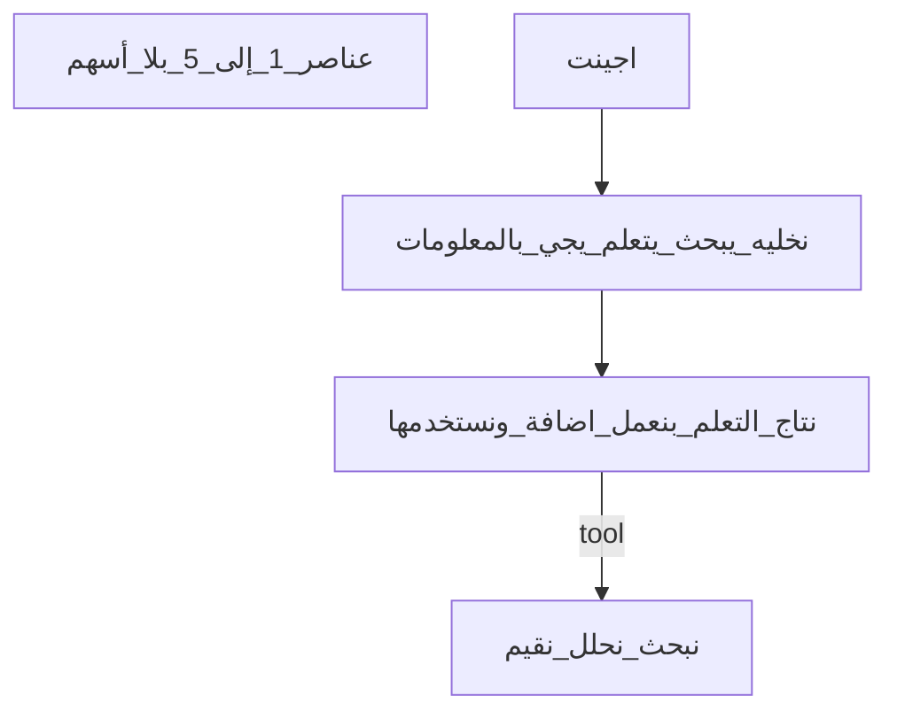

# تقرير التحقق من قراءة الصفحة (note.jpg)

## 1. قراءتي المستقلة

1. **مكانه:** أعلى الصفحة، شمال. **نوعه:** صندوق مستطيل. **النص:** `monos` (حروف لاتينية صغيرة). **الثقة:** عالية.

2. **مكانه:** أعلى الصفحة، وسط. **نوعه:** سطر تاريخ، تحته خط. **النص:** `19/10/2026`. **الثقة:** عالية.

3. **مكانه:** أعلى الصفحة، يمين (بجوار/بعد التاريخ). **نوعه:** سطر مختصر، تحته خط. **النص:** `mon`. **الثقة:** عالية.

4. **مكانه:** أعلى يمين، فوق المخطط. **نوعه:** عنوان، تحته خط. **النص:** `تعليم الاجينت` (بالعربي، بدون فصل `الـ` قبل كلمة إنجليزية). **الثقة:** عالية.

5. **مكانه:** تحت العنوان مباشرة، يمين. **نوعه:** سطر بين نجمتين. **النص:** `* … ازاي يتعلم *` — الكلمات الأولى غير حاسمة بين قراءتين للصورة: `متخيله` في مراجعة أولى و`متعلم` في ثانية؛ **ليست** `نتعلم ازاي نتعلم`. **الثقة:** `ازاي يتعلم` عالية؛ الكلمة/الكلمات قبل `ازاي` **منخفضة إلى متوسطة**.

6. **مكانه:** وسط-فوق المخطط. **نوعه:** صندوق صغير. **النص:** `اجينت`. **الثقة:** متوسطة إلى عالية (عربي؛ ليس `agent` لاتيني واضح).

7. **مكانه:** تحت الصندوق (6). **نوعه:** سهم عمودي نازل. **النص:** (لا نص). **الثقة:** عالية.

8. **مكانه:** وسط الصفحة، تحت السهم (7)، بدون صندوق. **نوعه:** سطر نص حر. **النص:** يبدأ بصيغة من نوع `نخليه هو يبحث يتعلم` أو `يخلي حد يبحث يتعلم` — **ليس** `نخلي حر يبحث يتعلم`. **الثقة:** `يبحث يتعلم` عالية؛ بداية السطر **متوسطة** (غموض بين `نخليه هو` و`يخلي حد`).

9. **مكانه:** تحت (8). **نوعه:** سطر نص حر. **النص:** `يجي بـ المعلومات` (حرف الباء مع كسره/مدّة قصيرة قبل «المعلومات»). **الثقة:** عالية لـ`يجي` و`المعلومات`؛ متوسطة لشكل كتابة `بـ`.

10. **مكانه:** تحت السطرين (8–9). **نوعه:** سهم عمودي نازل. **النص:** (لا نص). **الثقة:** عالية.

11. **مكانه:** وسط-تحت. **نوعه:** صندوق عريض واحد. **النص:** جملة واحدة (قد تُلفّ على سطرين بسبب عرض الصندوق): `نتاج التعلم بنعمل اضافة ونستخدمها` — **لا** يوجد سطر منفصل `نعمله اداة` ولا استبدال واضح لـ`اضافة` بـ`اداة`. **الثقة:** `بنعمل اضافة ونستخدمها` و`التعلم` عالية؛ `نتاج` متوسطة (بديل محتمل `نتائج`).

12. **مكانه:** من حافة يمين الصندوق (11) نحو اليمين. **نوعه:** سهم أفقي لليمين + تسمية. **النص:** `tool` بجانب/فوق مسار السهم. **الثقة:** عالية.

13. **مكانه:** يمين المخطط. **نوعه:** صندوق عمودي، ثلاثة أسطر. **النص:**
    `نبحث`
    `نحلل`
    `نقيم`
    **الثقة:** `نبحث` و`نحلل` عالية؛ `نقيم` متوسطة (بدائل بعيدة مثل `نقدم`/`نفهم` غير مرجّحة على الصورة).

**ملاحظة مرئية (ليست عنصر نصي):** الصفحة اليسرى في الإطار فارغة من كتابة؛ الكتابة والمخطط على صفحة اليمين. الحبر الأزرق في الترويسة (`monos`، التاريخ) والأسود/الأزرق الداكن في باقي العناصر حسب الإضاءة.

---

## 2. جدول المقارنة

| العنصر | قراءة reader.md | قراءتي | الحكم | السبب |
|--------|-----------------|--------|-------|--------|
| 1 `monos` | `monos` | `monos` | متفق | تطابق |
| 2 التاريخ | `19/10/2026` | `19/10/2026` | متفق | تطابق |
| 3 `mon` | `mon` | `mon` | متفق | تطابق |
| 4 عنوان يمين | `تعليم الـ agent` (غموض) | `تعليم الاجينت` | مختلف | الصفحة تكتب «الاجينت» عربيًا تحت خط؛ لا يظهر `agent` لاتيني في هذا السطر |
| 5 نجمتان | `* نتعلم ازاي نتعلم *` | `* … ازاي يتعلم *` | مختلف | لا يوجد تكرار «نتعلم»؛ بداية السطر أقرب لـ«متخيله» أو «متعلم» وليس «نتعلم ازاي نتعلم» |
| 6 صندوق | `اجينت` (بديل agent) | `اجينت` | متفق | نفس النص؛ reader أضاف بديلًا غير ضروري لكن النص الأساسي صحيح |
| 7 سهم 1 | نازل | نازل | متفق | تطابق |
| 8 سطر وسط | `نخلي حر يبحث يتعلم` | `نخليه هو…` / `يخلي حد…` | مختلف | «حر» غير مرئية؛ البداية أقرب لـ«نخليه هو» أو «يخلي حد» |
| 9 سطر ثانٍ | `يجي ب المعلومات` | `يجي بـ المعلومات` | متفق | فرق ترقيم بسيط لـ`بـ` |
| 10 سهم 2 | نازل | نازل | متفق | تطابق |
| 11 صندوق عريض | `نتاج التعلم نعمله اداة` + `ونستخدمها` | `نتاج التعلم بنعمل اضافة ونستخدمها` | مختلف | reader استبدل «بنعمل اضافة» بـ«نعمله اداة» وفصل المعنى خطأً |
| 12 سهم + tool | لليمين + `tool` | لليمين + `tool` | متفق | تطابق |
| 13 صندوق يمين | `نبحث` / `نحلل` / `نقيّم` | `نبحث` / `نحلل` / `نقيم` | متفق | نفس الكلمات؛ تشكيل الشدة اختياري |
| صفحة شمال | فارغة | فارغة (في الإطار) | متفق | reader صحيح |
| ألوان الحبر | أزرق للكل | أزرق في الترويسة، داكن في المخطط | مختلف (جزئي) | reader عمّم «أزرق»؛ المخطط يبدو أسود/أزرق غامق — لا يغيّر النص |

---

## 3. الأسهم والشبكة

**ما يتفق مع الصورة (كما في reader.md):**
- عقدة صندوق `اجينت` (6) → نص حر (8–9) → صندوق عريض (11) → سهم لليمين مع `tool` → صندوق ثلاثي (13).
- سهمان نازلان متتاليان بدون كلمات؛ لا سهم راجع ولا حلقة.
- العناصر (1–5) في الترويسة/الهامش بلا أسهم واصلة بالمخطط.

**فروق أو ملاحظات:**
- reader يصف كتلة (8–9) بنص **خاطئ** لكن **موضعها** في السلسلة صحيح.
- reader يربط السهم الأيمن بين (11) و(13) مباشرة؛ الصورة تضع `tool` كتسمية على السهم وليس داخل الصندوق الثلاثي — **متفق** مع reader.
- reader لا يذكر أن جملة (11) **جملة واحدة** فيها «اضافة»؛ شبكته تعامل الصندوق كـ«نتاج → أداة» وهذا **انعكاس لقراءة نصية خاطئة** لا لشكل أسهم مختلف.

---

## 4. مراجعة التفسير

**مدعوم بما على الصفحة (مع نصوص مصححة):**
- ملاحظة مؤرخة `19/10/2026` و`mon` ووسم `monos`.
- عنوان جانبي عن **تعليم الاجينت** وسطر تعلّم/تخيّل التعلّم (الصيغة الدقيقة للسطر (5) غامضة).
- تدفق: **اجينت** → جعله/جعل أحد **يبحث ويتعلم** → **يجي بالمعلومات** → **نتاج التعلم** يُعالَج بـ **إضافة** ثم **استخدام** → تسمية `tool` → أنشطة **نبحث / نحلل / نقيم**.

**إضافات في reader.md غير مكتوبة صراحة:**
- تحويل النتاج إلى **«أداة»** (`اداة`) — ناتج عن misread للصندوق (11)، وليس نص الصفحة.
- عبارة **«نتعلم إزاي نتعلم»** في التفسير — مبنية على قراءة خاطئة للسطر (5).
- فكرة **«يُتْرَك حرًا»** من قراءة `حر` — غير موجودة في الصورة.
- استنتاج أن `mon` اختصار يوم — **منطقي** لكنه **استنتاج** (الصفحة لا تكتب «Monday» كاملة).

**ما فات reader.md:**
- كلمة **«اضافة»** في الصندوق العريض (خطأ جوهري).
- احتمال **«متخيله»** أو **«متعلم»** في السطر بين النجمتين.
- **«نخليه هو»** أو **«يخلي حد»** بدل «نخلي حر».
- كتابة العنوان **«الاجينت»** عربيًا بدون خلط `agent` في نفس السطر.

---

## 5. الحكم النهائي

**فيها أخطاء جوهرية** — هيكل الأسهم والعقد صحيح غالبًا، لكن أخطاء حرفية في العنوان الجانبي (5)، السطر الوسط (8)، والصندوق العريض (11) تغيّر المعنى (خصوصًا «اضافة» مقابل «اداة»).

**النسخة النهائية المصححة (مع الإبقاء على الغموض حيث لا تحسم الصورة):**

- `monos` [صندوق، أعلى شمال]
- `19/10/2026` [وسط، تحته خط]
- `mon` [أعلى يمين، تحته خط]
- `تعليم الاجينت` [يمين، تحته خط]
- `* متخيله ازاي يتعلم *` — أو بديل غير محسوم: `* متعلم ازاي يتعلم *`
- [صندوق] `اجينت`
- ↓
- `نخليه هو يبحث يتعلم` — أو بديل محتمل: `يخلي حد يبحث يتعلم`
- `يجي بـ المعلومات`
- ↓
- [صندوق عريض] `نتاج التعلم بنعمل اضافة ونستخدمها`
- → `tool`
- [صندوق] `نبحث` / `نحلل` / `نقيم`

---

**تنفيذ المهمة:** لا تعديل على ملفات؛ هذا التقرير هو المخرج النهائي للتحقق.

