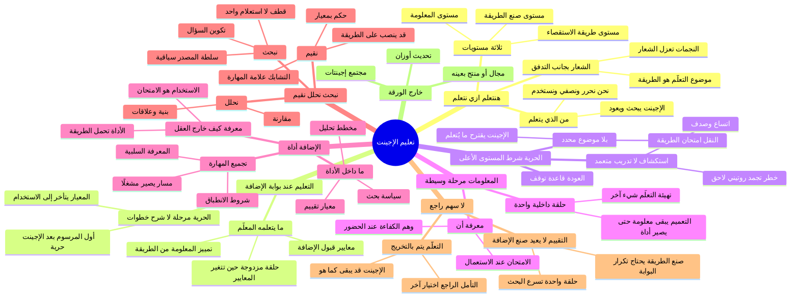

# خريطة: ما الذي يُتعلَّم حين نتعلّم كيف نتعلّم

العلامات: [الورقة] نص الورقة أو توضيح صاحبها في idea.md. [استنتاج] قراءة مبنية على عنصر من الورقة. [بحث: URL] ادّعاء من أدبيات معروفة، والرابط مصدره المعياري. [تخمين] امتداد محتمل لم تثبته الورقة ولا المصدر. كل فرع يسمّي العنصر الذي ينبت منه.

تعذّر جلب الصفحات مباشرة في هذه الجلسة. روابط القسم 6 أعمال منشورة استندتُ إليها بمعرفتي بها، وكل رابط هو المدخل المعياري للعمل، لا صفحة فُتحت الآن.

## 1. الفكرة في جملة واحدة كما فهمتها

«تعليم الإجينت» تحت شعار «هنتعلم ازي نتعلم» هو أن نترك إجينتًا حرًا يبحث ويتعلم، فيعود بمعلومات، فنحوّل نتاج ذلك إلى إضافة ثابتة على هيئة أداة نستخدمها لنبحث ونحلل ونقيّم، وفي هذا التحويل نفسه تتعلّم الطريقة لا مادة موضوع.

## 2. الخريطة

- **تعليم الإجينت** — من E4 [الورقة]
  - العنوان موضوع بجانب التدفق، وهو اسم الفكرة كلها لا خطوة داخل السهم — من E4 [الورقة]
  - «تعليم» صيغة سببية: طرف يُنشئ عند الإجينت قدرة — من E4 [استنتاج]
    - القدرة المقصودة، بحسب صاحب الورقة، هي البحث نفسه: إزاي نعلّم الإجينت يبحث — من E4 [الورقة]
    - مادة القدرة، بحسب الشعار، هي طريقة التعلّم — من E5 [الورقة]
  - في الرسم الضمير يتبدل: «نخلي» لنا، «يبحث / يجي» للإجينت، «نعمله إضافة ونستخدمها» و«نبحث / نحلل / نقيّم» لنا — من E8 وE9 وE11 وE13 [الورقة]
    - الإجينت هو من يبحث ويعود — من E6 وE8 وE9 [استنتاج]
    - نحن من نحرّره، ونصفّي نتاجه، ونستخدم الأداة — من E4 وE8 وE11 وE13 [استنتاج]
    - التعليم هنا تربية عضو باحث ثم حصاد طريقته، والتعليم عند البشر الذين يعلّمونه يجري في فعل الحصاد نفسه — من E4 وE5 وE11 [استنتاج]
  - **ما يتعلّمه من يعلّم** — من E4 وE5 [استنتاج]
    - أن يميّز معلومة الحلقة من طريقة تصلح لإعادة الاستعمال — من E9 وE11 [استنتاج]
    - أن الحرية شرط، وأن معيار قبول الإضافة هو التدريس الحقيقي — من E8 وE11 [استنتاج]
      - أثناء الحرية لا تظهر على الورقة نمذجة ولا تلميح ولا سؤال سقراطي — من E8 [الورقة]
      - لحظة التعليم المرسومة هي تحويل النتاج إلى شيء يُستخدم — من E11 [استنتاج]
    - معاييره في قبول الإضافة هي نظريته العملية في «البحث الجيد»، وتظهر حين يُبقي إضافة ويرفض أخرى — من E5 وE11 [استنتاج]
      - تغيير هذه المعايير هو تعلّمه هو للمستوى الأعلى: يتعلّم كيف يصنع طرق التعلّم — من E5 [استنتاج]
      - هذا هو التعلّم مزدوج الحلقة: الفعل يتغير في الحلقة الواحدة، والمتغيّر الحاكم للفعل يتغير في الحلقة المزدوجة — من E5 [بحث: https://hbr.org/1977/09/double-loop-learning-in-organizations]
    - استخدام الأداة يمتحنه: إن عجزت الأداة عن بحث وتحليل وتقييم في موقف لاحق، فتجميعه للنتاج لم يُنتج طريقة — من E11 وE13 [استنتاج]
    - أمثلة للبوابة نفسها من حقول متباعدة، والبوابة واحدة — من E11 [استنتاج]
      - مختبر يحوّل تجوال باحث في ظاهرة إلى بروتوكول يُعاد تشغيله: جمع، تحليل، حكم
      - غرفة أخبار تحوّل مسار تحقيق إلى أداة تحقق تُستخدم على تحقيق تالٍ
      - عيادة تحوّل حالة صعبة إلى تسلسل تشخيص: جمع المعطيات، تحليل الفروقات، تقدير الرجحان
      - أرشيف يحوّل طريقة قراءة رصيد جديد إلى إجراء نقد مصادر
      - قاعة تدريب تحوّل مآزق بحث طالب إلى أداة «كيف نفحص دعوى»

- **هنتعلم ازي نتعلم** — من E5 [الورقة]
  - السطر بين نجمتين تحت العنوان وعلى جنب التدفق — من E5 [الورقة]
    - النجمات تعزله عن خطوات السهم، فصيغته شعار للفكرة كلها — من E4 وE5 [استنتاج]
  - صاحب الورقة: الفكرة بحث في طريقة تعليم الإجينت أن يبحث، أي تعلّم طريقة التعلّم — من E5 [الورقة]
  - **ثلاثة مستويات متراكبة داخل الشعار** — من E5 [استنتاج]
    - مستوى المعلومة: ما يعود به الإجينت من الحلقة — من E9 [الورقة]
      - عند باتسون هذا Learning I: تغيّر الاختيار داخل مجموعة بدائل معطاة — من E9 [بحث: https://en.wikipedia.org/wiki/Double-loop_learning]
    - مستوى الطريقة: أداة تنفّذ بحثًا وتحليلًا وتقييمًا — من E13 [الورقة]
      - هذا Learning II أو deutero-learning: تغيّر في مجموعة البدائل التي يُختار منها التعلّم التالي، أي تغيّر سياق التعلّم لا بند المعرفة — من E5 [بحث: https://en.wikipedia.org/wiki/Double-loop_learning]
    - مستوى صنع الطريقة: نحن نتعلّم أي نتاج يستحق أن يصير إضافة — من E5 وE11 [استنتاج]
      - في تعلّم الآلة: الحلقة الداخلية تتعلّم مهمة، والحلقة الخارجية تتعلّم خوارزمية التعلّم عبر توزيع من المهام — من E5 [بحث: https://arxiv.org/abs/2004.05439]
      - الرسم يُري تنفيذًا واحدًا لقالب الحلقة الخارجية — من E5 وE6 [استنتاج]
      - صيغة «نعمله / نستخدمها» بصيغة الممارسة، فالقالب قابل للتكرار وتراكم الإضافات قراءة طبيعية للصيغة — من E11 [استنتاج]
  - **من «نحن» في الشعار** — من E5 [استنتاج]
    - قراءة أولى: نحن البشر نتعلّم كيف يُتعلَّم، والإجينت أداة هذا الدرس — من E4 وE5 [استنتاج]
    - قراءة ثانية: الإجينت داخل «نحن»، والشعار وعد بتكوينه — من E4 وE5 [استنتاج]
    - قراءة ثالثة: الطرفان يتعلّمان شيئين مختلفين في المرور الواحد — من E5 وE9 وE11 [استنتاج]
      - الإجينت، على الرسم، يمارس بحثًا ويعود بمعلومات — من E8 وE9 [الورقة]
      - نحن نخرج من المرور بطريقة مجسّدة في أداة — من E11 وE12 [استنتاج]
      - الورقة ترسم النتاج ولا ترسم تغيّرًا داخل صندوق الإجينت — من E6 وE11 [استنتاج]
  - **ماذا يُتعلَّم حين يُتعلَّم البحث** — من E5 وE13 [استنتاج]
    - المعرفة الفوقية عند فلافيل: معرفة بالشخص والمهمة والاستراتيجية، وخبرة مراقبة، واستراتيجيات تُمارَس — من E5 [بحث: https://doi.org/10.1037/0003-066X.34.10.906]
      - ما يُكتسب في «تعلّم التعلّم» معرفة مشروطة: أي استراتيجية تصلح لأي نوع مهمة — من E5 وE13 [بحث: https://doi.org/10.1037/0003-066X.34.10.906]
      - «How People Learn»: مقاربة فوق-معرفية تساعد المتعلّم أن يمسك بزمام تعلّمه، والكفاءة إطار ينظّم المعرفة بحيث تُسترجع في الموقف المناسب — من E4 وE5 [بحث: https://nap.nationalacademies.org/catalog/9853/how-people-learn-brain-mind-experience-and-school-expanded-edition]
    - التعلّم المنظَّم ذاتيًا يمر بتمهيد، فأداء، فتأمل — من E5 [بحث: https://doi.org/10.1207/s15430421tip4102_2]
      - الورقة تُظهر الأداء: حر يبحث ويتعلم — من E8 [الورقة]
      - الورقة تُظهر تأملًا مؤجّلًا داخل أداة التقييم لا داخل الإجينت أثناء البحث — من E13 [استنتاج]
      - صندوق التمهيد غائب: لا هدف مرسوم قبل الحرية — من E8 [استنتاج]
        - الغاية قد تكون داخل الإجينت الحر وغير مرسومة — من E6 وE8 [تخمين]
        - أو الحرية نفسها استبدال للتمهيد: المتعلّم يعيّن ما يستحق البحث — من E5 وE8 [استنتاج]
    - أركان مهارة البحث كما تستقر في أدب الاستقصاء، وكل ركن يتتبع إلى فعل من أفعال الأداة أو إلى الحرية — من E8 وE13 [استنتاج]
      - تكوين السؤال: البحث يطلب شيئًا، فصنعة البحث تبدأ بجعل الموقف سؤالًا — من E8 وE13 [استنتاج]
      - البحث كاستقصاء، والبحث كتلمّس استراتيجي يتطور أثناء الطريق لا كاستعلام واحد — من E13 [بحث: https://www.ala.org/acrl/standards/ilframework]
        - نموذج قطف الثمر: الاستعلام يتغيّر مع ما يُلتقط، والتصفح جزء من البحث — من E8 وE13 [بحث: https://doi.org/10.1108/eb024320]
      - السلطة تُبنى وسياقها جزء من معنى المصدر — من E13 [بحث: https://www.ala.org/acrl/standards/ilframework]
        - عند المؤرّخين المهرة، نقد المصدر يحدث لحظة مقابلة الوثيقة: من كتب، لأي غرض، مقابل ماذا — من E13 [بحث: https://doi.org/10.1037/0022-0663.83.1.73]
      - التحليل: تفكيك الدعوى، وعقد العلاقات، والمقارنة — من E13 [الورقة]
      - التقييم: حكم بمعايير — من E13 [الورقة]
        - المعايير التي يصنعها خبير بحث: المصداقية، والصلة، والكفاية، والتماسك — من E13 [استنتاج]
        - حكم يفحص ما يخالف الفرض أيضًا، وإلا صار التقييم جمعًا لمؤيدات — من E13 [تخمين]
      - قواعد التوقف: «يجي بـ المعلومات» يعني أن البحث ينتهي ويعود — من E9 [الورقة]
        - تعلّم البحث يتضمن تعلّم متى تكفي العودة — من E5 وE9 [استنتاج]
      - شروط الانطباق: الطريقة الخبيرة تحمل معها متى تُستخدم — من E11 وE13 [بحث: https://nap.nationalacademies.org/catalog/9853/how-people-learn-brain-mind-experience-and-school-expanded-edition]
      - المعرفة السلبية: المسارات التي أغلقت جزء من خبرة الحرية — من E8 [استنتاج]
        - إضافة لا تحفظ إلا المسار الناجح تُسقط نصف النتاج الذي تعلّم به الإجينت أن يبحث — من E8 وE11 [تخمين]
      - النقل: صاحب الورقة أخرج الفكرة من أي موضوع بعينه — من E5 [الورقة]
        - امتحان أن الأداة طريقة، لا مخزن حلقة واحدة، هو أن تبحث وتحلل وتقيّم في موقف لم تُجمع معلوماته في الحرية — من E9 وE13 [استنتاج]
        - النقل هو الشكل الذي يكشف به التعلّم البشري أنه صار قدرة لا حفظًا — من E5 [بحث: https://nap.nationalacademies.org/catalog/9853/how-people-learn-brain-mind-experience-and-school-expanded-edition]
    - خبرة روتينية وخبرة متكيفة — من E5 وE11 [بحث: https://nap.nationalacademies.org/catalog/9853/how-people-learn-brain-mind-experience-and-school-expanded-edition]
      - الروتينية: إجراء كفء في بيئة ثابتة
      - المتكيفة: قدرة على إعادة تركيب الإجراء حين يتغير الموقف
      - الشعار يطلب الثانية — من E5 [استنتاج]
      - تجميد الثلاثي في أداة ثابتة يصنع الأولى — من E11 وE12 [استنتاج]
        - شكل الإضافة هو ما يحسم أي الخبرتين بقيت من الحرية — من E8 وE11 [استنتاج]

- **الإجينت الحر** — من E6 وE8 [الورقة]
  - صندوق «اجينت» ثم سهم نازل إلى «نخلي حر يبحث يتعلم» — من E6 وE8 [الورقة]
  - «حر»: يُترك يبحث ويتعلم بنفسه — من E8 [الورقة]
  - **الحرية هي شرط المستوى الأعلى لأنها تُلزمه باختيار ما يُتعلَّم** — من E5 وE8 [استنتاج]
    - بحث داخل موضوع محدَّد سلفًا يدرّب اختيارًا داخل بدائل جاهزة — من E8 [استنتاج]
    - بحث بلا موضوع، كما أراد صاحب الورقة، يدرّب تعيين مجال البدائل — من E5 وE8 [الورقة]
    - في التعلّم الفوقي الآلي، توزيع المهام جزء من تعريف الحلقة الخارجية؛ هنا «حر» يدفع اقتراح المهمة إلى الإجينت — من E6 وE8 [بحث: https://arxiv.org/abs/2004.05439]
  - **الحرية استكشاف، والتدريب المتعمّد عند الخبراء شيء آخر** — من E8 [بحث: https://doi.org/10.1037/0033-295X.100.3.363]
    - التدريب المتعمّد: ممارسة على الحافة مع تغذية راجعة ومعيار واضح — من E8 [بحث: https://doi.org/10.1037/0033-295X.100.3.363]
    - الورقة ترسم حرية بلا معيار أثناء الطريق — من E8 [الورقة]
    - هذا الشكل يفتح الاتساع والصدف وصياغة مشاكل لم تكن في بال المعلّم — من E8 [استنتاج]
    - المعيار يظهر لاحقًا عند بوابة الإضافة لا داخل البحث — من E8 وE11 [استنتاج]
  - **توجيه أدنى وحدوده** — من E8 وE4 [بحث: https://doi.org/10.1207/s15326985ep4102_1]
    - أدب التدريس: اكتشاف بلا إرشاد يثقل على المبتدئ لأن مساحة البحث أوسع من ذاكرته العاملة — من E8 [بحث: https://doi.org/10.1207/s15326985ep4102_1]
    - التلمذة المعرفية تعالج ذلك بنمذجة ثم تدريب ثم سقالة ثم انسحاب تدريجي — من E4 [استنتاج]
    - الورقة تبدأ عند الانسحاب: الحرية أول ما يُرسم بعد صندوق الإجينت — من E6 وE8 [الورقة]
      - قراءة: الإجينت يُفترض قادرًا على بحث أول، والتعليم ليس شرح خطوات البحث — من E4 وE8 [استنتاج]
      - قراءة: المعلّم يتعلّم حدود الحرية بأن يراها تفشل ثم يضبط البوابة — من E4 وE5 وE8 [تخمين]
  - نظام فضولي بلا مهمة خارجية قريب من هذه الحرية — من E8 [بحث: https://arxiv.org/abs/2305.16291]
    - Voyager يولّد منهجًا تلقائيًا ثم يخزن مهارات تنفيذية في مكتبة — من E8 وE11 [بحث: https://arxiv.org/abs/2305.16291]
    - المنهج التلقائي قيد على الحرية غير مرسوم على الورقة — من E8 [استنتاج]
    - الورقة تترك القيد لمرحلة «ونستخدمها»: ما لا يصير أداة بحث وتحليل وتقييم لا يُحفظ — من E11 وE13 [استنتاج]
  - العودة حدث على الورقة، فالحرية ليست دورانًا بلا نهاية — من E9 [الورقة]

- **يجي بـ المعلومات** — من E9 [الورقة]
  - المعلومات حصيلة الحلقة ووسيطها — من E9 [الورقة]
  - الشعار يطلب طريقة، فالمعلومة مادة خام للتحويل لا غاية الشعار — من E5 وE9 [استنتاج]
  - **معرفة-أن في هذه الخانة** — من E9 [بحث: https://plato.stanford.edu/entries/knowledge-how/]
    - رايل: معرفة-كيف ليست كومة قضايا تُستظهر — من E9 وE12 [بحث: https://plato.stanford.edu/entries/knowledge-how/]
    - العودة بالمعلومات إنجاز معرفة-أن — من E9 [استنتاج]
    - الأداة لاحقًا محاولة لتجسيد معرفة-كيف — من E12 [استنتاج]
  - **وهم الكفاءة** — من E9 وE11 [استنتاج]
    - حيازة المعلومات في السياق إحساس قوي بأن التعلّم تم — من E9 [استنتاج]
    - التعلّم البشري يكشف الكفاءة عند الاسترجاع والاستعمال لا عند حضور المادة — من E9 وE13 [بحث: https://nap.nationalacademies.org/catalog/9853/how-people-learn-brain-mind-experience-and-school-expanded-edition]
    - الورقة تضع بعد المعلومات اختبارًا عمليًا: تصير إضافة ثم تُستخدم — من E11 [الورقة]
  - المعلومات وحدها حلقة داخلية واحدة؛ بلا كتابة على طريقة التعلّم تبقى Learning I — من E5 وE9 [بحث: https://arxiv.org/abs/1703.03400]
    - MAML يتعلّم تهيئة تجعل التكيّف مع مهمة جديدة سريعًا: المُتعلَّم في المستوى الأعلى نقطة بدء التعلّم لا حل المهمة — من E5 [بحث: https://arxiv.org/abs/1703.03400]
  - شكل المعلومة العائدة قد يكون أعلى من الخام — من E9 [تخمين]
    - تأملات Generative Agents تُكثّف ذكريات إلى قضايا أعم قبل إعادة الاستعمال — من E9 [بحث: https://arxiv.org/abs/2304.03442]
    - حتى القضية المعمَّمة تبقى معلومة إلى أن تُجعل أداة تنفّذ بحثًا وتحليلًا وتقييمًا — من E9 وE12 وE13 [استنتاج]

- **نتاج التعلّم إضافة تُستخدم** — من E11 [الورقة]
  - الصيغة كاملة على الورقة: النتاج يُعمل إضافة، والإضافة تُستخدم — من E11 [الورقة]
  - «إضافة»: ما تُعلِّم يصير شيئًا ثابتًا يُضاف ويُعاد استعماله — من E11 [الورقة]
  - **الاستعارة هنا اقتناء: للتعلّم ثمرة تُمتلك** — من E11 [بحث: https://doi.org/10.3102/0013189X027002004]
    - سفرِد: استعارة الاقتناء تجعل التعلّم حيازة معرفة، واستعارة المشاركة تجعله صيرورة داخل ممارسة — من E11 [بحث: https://doi.org/10.3102/0013189X027002004]
    - الورقة تقف في الاقتناء: نتاج، إضافة، استخدام — من E11 [الورقة]
    - الشعار «ازي نتعلم» صيغته صيرورة، والرسم ثمرة؛ الثمرة هي الشكل الذي رضيت به الورقة للصيرورة — من E5 وE11 [استنتاج]
  - **التجميع: من مسار متعدد الخطوات إلى مشغّل واحد** — من E11 وE12 [بحث: https://doi.org/10.1007/BF00116249]
    - التقطيع في Soar: سلسلة استدلال تُضغط إلى إنتاج يُستدعى لاحقًا كقطعة واحدة — من E11 [بحث: https://doi.org/10.1007/BF00116249]
    - تجميع المهارة عند أندرسون: معرفة تصريحية تصير، مع الممارسة، قواعد إجرائية — من E9 وE11 [بحث: https://doi.org/10.1037/0033-295X.89.4.369]
    - الورقة تقفز من معلومات إلى أداة؛ الممارسة الطويلة غير مرسومة، والقفزة هي قرار التجميع — من E9 وE11 وE12 [استنتاج]
    - ما يضيع غالبًا في التجميع: مبرر الخطوة وحدودها — من E11 [استنتاج]
      - لذلك شروط الانطباق جزء من الإضافة إن أُريد لها أن تبقى طريقة لا عادة عمياء — من E11 وE13 [بحث: https://nap.nationalacademies.org/catalog/9853/how-people-learn-brain-mind-experience-and-school-expanded-edition]
  - **مكتبة مهارات تنفيذية أقرب شكل منفَّذ لهذه الخانة** — من E11 وE12 [بحث: https://arxiv.org/abs/2305.16291]
    - في Voyager المهارة برنامج يُستدعى ويُركَّب، لا فقرة تُلصق في السياق — من E12 [بحث: https://arxiv.org/abs/2305.16291]
    - ExpeL يستخرج رؤى من مسارات النجاح والفشل إلى رصيد يُعاد استخدامه — من E11 [بحث: https://arxiv.org/abs/2308.10144]
      - الرؤى اللغوية أقرب إلى معلومة معمّمة؛ الورقة تشترط أداة — من E11 وE12 [استنتاج]
  - Toolformer يتعلّم متى يفيد استدعاء أداة موجودة، بمعيار تحسّن التوقع — من E12 [بحث: https://arxiv.org/abs/2302.04761]
    - الورقة تعكس الاتجاه: التعلّم يَلد الأداة، والأداة لم تكن في الصندوق قبل النتاج — من E11 وE12 [الورقة]
    - معيار الإبقاء عندهم آلي؛ معيار الورقة أن نستخدمها نحن — من E11 [استنتاج]
  - **الاستخدام تعريف عملي لتمام التعلّم على الورقة** — من E11 [الورقة]
    - ما لا يُستخدم لا يكمل جملة الخانة — من E11 [الورقة]
    - الاستخدام المطلوب استخدام في بحث وتحليل وتقييم — من E11 وE13 [الورقة]
    - بذلك تصير دالة اللياقة ضيقة ووظيفية وسط حرية واسعة: يُحفظ ما يعين الاستقصاء — من E8 وE11 وE13 [استنتاج]
  - الإضافة قد تتراكم إن تكررت الممارسة: مكتبة طرق لا بطاقة واحدة — من E11 [استنتاج]
    - الورقة ترسم صندوق إضافة واحدًا — من E11 [الورقة]
    - الصيغة المضارعة تسمح بقراءته كقالب يُعاد — من E11 [استنتاج]

- **tool** — من E12 [الورقة]
  - سهم لليمين مكتوب عنده tool، من صندوق الإضافة إلى صندوق الأفعال — من E11 وE12 وE13 [الورقة]
  - الوسم إنجليزي داخل ورقة عربية: الإضافة تُسمى بجنسها التشغيلي — من E12 [الورقة]
  - **الأداة معرفة-كيف موضوعة خارج العقل الذي أنتجها** — من E12 [استنتاج]
    - رايل يضع معرفة-كيف في تصرّف العارف — من E12 [بحث: https://plato.stanford.edu/entries/knowledge-how/]
    - الورقة تضعها في شيء يُستخدم، فيمكن للمنظومة أن تملك الطريقة وللشخص أن يبقى مشغّل أداة — من E12 وE13 [استنتاج]
    - الثقافات تفعل ذلك بأدواتها النفسية: خارطة، اختبار إحصائي، بروتوكول، فهرس — من E12 [استنتاج]
    - نجاح «تعليم الإجينت» على الرسم يُقاس بالأداة الباقية — من E4 وE12 [استنتاج]
  - الأداة تنفّذ، والوثيقة تصف؛ اختيار كلمة tool يعني أن النتاج يعمل أفعال الاستقصاء — من E12 وE13 [استنتاج]
  - **ما الذي تحمله أداة وُلدت من تعلّم البحث** — من E12 وE13 [استنتاج]
    - سياسة بحث: صياغة الطلب، اختيار المصدر، قاعدة التوقف — من E13 [استنتاج]
    - مخطط تحليل: كيف تُفك الدعوى وكيف تُقارن — من E13 [استنتاج]
    - معيار تقييم: ماذا يُحسب دليلًا كافيًا، وما الذي يقلب الحكم — من E13 [استنتاج]
    - حدود الانطباق مكتوبة مع السياسة — من E12 [بحث: https://nap.nationalacademies.org/catalog/9853/how-people-learn-brain-mind-experience-and-school-expanded-edition]
    - آثار الفشل إن بقيت — من E8 وE12 [تخمين]
  - أداة بلا حدود انطباق مطرقة: تنفّذ الثلاثي في كل مقام — من E12 [تخمين]

- **نبحث / نحلل / نقيّم** — من E13 [الورقة]
  - ثلاثة أفعال في صندوق واحد تتصل به الأداة — من E12 وE13 [الورقة]
  - الإضافة مفردة والأفعال ثلاثة: أداة واحدة بوظيفة ثلاثية، وهي هيئة منهج استقصاء — من E11 وE13 [استنتاج]
  - الترتيب الرأسي في الصورة يوحي بتتالي: بحث ثم تحليل ثم تقييم — من E13 [استنتاج]
    - قراءة ثانية: قائمة وظائف لا خط زمني — من E13 [استنتاج]
  - **نبحث داخل الأداة هو الفعل الذي كان الإجينت يمارسه حرًا، بعد أن صار وظيفة قابلة لإعادة التشغيل** — من E8 وE13 [استنتاج]
    - إطار ACRL يسمي أركانًا لهذا الفعل: البحث استقصاء، والبحث محادثة، وإنشاء المعلومات عملية، والبحث استكشاف استراتيجي — من E13 [بحث: https://www.ala.org/acrl/standards/ilframework]
    - قطف الثمر يمنع اختزال «نبحث» في طلب واحد يعيد قائمة — من E13 [بحث: https://doi.org/10.1108/eb024320]
  - **نحلل** — من E13 [الورقة]
    - التحليل إخراج البنية: أجزاء، علاقات، إسناد — من E13 [استنتاج]
    - بلا تحليل يبقى البحث كومة معلومات، وهي خانة E9 — من E9 وE13 [استنتاج]
  - **نقيّم** — من E13 [الورقة]
    - التقييم حكم بمعيار بعد أن صارت المادة ذات بنية — من E13 [استنتاج]
    - هو الفعل الوحيد بين الثلاثة الذي يستطيع أن يأخذ الطريقة نفسها موضوعًا — من E5 وE13 [استنتاج]
      - تقييم مصدر أو دعوى يُسرع Learning I — من E9 وE13 [استنتاج]
      - تقييم سياسة البحث ومعيار الإضافة يفتح Learning II — من E5 وE13 [بحث: https://hbr.org/1977/09/double-loop-learning-in-organizations]
      - الورقة لا تسمي مفعول «نقيّم» — من E13 [الورقة]
    - عند الماهر، التقييم متشابك مع البحث لا مؤجّل إلى آخر الخط — من E13 [بحث: https://doi.org/10.1037/0022-0663.83.1.73]
      - أداة تفصل الثلاثة فصلًا جامدًا تحمل شكل المبتدئ للثلاثي نفسه — من E13 [استنتاج]
      - أداة تتعلّم متى تداخل الأفعال تحمل شكل الخبرة المتكيفة — من E5 وE13 [استنتاج]
  - الثلاثي معًا دورة استقصاء دنيا — من E13 [استنتاج]
    - بحث بلا تحليل يُغرق — من E13 [استنتاج]
    - تحليل بلا معيار يُرتّب بلا حكم — من E13 [استنتاج]
    - تقييم بلا تحليل حكم بلا أسباب — من E13 [استنتاج]
    - «تعلّم كيف نتعلّم» على هذه الورقة هو حيازة هذا الثلاثي أداةً عاملة — من E5 وE13 [استنتاج]
  - أفعال الأداة بصيغة «نحن»: المستخدِم داخل الفعل، والأداة ليست خلفية صامتة — من E12 وE13 [استنتاج]

- **السهم في اتجاه واحد** — من E8 وE9 وE11 وE12 [الورقة]
  - الشكل: إجينت، حرية وبحث، معلومات، إضافة، أداة، ثلاثي أفعال؛ ولا سهم راجع — من E6 إلى E13 [الورقة]
  - **التعلّم على الورقة يتمّ بالتخريج** — من E11 [استنتاج]
    - Reflexion يخزن تأملًا لفظيًا ويستخدمه في المحاولة التالية: سهم راجع إلى الذاكرة — من E11 [بحث: https://arxiv.org/abs/2303.11366]
    - Voyager يغلق حلقة مع البيئة أثناء صنع المهارة: تجربة، تحقق، تصحيح — من E8 وE11 [بحث: https://arxiv.org/abs/2305.16291]
    - الورقة تختار إخراج النتاج إلى أداة على إرجاعه إلى الإجينت — من E6 وE11 وE12 [استنتاج]
  - دورة كولب التجريبية تغلق: تجربة، ملاحظة، تجريد، تجريب نشط — من E8 وE11 وE13 [بحث: https://en.wikipedia.org/wiki/Experiential_learning]
    - الورقة فيها تجربة الحرية، وتجريد الإضافة، واستعمال لاحق — من E8 وE11 وE13 [استنتاج]
    - السهم الراجع الذي يغلق الدورة غير مرسوم — من E13 وE6 [الورقة]
  - **ما يثبت بسبب غياب الرجوع** — من E5 وE6 [استنتاج]
    - الإجينت في الصندوق قد يبقى كما هو، والمنظومة تكبر بأدواتها — من E6 وE11 [استنتاج]
    - قياس التعليم يصير قياس الأدوات المخلّفة، كمحفظة صانع لا كدرجة داخل النموذج — من E4 وE11 [استنتاج]
    - حلقة واحدة بلا رجوع لا تكفي ليتعلّم المعلّم كيف يصفّي؛ التكرار غير المرسوم هو ما يدرب البوابة — من E4 وE5 وE11 [تخمين]
    - التقييم داخل الأداة يستطيع أن يحكم على نواتج بحث جديدة، وحكمه على طريقة صنع الإضافات يحتاج سهمًا لم يُرسم — من E5 وE13 [استنتاج]
  - هذا الشكل أقرب إلى ثقافة أدوات منه إلى تحديث أوزان — من E11 وE12 [استنتاج]
    - تحديث الأوزان يغيّر الإجينت نفسه، والورقة تغيّر ما بيد المستخدم — من E6 وE12 [استنتاج]

### خارج الورقة

فروع تغري بها عبارة «إجينت يتعلّم» ولا أثر لها في عناصر الصفحة:

- تحديث أوزان، ضبط، أو تعلم معزز بمكافأة عددية. الورقة تتحدث عن إضافة وأداة واستخدام.
- مجتمع إجينتات يتخصص ويتفاوض. الورقة صندوق إجينت واحد.
- وعي الإجينت أو صدق «خبرته» الداخلية. المطلوب نتاج يُستخدم.
- لوحة متصدرين أو معيار رقمي جاهز. معيار الورقة الاستخدام في البحث والتحليل والتقييم.
- مجال صناعي أو منتج بعينه، واسم monos أعلى الدفتر. صاحب الورقة أخرجهما من الفكرة.

## 3. رسم الخريطة

## 4. أهم 5 اكتشافات

1. **الشعار والمستوى الثاني من التعلّم شيء واحد.** «هنتعلم ازي نتعلم» يطابق ما سمّاه باتسون Learning II، وما سمّاه أدب المنظمات حلقة مزدوجة، وما سمّته نماذج التعلّم الفوقي حلقة خارجية: المُتعلَّم طريقة التعلّم لا بند المعلومات. الورقة ترسم البنود في «يجي بـ المعلومات»، وترسم الطريقة في الإضافة-الأداة. هذا يمنع اختزال الفكرة إلى إجينت يلخّص موضوعًا.

2. **التعليم مرسوم عند البوابة لا أثناء الحرية.** «تعليم» و«حر» يبدوان طلبين متقابلين. على الورقة هما مرحلتان: الحرية تنتج اتساعًا بلا معيار ظاهر، و«نعمله إضافة ونستخدمها» هي حيث يُقرر إنسان أي نتاج صار طريقة. من يعلّم الإجينت يتعلّم، في هذا القرار، نظريته العملية في البحث. التدريس هنا تحرير ثم تحرير انتقائي للنتاج.

3. **ما يُحفظ عامل استقصاء، والمعرفة-كيف تخرج من الإجينت إلى الأداة.** رايل يضع معرفة-كيف في التصرّف؛ التقطيع في Soar ومهارات Voyager يضعانها في مشغّل يُعاد استدعاؤه؛ الورقة تختار الجهة الثانية بكلمة tool. النجاح على الرسم أداة نبحث بها ونحلل ونقيّم، حتى لو صندوق «اجينت» لم يتغيّر. المنظومة تتعلّم في أدواتها.

4. **«نقيّم» هو فعل المستوى الأعلى، والورقة تترك مفعوله فارغًا ولا تُرجع سهمًا.** تقييم دعوى يسرّع البحث. تقييم سياسة البحث ومعايير صنع الإضافة هو التعلّم كيف نتعلّم. Reflexion وVoyager يغلقان حلقة على الفاعل أثناء التعلّم؛ الورقة تخرج النتاج وتقف عند الاستخدام. الفرق بين أداة تبحث أسرع، ومنظومة تتعلّم كيف تصنع طرق بحث، هو هذا المفعول الناقص.

5. **مهارة البحث الخبيرة مشروطة ومتشابكة، وتجميدها خط يهدد الشعار.** قطف الثمر، ونقد المصدر لحظة اللقاء، وشرطية المعرفة في How People Learn، والفرق بين خبرة روتينية ومتكيفة: الخبير لا يمرّ بخط «ابحث ثم حلل ثم قيّم» مرور المبتدئ. الإضافة إن حبست الثلاثي في هذا الخط حوّلت حرية E8 إلى روتين كفء. شكل الأداة هو الذي يقرر إن كان الشعار قد تحقق.

## 5. أسئلة مفتوحة

- من «نحن» في الشعار: البشر الذين يعلّمون، أم الإجينت معهم، أم المنظومة بعد أن صارت لها أداة؟
- هل الرسم حلقة واحدة تُروى، أم قالب ممارسة يُعاد حتى تتراكم الإضافات ويتعلّم حرّاس البوابة؟
- ما مفعول «نقيّم»: المادة التي جاء بها البحث، أم طريقة البحث، أم قرار تحويل النتاج إلى إضافة؟
- ما حدّ «حر»؟ الورقة لا ترسم منهجًا ولا سقفًا ولا مدة، وترسم مع ذلك عودة.
- أي جزء من مسار الحرية هو «نتاج التعلّم»: المسار الناجح فقط، أم المآزق وقواعد التوقف أيضًا؟
- هل تعود الأداة إلى الإجينت في يوم لاحق، أم تبقى في يد من يستخدمها؟ السهم لا يقول.
- متى نعرف أن الأداة طريقة تعلّم لا معلومات حلقة متنكرة في إجراء؟
- من يملك معيار «نستخدمها» حين يختلف مستخدمان على قيمة الإضافة؟
- هل تتداخل بحث وتحليل وتقييم داخل الأداة، أم تبقى بالترتيب الرأسي المرسوم؟
- ماذا يتغيّر داخل صندوق الإجينت نفسه بعد أن تُصنع الإضافة؟ الورقة صامتة.

## 6. المصادر

- https://en.wikipedia.org/wiki/Double-loop_learning — مدخل مستويات باتسون في التعلّم، وصلة الحلقة المزدوجة بتعلّم التعلّم.
- https://hbr.org/1977/09/double-loop-learning-in-organizations — آرجيريس: الحلقة الواحدة تغيّر الفعل، والمزدوجة تغيّر المتغيّر الحاكم.
- https://doi.org/10.1037/0003-066X.34.10.906 — فلافيل 1979: المعرفة الفوقية، المراقبة، والاستراتيجيات.
- https://doi.org/10.1207/s15430421tip4102_2 — زيمرمان: التمهيد والأداء والتأمل في التعلّم المنظَّم ذاتيًا.
- https://nap.nationalacademies.org/catalog/9853/how-people-learn-brain-mind-experience-and-school-expanded-edition — برانسفورد وزملاؤه: ما وراء المعرفة، المعرفة المشروطة، النقل، الخبرة المتكيفة.
- https://doi.org/10.1037/0033-295X.100.3.363 — إريكسون وزملاؤه: التدريب المتعمّد مقابل مجرد تكرار النشاط.
- https://doi.org/10.1207/s15326985ep4102_1 — كيرشنر وسويلر وكلارك: حدود التوجيه الأدنى في تعليم المبتدئ.
- https://doi.org/10.3102/0013189X027002004 — سفرِد: استعارة الاقتناء واستعارة المشاركة في التعلّم.
- https://plato.stanford.edu/entries/knowledge-how/ — رايل ومن بعده: معرفة-كيف مقابل معرفة-أن.
- https://doi.org/10.1037/0033-295X.89.4.369 — أندرسون: اكتساب المهارة بتحويل المعرفة التصريحية إلى إجراء.
- https://doi.org/10.1007/BF00116249 — التقطيع في Soar: ضغط سلسلة الاستدلال إلى مشغّل يُعاد استخدامه.
- https://doi.org/10.1037/0022-0663.83.1.73 — واينبرغ: نقد المصدر عند المؤرّخ الماهر يحدث أثناء اللقاء بالوثيقة.
- https://www.ala.org/acrl/standards/ilframework — إطار الإلمام المعلوماتي: البحث استقصاء واستكشاف استراتيجي، والسلطة سياقية.
- https://doi.org/10.1108/eb024320 — مارشا بيتس: قطف الثمر، والبحث مسار متغيّر لا استعلام واحد.
- https://arxiv.org/abs/2004.05439 — مسح هوسپيديلز وزملائه: الحلقة الداخلية مهمة، والخارجية طريقة التعلّم عبر توزيع مهام.
- https://arxiv.org/abs/1703.03400 — MAML: المستوى الأعلى تهيئة تسرّع التعلّم، لا حل المهمة ذاتها.
- https://arxiv.org/abs/2305.16291 — Voyager: منهج تلقائي ومكتبة مهارات تنفيذية تُركَّب، مع حلقة تحقق أثناء الصنع.
- https://arxiv.org/abs/2308.10144 — ExpeL: استخراج رؤى من مسارات النجاح والفشل إلى رصيد قابل لإعادة الاستعمال.
- https://arxiv.org/abs/2302.04761 — Toolformer: تعلّم متى تُستدعى أداة موجودة؛ الاتجاه عكس ولادة الأداة من النتاج.
- https://arxiv.org/abs/2303.11366 — Reflexion: تأمل لفظي يُخزَّن ويُرجع إلى المحاولة التالية.
- https://arxiv.org/abs/2304.03442 — Generative Agents: تكثيف الذكريات إلى تأملات أعلى قبل إعادة الاستعمال.
- https://en.wikipedia.org/wiki/Experiential_learning — دورة كولب المغلقة، ومقابلها السهم المفتوح على الورقة.
