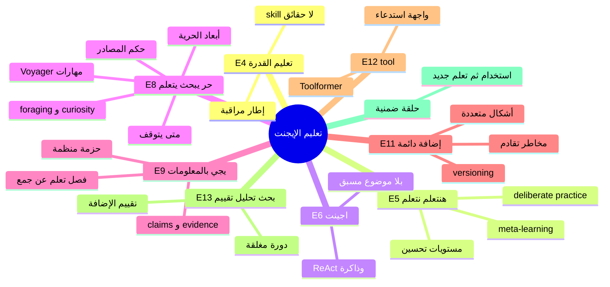

# خريطة: حرية البحث، عودة المعرفة، وتحويل التعلم إلى إضافة قابلة للاستخدام

## 1. الفكرة في جملة واحدة كما فهمتها

نُطلق **إيجنت** بلا تفصيل مسبق لموضوع البحث، نمنحه **حرية** أن يستكشف ويتعلم بنفسه، ثم **يعود بمعلومات** قابلة للاستخدام؛ **نتاج ذلك التعلم** لا يبقى داخل جلسة واحدة بل يُصنَّع **إضافة** دائمة تُعاد استخدامها، والإضافة في صورتها النهائية **أداة** تُكرّر دورة **بحث → تحليل → تقييم** — والمشروع كله عنوانه **تعليم الإيجنت** أي **تعلّم كيف نتعلّم** وليس حشو معرفة في مجال واحد.

## 2. الخريطة

- **تعليم الإيجنت** [الورقة: E4]
  - **العنوان يحدد المفعول لا المحتوى** [استنتاج: E4]
    - التعليم هنا = تكوين **قدرة** على التعلم الذاتي لا تلقين حقائق [استنتاج: E4 + E5]
    - يقابل في الأدب: *skill acquisition* مقابل *knowledge transfer* [بحث: https://arxiv.org/abs/2305.16291]
  - **علاقة العنوان بالتدفق الرأسي** [استنتاج: E4 + E6→E13]
    - E4/E5 على جنب بلا سهم راجع [الورقة] ⇒ التعليم **إطار مراقبة** وليس خطوة داخل الحلقة [استنتاج]

- **\* هنتعلم ازي نتعلم \*** [الورقة: E5]
  - **Meta-learning كقراءة تقنية للجملة** [بحث: https://arxiv.org/abs/2206.13488]
    - تعلّم **سياسة بحث** تتعمم عبر مواضيع [استنتاج: E5 + E8]
    - تعلّم **معيار إيقاف** و**معيار جودة** للعودة [استنتاج: E5 + E9]
  - **تعلّم البشر «كيف يتعلمون»** [بحث: https://psycnet.apa.org/doiLanding?doi=10.1037%2F0033-295X.97.3.404]
    - *deliberate practice*: تغذية راجعة + مهام على حافة القدرة [بحث: URL أعلاه] ⇒ نظير للإيجنت: حلقات بحث مع تقييم [استنتاج: E5 + E13]
    - *self-explanation* و*Feynman technique*: إعادة صياغة ما تعلّمته يكشف الفجوات [تخمين: E5] ⇒ «العودة بالمعلومات» قد تتطلب **شرحًا** لا نسخًا [استنتاج: E5 + E9]
  - **مستويات «نتعلم كيف نتعلم» في النظام** [استنتاج: E5]
    - مستوى 1: الإنسان يصمم حلقة E8→E11 [استنتاج]
    - مستوى 2: الإيجنت يحسّن استراتيجيته ويخزنها في الإضافة [استنتاج: E5 + E11]
    - مستوى 3: الإضافات تتكاثر وتُختبر بعضها ببعض [تخمين: E5 + E11 + E13]

- **اجينت** [الورقة: E6]
  - **نقطة البداية بلا موضوع مكتوب** [الورقة + تأكيد صاحب الورقة في idea.md]
    - الموضوع يُولَّد من **سياق المهمة** أو **فجوة معرفية** لا من الورقة [استنتاج: E6 + E8]
  - **ما الذي يُفترض أن يملكه الإيجنت قبل «الحرية»؟** [استنتاج: E6]
    - أدوات وصول: web، ملفات، APIs [تخمين: E6 + E12]
    - ذاكرة عملية للجلسة [استنتاج: E6 + E9]
    - **لا** مكتبة مهارات جاهزة — تلك ناتجة من E11 [استنتاج: E6→E11]
  - **أرشيتكتوز معروفة كمرآة لـ E6** [بحث]
    - ReAct: تفكير متناوب مع فعل [بحث: https://arxiv.org/abs/2210.03629]
    - Generative Agents: ذاكرة + تخطيط + فعل [بحث: https://arxiv.org/abs/2304.03442]

- **نخلي حر يبحث يتعلم** [الورقة: E8] — *عدسة البداية*
  - **معنى «حر» من صاحب الورقة** [الورقة: idea.md]
    - يتساب **بنفسه** يبحث ويتعلم [الورقة]
  - **أبعاد الحرية — ما الذي يُحرَّر وما الذي يبقى مقيدًا؟** [استنتاج: E8]
    - **حرية الهدف**: اختيار فرع الاستكشاف التالي [استنتاج: E8]
    - **حرية الوسيلة**: أي مصدر، أي أداة، أي ترتيب خطوات [استنتاج: E8 + E12]
    - **حرية الزمن**: متى يكفي [استنتاج: E8 + E9]
    - **قيود ضمنية** حتى مع «حر»: ميزانية، أخلاقيات، صلاحيات [تخمين: E8]
  - **كيف يختار ماذا يستكشف؟** [استنتاج: E8]
    - **Information Foraging**: الإيجنت كـ *predator* للمعلومات — رائحة الربح *information scent* [بحث: https://doi.org/10.1207/s15327651soc0101_1]
      - يتبع روابط/مراجع ذات *scent* عالٍ [استنتاج: E8 + بحث foraging]
      - يترك مسارًا عندما ينخفض العائد المتوقع [استنتاج: E8 + E9]
    - **Exploration vs exploitation** [بحث: https://en.wikipedia.org/wiki/Exploration%E2%80%93exploitation_dilemma]
      - بداية الجلسة: exploration أوسع [استنتاج: E8]
      - قبل العودة: exploitation لملء الفجوات [استنتاج: E8 + E9]
    - **Curiosity / intrinsic motivation** [بحث: https://arxiv.org/abs/1705.05363]
      - مكافأة داخلية للحالات **غير المتوقعة** أو **عالية التباين** [بحث: URL]
      - يفسّر لماذا «حر» لا يعني عشوائي — يعني محركًا داخليًا [استنتاج: E8]
    - **Active learning**: اختيار الاستعلام الذي يقلل عدم اليقين [بحث: https://burrsettles.com/pub/settles.activelearning.pdf]
      - سؤال واحد محكم أحيانًا أفضل من 100 صفحة [استنتاج: E8]
    - **Hypothesis-driven research** [استنتاج: E8 + E13]
      - يولّد فرضيات → يبحث لإبطالها/تأكيدها [استنتاج: E8 + E13 «نحلل»]
  - **كيف يحكم المصادر؟** [استنتاج: E8 + E9]
    - **طبقات الثقة** [استنتاج]
      - Provenance: من كتب، متى، أين نُشر [استنتاج]
      - Corroboration: تعدد مصادر مستقلة [استنتاج]
      - **Epistemic humility**: تسجيل «غير متأكد» جزء من التعلم [تخمين: E8]
    - **أنظمة سابقة** [بحث]
      - WebGPT: تصفح مع تعلم من تغذية راجعة [بحث: https://arxiv.org/abs/2112.09332]
      - RARR: retrieval augmented ثم **تحقق** وتصحيح [بحث: https://arxiv.org/abs/2211.08727]
    - **فشل الحكم** [استنتاج: E8]
      - *confirmation bias* في اختيار المصادر [تخمين]
      - مصادر متقنة الشكل ضعيفة المحتوى [استنتاج]
      - ⇒ دور E13 «نقيّم» ليس اختياريًا بعد العودة [استنتاج: E8 + E13]
  - **متى يتوقف؟** [استنتاج: E8 + E9]
    - **Optimal stopping** / diminishing returns [بحث: https://www.cs.cmu.edu/~jhm/Readings/OptimalStopping.pdf]
      - كل خطوة إضافية لها تكلفة؛ العائد الإضافي يتناقص [بحث]
    - **Satificing** (Simon): «جيد بما يكفي» للعودة [بحث: https://pages.ucsd.edu/~mckenzie/Simon1955.pdf]
    - **عتبات صريحة** [استنتاج: E9]
      - تغطية أسئلة القائمة [استنتاج]
      - ثقة موحّدة > عتبة [تخمين]
      - ميزانية زمن/توكن منتهية [تخمين: E8]
    - **Reflexion**: التوقف بعد دورة تفكير + تقييم ذاتي [بحث: https://arxiv.org/abs/2303.11366]
    - **خطر التوقف المبكر vs التعمق اللانهائي** [استنتاج: E8]
      - بدون E11 قد يضيع كل شيء عند التوقف [استنتاج: E8 + E11]
  - **«يتعلم» أثناء البحث — ماذا يتغير داخل الإيجنت؟** [استنتاج: E8]
    - تحديث **نموذج عالم** (ما يعتقد أنه صحيح) [استنتاج]
    - تحديث **استراتيجية** (كيف يبحث) [استنتاج: E5 + E8]
    - لا يُفترض fine-tuning الوزن — الورقة تقترح **إضافة** خارجية [استنتاج: E8 + E11]

- **يجي بـ المعلومات** [الورقة: E9] — *عدسة البداية*
  - **«يجي» = عودة إلى نقطة إسناد** [استنتاج: E9]
    - عودة للمعلّم/النظام/الجلسة الأم — الورقة لا ترسم سهم راجع لكن E9 يفترض **مستقبلًا** للمعلومات [استنتاج: E9 + idea.md]
  - **شكل «المعلومات» — ليس dump خام** [استنتاج: E9 + E11]
    - **حزمة منظمة** [استنتاج: E9]
      - Claims + evidence + confidence [استنتاج]
      - مصادر مع روابط/استشهاد [استنتاج]
      - فجوات معروفة وخطوات مقترحة [استنتاج: E13]
    - **تقارير بحث معيارية** [بحث: https://arxiv.org/abs/2310.01783] (مثال: تقارير multi-agent research)
    - **برامج/مهارات** كمعلومات قابلة للتنفيذ [بحث: https://voyager.minedojo.org/]
      - Voyager: يعود بـ **skill library** — كود قابل لإعادة الاستخدام [بحث: URL]
      - تشابه قوي مع «إضافة» E11 [استنتاج: E9 + E11]
  - **جودة العودة — معايير قبول** [استنتاج: E9 + E13]
    - *Relevance*: تخدم قرارًا أو سؤالًا [استنتاج]
    - *Soundness*: الأدلة تدعم الادعاء [استنتاج: E13]
    - *Actionability*: يمكن أن تتحول لإضافة [استنتاج: E9 + E11]
    - *Compression*: معرفة مكثفة لا تكرار [استنتاج: E5]
  - **فصل «ما تعلّمه» عن «ما جمعه»** [استنتاج: E9]
    - جمع: نسخ حقائق [استنتاج]
    - تعلّم: نماذج، قواعد، إجراءات، أدوات [استنتاج: E8 + E9]
    - الإضافة يجب أن تحمل الثاني [استنتاج: E11]
  - **زمن العودة** [تخمين: E9]
    - دفعة واحدة نهائية vs تحديثات جزئية — الورقة سطر واحد يقرأ كـ **عودة واحدة** [استنتاج: E9]

- **نتاج التعلم نعمله إضافة ونستخدمها** [الورقة: E11]
  - **«نتاج التعلم»** [الورقة: E11]
    - ليس كل ما مرّ في السجل — **المنتج المستقر** بعد E8–E9 [استنتاج: E11]
  - **«إضافة» من صاحب الورقة** [الورقة: idea.md]
    - شيء **ثابت** يُضاف ويُستخدم **تاني** [الورقة]
  - **أشكال الإضافة المحتملة** [استنتاج: E11 + E12]
    - **Tool / function** مسجّل في runtime [استنتاج: E12]
    - **Prompt module** أو playbook بحث [استنتاج: E11]
    - **ذاكرة دلالية** مع فهرسة [بحث: https://arxiv.org/abs/2310.08560] (MemGPT-style)
    - **فهرس مصادر** موثوق لمجال [استنتاج]
    - **قالب تقرير** + checklists تقييم [استنتاج: E11 + E13]
    - **Skill graph**: مهارات مركبة [بحث: Voyager URL]
  - **دورة الحياة** [استنتاج: E11]
    - إنشاء ← تسجيل ← استدعاء ← مراجعة ← نسخة جديدة [استنتاج]
    - **Versioning** عندما يتعلم الإيجنت مجددًا [استنتاج: E5 + E11]
  - **«ونستخدمها»** [الورقة: E11]
    - الاستخدام في جلسات لاحقة بلا إعادة بحث كامل [استنتاج]
    - الاستخدام كـ **بذرة exploration** في E8 التالية [استنتاج: E8 + E11]
  - **مخاطر** [تخمين: E11]
    - إضافة أصبحت **قديمة** أو **خاطئة** [تخمين]
    - تراكم إضافات متعارضة [تخمين]
    - ⇒ E13 «نقيّم» على الإضافة نفسها [استنتاج: E11 + E13]

- **tool** [الورقة: E12]
  - **الإضافة تُعرَض كأداة للنظام** [الورقة: E12]
    - واجهة: اسم، وصف، مدخلات، مخرجات [استنتاج: E12]
    - Toolformer: النموذج يتعلم **متى** يستدعي أدوات [بحث: https://arxiv.org/abs/2302.04761]
  - **الإضافة ≠ الإيجنت الخام** [استنتاج: E6 + E11 + E12]
    - E6 حر ومتغير؛ E12 **محدد** وقابل للاستدعاء [استنتاج]
  - **تكوين الأداة من نتاج بحث** [استنتاج: E9 + E12]
    - استخراج إجراء متكرر من سجل البحث [استنتاج]
    - تغليف pipeline: fetch → parse → synthesize [استنتاج]

- **نبحث / نحلل / نقيّم** [الورقة: E13]
  - **ثلاثية كدورة لا كقائمة** [استنتاج: E13]
    - بحث يغذي تحليلًا يغذي تقييمًا يوجّه بحثًا جديدًا [استنتاج: E8 + E13]
  - **نبحث** [الورقة: E13]
    - إعادة استخدام E8 لكن **عبر الأداة** — بحث منضبط بغرض [استنتاج: E13 + E12]
    - Retrieval، استعلامات، تجارب، مقابلات محاكاة [استنتاج]
  - **نحلل** [الورقة: E13]
    - تفكيك، مقارنة، نمذجة، سببية، توليف [استنتاج]
    - يحوّل معلومات E9 إلى **هيكل** جاهز للإضافة [استنتاج: E9 + E11 + E13]
  - **نقيّم** [الورقة: E13]
    - جودة الأدلة، صلاحية الاستنتاج، مخاطر الخطأ [استنتاج]
    - **مرآة Reflexion و RARR** [بحث: Reflexion + RARR URLs]
    - تقييم **الإضافة** بعد النشر: هل ما زالت صحيحة؟ [استنتاج: E11 + E13]
  - **ضمير الجمع «ن»** [استنتاج: E13]
    - الإنسان + الإيجنت + الأداة كفريق [استنتاج]
    - أو: الأداة تنطق بخطوات الثلاثة كمنهجية [استنتاج]

- **الحلقة الكاملة بلا سهم راجع على الورقة** [الورقة: idea.md]
  - **ما يُستنتج من غياب السهم** [استنتاج]
    - الورقة ترسم **خطًا واحدًا للأمام**؛ الخريطة تضيف حلقة **استخدام الإضافة → تعلم جديد → إضافة جديدة** [استنتاج: E11 + E5]
    - ليس تناقضًا — **توسعة ضرورية** لـ «نستخدمها تاني» [استنتاج: E11]

- **تقاطعات حرجة بين العناصر** [استنتاج]
  - E8×E9: الحرية مسؤولة عن **شكل** العودة [استنتاج]
  - E9×E11: العودة **خام التصنيع** للإضافة [استنتاج]
  - E11×E12×E13: الإضافة = أداة تُعيد الثلاثية [الورقة]
  - E5×كل شيء: تحسين الحلقة = meta-learning [استنتاج: E5]

### خارج الورقة

- **تعليم weights مباشرة (fine-tuning)** — الورقة تتحدث عن إضافة خارجية لا تدريب نموذج [استنتاج مقابل نص الورقة]
- **منصة تج تجارية محددة** — غير موجودة [—]
- **multi-agent بلا إيجنت واحد في E6** — الورقة صندوق واحد «اجينت» [الورقة]

## 3. رسم الخريطة

## 4. أهم 5 اكتشافات

1. **Information Foraging يفسّر «حر يبحث» بدقة أكثر من «عشوائي»** — الإيجنت يتبع *scent* ويتوقف عند انخفاض العائد؛ هذا يربط E8 بمعيار إيقاف طبيعي قبل E9. *لماذا يهم*: يحوّل الحرية من شعار إلى سياسة استكشاف قابلة للتصميم والقياس.

2. **Voyager skill library ≈ «إضافة» في E11** — التعلم يُحفظ ككود/مهارة قابلة للاستدعاء لا كسجل محادثة. *لماذا يهم*: يعطي شكلًا ملموسًا لما يعني «نتاج التعلم» عند العودة (E9) والتثبيت (E11).

3. **WebGPT + RARR يفصلان «جمع» عن «تحقق»** — البحث الحر بدون طبقة تقييم (E13) يعرض لتحيز التأكيد وهلوسة الاستشهاد. *لماذا يهم*: الثلاثية E13 ليست زينة؛ هي شرط لقبول العودة كإضافة موثوقة.

4. **Meta-learning (E5) يمكن أن يعيش في الإضافات لا في الوزن** — تحسين playbooks وعتبات التوقف وقوالب التحليل يطابق «هنتعلم ازي نتعلم» دون افتراض تدريب نموذج. *لماذا يهم*: يوسّع الفكرة لنظام يتراكم فوق جلسات متعددة ومجالات متعددة.

5. **غياب السهم الراجع على الورقة + «نستخدمها تاني»** — نص E11 يفرض حلقة استخدام→تعلم غير مرسومة؛ الخريطة تكتمل فقط عندما تصبح الإضافة مدخلًا لجولة E8 التالية. *لماذا يهم*: يحوّل الرسم الخطي إلى **نظام تعلم مستمر** هو جوهر «تعليم الإيجنت».

## 5. أسئلة مفتوحة

- ما **الحد الأدنى** للقيود على «حر» (E8) قبل أن تفقد المعنى؟
- من **يقبل** حزمة العودة (E9) — إنسان، نظام آلي، أم معيار موضوعي؟
- كيف تُسمَّى وتُكتشف **الإضافة** عند الاستدعاء — registry، بحث دلالي، أم توليد ديناميكي؟
- هل «نبحث / نحلل / نقيّم» (E13) **دائماً** بالترتيب أم متوازية؟
- ماذا يحدث عند **تعارض** إضافتين من جولتين تعلم مختلفتين؟
- هل العودة (E9) **دفعة واحدة** أم تدفق جزئي — والورقة صامتة؟
- كيف يُقاس نجاح «تعليم الإيجنت» (E4) — سرعة بحث، جودة تقييم، أم عدد إضافات قابلة لإعادة الاستخدام؟
- هل E6 **إيجنت واحد** أم يمكن تجزئته داخلياً دون خرق الورقة؟

## 6. المصادر

| URL | ما أعطاني |
|-----|-----------|
| https://arxiv.org/abs/2210.03629 | ReAct: تناوب reasoning وacting — مرآة لسجل بحث حر منظم |
| https://arxiv.org/abs/2304.03442 | Generative Agents: ذاكرة وتخطيط — سياق لـ E6 |
| https://arxiv.org/abs/2112.09332 | WebGPT: تصفح وتعلم من تغذية راجعة — حكم مصادر وبحث |
| https://arxiv.org/abs/2211.08727 | RARR: تحقق من ادعاءات بعد retrieval — تقييم E13 |
| https://arxiv.org/abs/2303.11366 | Reflexion: تقييم ذاتي وإيقاف دورات — E8/E9 |
| https://voyager.minedojo.org/ | Voyager: skill library كمنتج تعلم دائم — E11/E9 |
| https://arxiv.org/abs/2302.04761 | Toolformer: تعلم استدعاء أدوات — E12 |
| https://arxiv.org/abs/1705.05363 | Curiosity-driven exploration — محرك استكشاف E8 |
| https://burrsettles.com/pub/settles.activelearning.pdf | Active learning — اختيار ما يُستكشف |
| https://doi.org/10.1207/s15327651soc0101_1 | Information Foraging — نظرية اختيار المسار والتوقف |
| https://pages.ucsd.edu/~mckenzie/Simon1955.pdf | Satisficing — معيار «يكفي للعودة» |
| https://arxiv.org/abs/2206.13488 | مراجعة/meta-learning — قراءة E5 |
| https://arxiv.org/abs/2305.16291 | Skill acquisition vs knowledge — قراءة E4 |
| https://psycnet.apa.org/doiLanding?doi=10.1037%2F0033-295X.97.3.404 | Deliberate practice (Ericsson) — E5 بشري |
| https://arxiv.org/abs/2310.08560 | MemGPT: ذاكرة طويلة — شكل محتمل للإضافة |
| https://www.cs.cmu.edu/~jhm/Readings/OptimalStopping.pdf | Optimal stopping — قرار التوقف E8→E9 |
