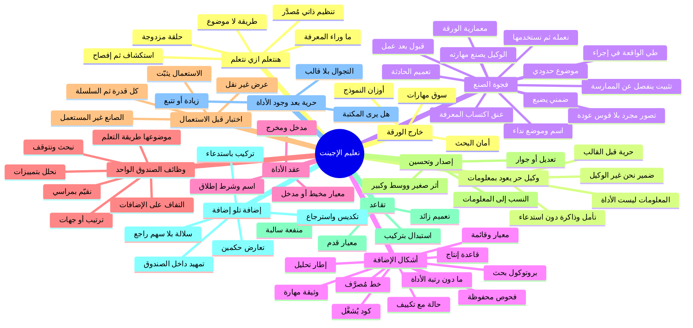

# خريطة: تقطير التعلم إلى إضافة تُستدعى

العلامات: **[الورقة]** ما هو مكتوب أو مؤكَّد من صاحبها في `idea.md`. **[استنتاج]** ما يُلزمه الرسم أو لفظه من غير أن يقوله. **[بحث: URL]** ما يأتي من مصدر. **[تخمين]** امتداد محتمل لا يلزم من الورقة ولا من المصدر. كل فرع داخل الخريطة يُردّ إلى عنصر من الصفحة (E4، E5، E6، E8، E9، E11، E12، E13). ما لا يُردّ إليها في آخر القسم 2 تحت «خارج الورقة».

## 1. الفكرة في جملة واحدة كما فهمتها

نتعلم كيف نتعلم بأن نترك وكيلاً يبحث بحرية ويعود بمعلومات، ثم نحوّل ناتج ذلك التعلم إلى إضافة ثابتة نستدعيها كأداة واحدة وظائفها البحث والتحليل والتقييم.

## 2. الخريطة

- E4 تعليم الإجينت: اسم الفكرة كلها، على جنب الرسم لا داخل السهم [الورقة]
  - التعليم هنا ليس درساً في موضوع، بل تعليم الوكيل أن يمارس التعلم [الورقة]
  - الرسم نفسه منهج من خمس محطات: وكيل، حرية، معلومات، إضافة، أداة [الورقة]
    - E6 صندوق «اجينت» في أعلى المسار [الورقة]
    - سهم نازل نحو الحرية والعودة، ثم سهم نازل نحو الإضافة، ثم سهم جانبي نحو الأداة: اتجاه واحد [الورقة]
    - لا سهم يرجع من الأداة إلى الوكيل ولا من الإضافة إلى الحرية [الورقة]
- E5 هنتعلم ازي نتعلم: الجملة بين نجمتين تحت العنوان، وهي موضوع الورقة لا زخرفة [الورقة]
  - موضوع الدورة هو طريقة التعلم، والمعلومات التي يعود بها الوكيل مادة لهذه الطريقة لا غاية في ذاتها [الورقة]
  - تعلم من الدرجة الثانية: تغيير طريقة التعلم لا تصحيح ناتج داخل طريقة ثابتة [بحث: https://hbr.org/1977/09/double-loop-learning-in-organizations]
    - الحلقة الواحدة تُصلح الفعل وتُبقي المعيار الحاكم كما هو [بحث: https://hbr.org/1977/09/double-loop-learning-in-organizations]
    - الحلقة المزدوجة تسأل عن المعيار نفسه: ما الذي نعدّه بحثاً كافياً، وتحليلاً سليماً، وتقييماً مقبولاً [بحث: https://en.wikipedia.org/wiki/Double-loop_learning]
    - المستوى الثاني عند باتسون، deutero-learning، هو تعلم تعلم: تغيير مجموعة البدائل لا الاختيار داخلها [بحث: https://en.wikipedia.org/wiki/Double-loop_learning]
    - قراءة E5 على هذا: الإضافة الناجحة تحمل طريقة، فإن غيّرت معيار التقييم داخلها صارت الحلقة المزدوجة مجسَّدة في أداة [استنتاج]
  - ما وراء المعرفة: معرفة عن المعرفة، وتنظيم لها بالتخطيط والمراقبة والتقييم [بحث: https://en.wikipedia.org/wiki/Metacognition]
    - «نبحث / نحلل / نقيّم» في E13 هي التنظيم ما وراء المعرفي وقد صار عمليات أداة، لا وصفاً لشعور الوكيل [استنتاج]
    - المعرفة ما وراء المعرفية تجيب: متى أبحث، كيف أعرف أني فهمت، أي حكم يكفي [بحث: https://en.wikipedia.org/wiki/Metacognition]
    - فصل نيلسون ونارينز بين مستوى الموضوع ومستوى أعلى يراقبه ويتحكم فيه؛ الأداة في الرسم هي هذا المستوى الأعلى وقد أُخرج من الرأس إلى شيء يُستدعى [بحث: https://en.wikipedia.org/wiki/Metacognition]
  - التعلم المنظم ذاتياً يدور بين تمهيد وأداء وتأمل، والأداة تُخرج هذا الدور من الشخص إلى إجراء قابل للإعادة [بحث: https://en.wikipedia.org/wiki/Self-regulated_learning]
    - التصدير هو بيت القصيد في E11: ما كان تنظيماً داخلياً أثناء الحرية يصبح شيئاً يستخدمه غير من عاش الرحلة [استنتاج]
  - التلمذة المعرفية تسمي لحظة الحرية استكشافاً: المتعلم يطرح مسائله، والمعلم لا يلقّنه الوجهة [بحث: https://en.wikipedia.org/wiki/Cognitive_apprenticeship]
    - E8 «نخلي حر» يطابق الاستكشاف: نحن نُخلي، لا نُعيّن موضوع البحث [استنتاج]
    - الإفصاح والتأمل في التلمذة هما اللحظة التي يصير فيها التفكير مرئياً وقابلاً للنقل، أي لحظة «نعمله إضافة» [بحث: https://en.wikipedia.org/wiki/Cognitive_apprenticeship]
- E6 ثم E8 ثم E9: الوكيل يُترك، يبحث ويتعلم، يعود بالمعلومات [الورقة]
  - «حر» كما فسّرها صاحب الورقة: يُساب يبحث ويتعلم بنفسه [الورقة]
    - الحرية سابقة على الإضافة في الرسم؛ التقييد يأتي بعدها لا قبلها [الورقة]
    - منهج يقترح على الوكيل المهمة التالية، كما في automatic curriculum عند Voyager، شكل آخر: الوجهة فيه مُولَّدة من فجوة المهارة لا من حرية غير مُوجَّهة [بحث: https://arxiv.org/abs/2305.16291]
    - الإبقاء على الحرية يعني أن مكتبة الإضافات قد تجيء فيها فجوات وتكرار، لأن أحداً لم يملأ خريطة النقص سلفاً [استنتاج]
  - ما يعود في E9 معلومات، والكلمة على الورقة «المعلومات» لا «الأداة» ولا «الدرس» [الورقة]
    - المعلومات ناتج الرحلة؛ الإضافة شيء يُصنع منها في المحطة التالية [الورقة]
    - Reflexion يحفظ تأملاً لفظياً في ذاكرة حلقية تُحقن في المحاولة التالية؛ الناتج يبقى نص خبرة لا أداة لها وظائف مستقلة [بحث: https://arxiv.org/abs/2303.11366]
    - الوكلاء التوليديون يرفعون الذكريات إلى reflections أعلى؛ الرفع ما زال ذاكرة مكتوبة لا أداة بحث وتحليل وتقييم [بحث: https://arxiv.org/abs/2304.03442]
    - ExpeL يستخرج insights لغوية عابرة للمهام ويُعيد جلبها؛ هذا أقرب إلى قاعدة تُقرأ منه إلى tool تُشغَّل، وهو جسر بين E9 وE12 لا يبلغ رسم الورقة كاملاً [بحث: https://arxiv.org/abs/2308.10144]
  - صاحب الرحلة هو الوكيل، وصانع الثبات في السطر التالي ضمير آخر [الورقة]
    - «نخلي» و«نعمله» و«نستخدمها» ضمير متكلم جمع، بينما الصندوق الأول «اجينت» [الورقة]
    - صاحب الورقة: الذي تعلّمه الوكيل يتحول إلى شيء ثابت يُضاف ويُستخدم ثانية [الورقة]
- E11 نتاج التعلم نعمله إضافة ونستخدمها: قلب هذه الخريطة [الورقة]
  - الإضافة، بشرح صاحب الورقة، حاجة ثابتة تُضاف وتُستخدم تاني؛ الثبات شرط، والإعادة شرط [الورقة]
  - بين E9 وE11 فجوة صنع لا فجوة نقل [الورقة]
    - «يجي بـ المعلومات» حدث وصول؛ «نعمله» حدث تشكيل؛ الرسم يفصل بينهما بسهم [الورقة]
    - من يصنع هو «نحن»؛ الورقة لا تقول إن الوكيل يُخرج الأداة جاهزة [الورقة]
    - لهذا تنفصل معماريتان: معمارية الورقة وفيها العائد معلومات والصانع نحن، ومعمارية الوكيل الذي يكتب مهارته بنفسه [استنتاج]
      - Voyager يكتب برنامجاً، ينفّذه في البيئة، ولا يُدخل المهارة المكتبة إلا بعد إتمام المهمة [بحث: https://arxiv.org/abs/2305.16291]
      - LATM يفصل tool maker يصنع دالة Python عن tool user يستدعي الدالة الجاهزة، فيُدفع ثمن الصنع مرة وتُستعمل الأداة كثيراً [بحث: https://arxiv.org/abs/2305.17126]
      - Creator يفكك المسار إلى خلق الأداة، ثم قرار استخدامها، ثم تنفيذ، ثم تعرّف على الموضع المناسب [بحث: https://arxiv.org/abs/2305.14318]
      - الورقة تجمع الصنع والاستعمال في ضمير واحد («نعمله» و«نستخدمها») وتترك الوكيل في محطة أسبق [استنتاج]
    - عنق زجاجة اكتساب المعرفة: أصعب جزء في الأنظمة الخبيرة كان استخراج ما يفعله الخبير الحر وتحويله إلى قواعد تُستدعى [بحث: https://en.wikipedia.org/wiki/Knowledge_acquisition]
      - الورقة تُبقي هذا الاستخراج عند «نحن»؛ الثمن بطء الصنع، والعائد أن الإضافة ملك من سيستخدمها لا ذاكرة خاصة بالوكيل [استنتاج]
      - نقل الصنع إلى الوكيل، كما في Voyager وLATM، يخفف العنق ويعيد مشكلة أخرى: الأداة قد تُولَد على هيئة يفهمها صانعها أكثر مما يفهمها من تُرسم لهم كلمة «نستخدمها» [استنتاج]
  - ماذا يفعل التقطير بالمعلومات حتى تصير إضافة [استنتاج]
    - يُسقط ما لا يُعاد استدعاؤه ويبقي إجراءً [بحث: https://en.wikipedia.org/wiki/ACT-R]
      - التجميع المعرفي عند أندرسون يمر بـ proceduralization: الواقعة التصريحية تُطوى داخل قاعدة، ثم composition تُدمج القواعد المتتالية في قاعدة واحدة [بحث: https://doi.org/10.1037/0033-295X.89.4.369]
      - بعد التطوي تُستعمل المهارة من غير إعادة جلب الدرس الأصلي؛ هذا تعريف تشغيلي لـ«ثابتة» [بحث: https://doi.org/10.1037/0033-295X.89.4.369]
      - مراحل فيتس وبوسنر: مرحلة معرفية تتكلم فيها الخطوات، ثم ارتباطية، ثم ذاتية تعمل من غير استحضار الشرح؛ الأداة هي المرحلة الذاتية وقد صارت شيئاً خارج الرأس [بحث: https://en.wikipedia.org/wiki/Motor_learning]
    - يعمّم حادثة الرحلة الحرة إلى إجراء يغطّي حالات لم تُرَ [بحث: https://en.wikipedia.org/wiki/Explanation-based_learning]
      - التعلم المبني على التفسير يصنع قاعدة قابلة للنقل من مثال واحد إذا وُجدت نظرية مجال تفسّر لماذا نجح المثال [بحث: https://en.wikipedia.org/wiki/Explanation-based_learning]
      - chunking في Soar: عند المأزق يبحث النظام، فإذا حُلّ المأزق تُحفظ chunk هي قاعدة إنتاج تختصر البحث في المرة القادمة [بحث: https://en.wikipedia.org/wiki/Soar_%28cognitive_architecture%29]
      - E9 حادثة واحدة في الرسم (عودة واحدة)؛ التعميم هو ما يجعل من تلك العودة أداة لا أرشيف تلك العودة [استنتاج]
    - يعطي الناتج اسماً وموضع استدعاء، وإلا بقي معلومة في دفتر [استنتاج]
      - كلمة tool على السهم E12 هي هذا الموضع: الإضافة تُستدعى، لا تُعاد قراءتها كحكاية [الورقة]
    - يحصر شكل الناتج في الوظائف الثلاث المكتوبة في الصندوق الأخير، فالصفاء شرط قبول لا تحسين لاحق [استنتاج]
      - ناتج تعلم لا يستطيع أن يبحث أو يحلل أو يقيّم لا يطابق الصندوق الذي يشير إليه السهم [استنتاج]
    - لا يدخل المكتبة قبل أن يُظهر أنه يعمل في موضع استعمال [بحث: https://arxiv.org/abs/2305.16291]
      - عند Voyager الالتزام بالمهارة تابع للنجاح في البيئة لا لجمال الكود [بحث: https://arxiv.org/abs/2305.16291]
      - الورقة تقول «ونستخدمها» من غير محطة اختبار مرسومة؛ الاختبار إذن استنتاج من فعل الاستعمال ومن أدبيات لا تحفظ المهارة قبل نجاحها [استنتاج]
  - ما يضيع حين تُصنع الإضافة، ولماذا الضياع جزء من الفكرة لا عارض [بحث: https://en.wikipedia.org/wiki/Tacit_knowledge]
    - بولاني: نعرف أكثر مما نستطيع أن نقول؛ جزء من حرية الوكيل لن يدخل أي إضافة مهما حَسُن الصنع [بحث: https://en.wikipedia.org/wiki/Tacit_knowledge]
    - التثبيت reification عند وينغر: المشاركة الحية تُعطى شكلاً (إجراء، أداة، وثيقة) فتصير قابلة للمشاركة، وقد ينفصل الشكل عن الممارسة التي ولدته [بحث: https://en.wikipedia.org/wiki/Communities_of_practice]
    - دريفوس: المبتدئ يتبع قواعد، والخبير يتصرف من غير أن يفكك موقفه إلى قواعد؛ أداةٌ على هيئة قواعد قد تُبقي مستخدمها في طور التتبع [بحث: https://en.wikipedia.org/wiki/Dreyfus_model_of_skill_acquisition]
    - القراءة من الورقة: الضياع مقبول لأن E8 وE11 محطتان معاً؛ الحرية تبقى مصدراً، والإضافة تبقى شيئاً ثابتاً، ولا واحدة تُلغى في الرسم [استنتاج]
  - الإضافة موضوع حدودي: صلبة بما يكفي لتبقى هي هي، ولينة بما يكفي ليحرّكها الوكيل ونحن [بحث: https://en.wikipedia.org/wiki/Boundary_object]
    - ستار وغريسيمر: الموضوع الحدودي يسافر بين جماعتين من غير أن يملكه طرف واحد [بحث: https://en.wikipedia.org/wiki/Boundary_object]
    - على الورقة الطرفان موجودان: وكيل تعلّم، ونحن نصنع ونستخدم [الورقة]
    - إن صُنعت الإضافة بلغة الوكيل فقط صارت ذاكرة له؛ وإن صُنعت بلغة الاستعمال فقط انقطعت عن الرحلة التي تبررها [استنتاج]
  - دورة كولب تضع بعد التجربة ملاحظة، ثم تصوراً مجرداً، ثم تجريباً نشطاً يعود إلى تجربة جديدة [بحث: https://en.wikipedia.org/wiki/Experiential_learning]
    - E8 تجربة، E9 ملاحظة ما وُجد، E11 تصور مجرد قد صار إضافة، والاستخدام تجريب نشط [استنتاج]
    - الورقة تقف قبل قوس العودة؛ التجريب النشط لا يُرسم كتجربة تالية للوكيل [الورقة]
  - SECI: الإخراج externalization ينقل ما كان ضمنياً في البحث الحر إلى شكل صريح، والدمج combination يركّب الصريح في نظام واحد [بحث: https://en.wikipedia.org/wiki/SECI_model_of_knowledge_dimensions]
    - الصندوق الواحد ذو الوظائف الثلاث هو لحظة الدمج: بحث وتحليل وتقييم في أداة واحدة لا في ثلاث حكايات [استنتاج]
  - إنغلبارت: أداة الفكر تزيد المستعمِل إذا بقيت أداةً بيده، لا إذا حلّت محل قدرته على البحث [بحث: https://www.dougengelbart.org/pubs/augment-3906.html]
    - «نستخدمها» تتسع لهذه القراءة: الإضافة زيادة على من يستخدم، والوكيل الحر يبقى في الرسم مصدراً لا قطعة غيار [استنتاج]
- أشكال الإضافة: كلها تحقيق لـ E11 بشرط أن تبلغ رتبة E12، أي أن تُستدعى لتعمل عمل E13 [استنتاج]
  - كود قابل للتشغيل: دالة أو برنامج له مدخل ومخرج [بحث: https://arxiv.org/abs/2305.17126]
    - في Voyager كل مهارة برنامج، ووصفها يُضمَّن في متجه، والاسترجاع بالشبه الدلالي للوصف لا بنص الرحلة [بحث: https://arxiv.org/abs/2305.16291]
    - المهارة المركبة تستدعي مهارات أبسط؛ العلاقة بين إضافة وإضافة هنا استدعاء لا تكديس فقط [بحث: https://arxiv.org/abs/2305.16291]
    - هذا الشكل يخدم الوظائف الثلاث إذا كان فيه إجراء بحث وإجراء تحليل وإجراء حكم، لا إذا كان سكربت مهمة واحدة في مجال [استنتاج]
    - مثال الشكل من مجالات متباعدة: دالة تجمع مصادر وتقارنها وتُرجع حكماً؛ قد تكون فرز أدلة في مختبر، أو موازنة روايات في أرشيف، أو موازنة لوازم في ورشة [تخمين]
  - وثيقة مهارة: نص يُحمَّل عند تطابق القصد، فيه متى تُستخدم الأداة وكيف تبحث وتحلل وتقيّم [استنتاج]
    - تختلف عن كومة ملاحظات E9 بأن لها شرط إطلاق وخطوات ثابتة؛ من غير شرط الإطلاق تبقى معلومات [استنتاج]
    - ExpeL أقرب إلى قواعد لغوية تُجلب؛ الوثيقة-المهارة تزيد على ذلك بنية استدعاء دائمة [بحث: https://arxiv.org/abs/2308.10144]
  - قاعدة إنتاج: إذا ظهر هذا النمط فافعل هذا البحث أو هذا الحكم [بحث: https://en.wikipedia.org/wiki/ACT-R]
    - أصغر إضافة يمكن حفظها؛ الأداة الكبيرة مجموعة قواعد مُدمجة بالـ composition [بحث: https://doi.org/10.1037/0033-295X.89.4.369]
    - chunk في Soar من هذا الشكل: تختصر بحثاً سابقاً في إطلاق واحد [بحث: https://en.wikipedia.org/wiki/Soar_%28cognitive_architecture%29]
    - خطرها أن تُطلق خارج نمطها؛ عندئذٍ «الثبات» يصير تعميماً زائداً لا مهارة [بحث: https://en.wikipedia.org/wiki/Explanation-based_learning]
  - بروتوكول بحث: أين ننظر، ما الذي يُعدّ مصدراً، متى نتوقف [استنتاج]
    - هذه الهيئة هي وظيفة «نبحث» وقد تبلورت وحدها داخل الأداة [الورقة]
    - PRISMA بروتوكول جاهز لمراجعة منهجية: سؤال، مصادر، معايير إدراج، طريقة تركيب؛ تعلم الجماعة كيف تبحث وقد صار أداة [بحث: https://www.prisma-statement.org/]
    - من غير قاعدة توقف يعود البروتوكول حريةً مقنّعة؛ سيمون يسمي الاكتفاء بعتبة مرضية satisficing لا باستنفاد العالم [بحث: https://en.wikipedia.org/wiki/Satisficing]
    - أمثلة الشكل لا المجال: بروتوكول العثور على سابقة قضائية، بروتوكول مسح أدب علمي، بروتوكول جمع روايات شفهية؛ الثلاثة أداة بحث لا نتيجة بحث [تخمين]
  - إطار تحليل: مجموعة تمييزات تُسلَّط على ما عاد به البحث [استنتاج]
    - التحليل من غير إطار بحثٌ ثانٍ؛ الإطار هو ما يجعل «نحلل» وظيفة ثابتة [استنتاج]
    - أمثلة الشكل: نقد مصدر تاريخي (خارجي ثم داخلي)، تفكيك قطعة موسيقية إلى عناصر، تفكيك تصميم تجربة إلى متغيرات؛ الإطار واحد والاستعمال يتعدد [تخمين]
  - معيار تقييم أو قائمة تحقق: سلّم، مراسي، شروط فشل [استنتاج]
    - هذه الهيئة هي وظيفة «نقيّم» وقد استقلت داخل الصندوق [الورقة]
    - قائمة السلامة الجراحية عند منظمة الصحة أداة تقييم مُقطَّرة من ممارسة، تُراجع وتُكيَّف وتبقى قصيرة عمداً [بحث: https://www.who.int/teams/integrated-health-services/patient-safety/research/safe-surgery]
    - غاواندي: الخبرة تُضغط في قائمة لأن الذاكرة والانتباه يخونان تحت الحمل؛ الثبات هنا فضيلة لا نقص [بحث: https://en.wikipedia.org/wiki/The_Checklist_Manifesto]
    - أمثلة الشكل: سلّم تحكيم غوص، نموذج تحكيم أقران، معيار نضج جبن أو خبز يقرره من يتذوق؛ المعيار أداة، والطبق أو الورقة موضوعها [تخمين]
  - حالة محفوظة ومعها إجراء تكييف، لا الحالة وحدها [بحث: https://en.wikipedia.org/wiki/Case-based_reasoning]
    - الاستدلال القائم على الحالة: استرجاع، إعادة استخدام، مراجعة، إبقاء [بحث: https://en.wikipedia.org/wiki/Case-based_reasoning]
    - الإبقاء retain هو لحظة الإضافة؛ من غير مراجعة وتكييف تبقى الحالة معلومة من E9 [استنتاج]
    - الحالة تخدم التقييم حين يكون الحكم «هذا يشبه ما فشل سابقاً» وتخدم البحث حين تدل على أين ننظر [استنتاج]
  - مجموعة اختبارات: المعرفة بما يُعدّ نجاحاً محفوظة كفحوص تُشغَّل [استنتاج]
    - هذا الشكل يخدم «نقيّم» خاصة؛ الفحص يُجري الحكم من غير أن يعيد رحلة التعلم [استنتاج]
    - في خط الأنابيب المُصرَّف يصير المقياس الذي نُحسّن عليه هو نفسه أداة التقييم [بحث: https://arxiv.org/abs/2310.03714]
  - خط أنابيب مُصرَّف: الوحدات الثلاث مصرَّحة، والتصريف يكتب شكلها الدائم بعد تحسين على مقياس [بحث: https://arxiv.org/abs/2310.03714]
    - DSPy يصرّف استدعاءات لغوية تصريحية إلى خط يُحسَّن على مقياس؛ الناتج القابل لإعادة التشغيل هو الإضافة لا سجل التدريب [بحث: https://arxiv.org/abs/2310.03714]
    - هذا أقرب أشكال الأدب إلى صندوق واحد فيه بحث ثم تحليل ثم تقييم [استنتاج]
  - ما يبقى دون رتبة الأداة وإن جاء من التعلم نفسه [استنتاج]
    - كومة المعلومات في E9 [الورقة]
    - تأمل يُحقن في السياق ولا وظيفة مستقرة له [بحث: https://arxiv.org/abs/2303.11366]
    - سلوك مضمور داخل أوزان النموذج بالاستدعاء الناجح فقط، كما يفعل Toolformer حين يُبقي نداء الأداة إذا حسّن التنبؤ بالنص [بحث: https://arxiv.org/abs/2302.04761]
      - ذلك تعلم يصير عادة داخل النموذج لا إضافة نفتحها ونستخدمها؛ الرسم يضع tool في صندوق منفصل عن الوكيل [استنتاج]
- E12 السهم المكتوب عنده tool: الإضافة تُستعمل بوصفها أداة [الورقة]
  - الأداة غير الوثيقة: الوثيقة تُقرأ، الأداة تُنادى لتعمل [استنتاج]
  - اتجاه السهم من صندوق النتاج إلى صندوق الوظائف؛ الأداة هي هيئة استعمال الإضافة لا مرحلة مستقلة عن النتاج [الورقة]
  - عقد الاستدعاء الأدنى حتى يحق للكلمة tool أن تُطلق [استنتاج]
    - اسم يُنادى به [استنتاج]
    - شرط إطلاق: في أي موقف تُستدعى ولا تُستدعى [استنتاج]
    - مدخل: سؤال، أو مادة، أو الاثنان [استنتاج]
    - ثلاث عمليات تقابل المكتوب في E13 [الورقة]
    - مخرج يمكن استعماله من غير إعادة فتح الرحلة الحرة [استنتاج]
  - موضع معيار الحكم داخل العقد سؤال لم تحسمه الورقة [تخمين]
    - إن كان المعيار مخيطاً داخل الأداة فالأداة تحمل قيمة «ما التعلم الحسن» وتصلح لحلقة مزدوجة [تخمين]
    - إن كان المعيار مدخلاً في كل استدعاء فالأداة أعمّ، ونحن نعيد تحديد الحسن في كل مرة [تخمين]
- E13 صندوق واحد بثلاثة أسطر: نبحث، نحلل، نقيّم [الورقة]
  - وحدة الصندوق تعني أداة واحدة بثلاث قدرات، لا ثلاث إضافات مرسومة [الورقة]
  - نبحث: تجلب ما ليس في اليد، وتتوقف عند عتبة مكتوبة فيها [استنتاج]
    - هي الصورة الثابتة لـ E8 بعد نزع الحرية: البحث يبقى، والتعيين الحر للوجهة يُستبدل بشرط إطلاق وقاعدة توقف [استنتاج]
    - ناتجها معلومات من جنس E9، لكنها معلومات حسب بروتوكول لا حسب تجوال [استنتاج]
  - نحلل: تُسلّط تمييزات ثابتة على ناتج البحث فتصير له بنية [استنتاج]
    - من غير هذه المحطة تقفز الأداة من كومة مصادر إلى حكم، فيصير التقييم ذوقاً لا وظيفة [استنتاج]
    - إطار التحليل هو محتوى هذه القدرة؛ تغيير التمييزات تغيير في الإضافة نفسها [استنتاج]
  - نقيّم: تُصدر حكماً على بنية بمقياس، وللمقياس مراسي وشرط فشل [استنتاج]
    - أخطر القدرات الثلاث عند الاستعمال لأن الحكم يُغلق قراراً؛ بحث ناقص يظهر نقصه، وحكم واثق قديم لا يظهر قدمه [استنتاج]
    - قائمة التحقق الطبية تُراجع لأن معيار السلامة إن جمد صار ثقة في غير موضعها [بحث: https://www.who.int/teams/integrated-health-services/patient-safety/research/safe-surgery]
  - ترتيب الأسطر من أعلى إلى أسفل قراءة ممكنة لمسار داخلي: بحث ثم تحليل ثم تقييم [استنتاج]
    - الورقة لا ترسم أسهماً بين الأسطر الثلاثة؛ الترتيب استنتاج من تكديسها لا نص [الورقة]
    - قراءة ثانية مباحة من الرسم نفسه: ثلاث جهات لقدرة واحدة تُستدعى مستقلة [استنتاج]
  - موضوع الوظائف الثلاث هو التعلم عن التعلم، لأن E5 عنوان الفكرة والصندوق لا يسمّي مجالاً [استنتاج]
    - الأداة تبحث في كيف نعرف، وتحلل طريقة معرفة، وتقيّم إن كانت الطريقة تُعلّم [استنتاج]
    - قراءة أوسع وما زالت من E5 وE13: الأداة منهج عام للبحث والتحليل والتقييم في أي مادة، وُلدت لأننا تعلمنا كيف نتعلم [استنتاج]
    - القراءة الضيقة والقراءة الواسعة كلتاهما بلا مجال مسمّى على الورقة؛ تعيين المجال زيادة لا سند لها [الورقة]
  - تقييم الإضافات الأخرى بالأداة نفسها التفاف ممكن على E5: الطريقة التي تعلمناها تُسلَّط على أدواتنا [استنتاج]
    - الورقة لا ترسم الأداة وهي تشير إلى مكتبة الإضافات؛ الالتفاف استنتاج من أن موضوع E5 طريقة التعلم، والإضافة طريقة متجسدة [استنتاج]
- اختبار الإضافة: من «نستخدمها» في E11 ومن «نقيّم» في E13، والمحطة نفسها غير مرسومة [استنتاج]
  - اختباران يجب ألا يُخلطا [استنتاج]
    - اختبار الأداة قبل أن تُعدّ إضافة: هل تبحث وتحلل وتقيّم كما وُعد في العقد [استنتاج]
    - وظيفة التقييم التي داخل الأداة: الأداة تحكم على موضوعها [الورقة]
  - النجاح على نفس الرحلة التي جاء منها الوكيل يثبت إعادة العرض لا يثبت أداة [استنتاج]
    - النقل إلى حالة لم تُرَ في الرحلة الحرة هو ما يفرق E11 عن أرشيف E9 [استنتاج]
    - Voyager يقيس مهاراته بالتنفيذ في البيئة وبادعاء انتقال المكتبة إلى عالم جديد؛ التنفيذ هنا فيصل القبول [بحث: https://arxiv.org/abs/2305.16291]
    - التعلم من مثال واحد بلا نظرية تفسّر النجاح يعطي قاعدة هشّة عند النقل [بحث: https://en.wikipedia.org/wiki/Explanation-based_learning]
  - كل قدرة تُختبر وحدها ثم تُختبر السلسلة [استنتاج]
    - بحث: هل توقف عند العتبة وهل المصادر من الجنس الذي سمّاه البروتوكول [استنتاج]
    - تحليل: هل التمييزات تُنتج بنية يمكن لغيرها أن يعيد بناءها [استنتاج]
    - تقييم: هل المراسي تُلزم حكماً واحداً بين مستعملين، أم الحكم يعود ذوق من يمسك الأداة [استنتاج]
  - الاستعمال المتكرر هو الاختبار الذي يثبّت الأثر، لا القراءة عند الصنع فقط [بحث: https://bjorklab.psych.ucla.edu/research/]
    - أثر الاختبار عند بيورك: الاسترجاع يغيّر ما يُحفظ؛ «نستخدمها» ليست استهلاكاً بعد التعلم بل جزء من تثبيت الإضافة [بحث: https://bjorklab.psych.ucla.edu/research/]
    - فشل أثناء الاستعمال هو الإشارة الوحيدة التي تملكها الورقة لتحسين لاحق، لأن سهماً راجعاً غير مرسوم؛ الإشارة استنتاج من الفعل «نستخدم» إذا جاء الاستعمال خاطئاً [استنتاج]
  - من يختبر: «نحن» الذين نصنع ونستخدم، لا الوكيل في لحظة حريته [استنتاج]
    - LATM يجعل المستعمِل غير الصانع حتى يظهر أن الأداة قائمة بذاتها [بحث: https://arxiv.org/abs/2305.17126]
    - انطباق ذلك على الورقة: إن لم يستطع غير صانع الرحلة أن ينادي الأداة، فما زلنا داخل E9 [استنتاج]
- إصدار الإضافة وتحسينها: تكرار «نعمله» على ناتج استعمال لاحق، والرسم يُري الصنع مرة واحدة [استنتاج]
  - الإصدار أثر مكتوب لتغيّر الإضافة مع بقاء اسم الاستدعاء [استنتاج]
    - semver يفرّق تغييراً يكسر العقد عن إضافة متوافقة عن إصلاح لا يمس المعنى [بحث: https://semver.org/]
    - إصلاح صياغة أو مرساة من غير تغيير الوظائف الثلاث: أثر صغير على الأداة نفسها [استنتاج]
    - مصدر جديد أو تمييز تحليلي جديد مع بقاء معنى الحكم: أثر وسط [استنتاج]
    - تغيير ما يُعدّ تقييماً مقبولاً: أثر كبير، وهو الحلقة المزدوجة داخل الأداة لا ترقيع ناتج [بحث: https://hbr.org/1977/09/double-loop-learning-in-organizations]
  - النسب: كل إصدار يقدر أن يشير إلى المعلومات التي صُنع منها [استنتاج]
    - أندرسون: بعد التطوي تُستعمل القاعدة من غير جلب الأصل؛ هذا يجعل الأداة سريعة ويجعل تدقيقها أصعب [بحث: https://doi.org/10.1037/0033-295X.89.4.369]
    - إبقاء E9 بجانب الأداة يحفظ النسب ولا يلغي التقطير؛ إذابة E9 تجعل الأداة هي كل ما تبقّى [استنتاج]
    - البروتوكول العلمي يحفظ المادة والطريقة معاً حتى يُعاد الحكم؛ النسب هنا شرط إمكان إعادة التقييم لا حنيناً إلى الرحلة [استنتاج]
  - التحسين تعديل إضافة قائمة؛ الإضافة الجديدة جسم آخر بجانب القديمة [استنتاج]
    - لفظ «إضافة» يميل إلى الجوار لا إلى المسح: شيء يُضاف إلى ما عندنا [استنتاج]
    - الورقة ترسم صندوقاً واحداً؛ الاختيار بين تعديل هذا الصندوق وبين صندوق ثانٍ غير مكتوب [الورقة]
- إحالة الإضافة إلى التقاعد: حتى يبقى «نستخدمها» استعمالاً لا تكديساً [استنتاج]
  - مشكلة المنفعة: القاعدة المتعلَّمة قد تكلّف مطابقتها أكثر مما توفره من بحث [بحث: https://en.wikipedia.org/wiki/Explanation-based_learning]
    - مينتون: تُحذف القاعدة إذا كان توفيرها المتوقع أقل من كلفة إطلاقها؛ المكتبة التي لا تحذف تبطؤ [بحث: https://en.wikipedia.org/wiki/Explanation-based_learning]
    - على الورقة: إضافة لا تُستدعى، أو تُستدعى فتؤخر البحث والتحليل والتقييم، لم تعد تحقق «نستخدمها» [استنتاج]
  - التعميم الزائد يطلق الأداة في موقف ليست له، فيفسد «نقيّم» خاصة [بحث: https://en.wikipedia.org/wiki/Explanation-based_learning]
  - القدم: العالم أو معيار الحسن تغيّر والأداة ثابتة كما طُلب منها أن تكون ثابتة [استنتاج]
    - الثبات الذي اشترطه صاحب الورقة يتعارض مع عالم يتحرك؛ التقاعد أو الإصدار الكبير هو مصالحة هذا التعارض لا نقض للثبات [استنتاج]
    - قوائم التقييم الطبية تُحدَّث لأن بقاءها الحرفي بعد تغيّر الممارسة يُنتج طمأنينة كاذبة [بحث: https://www.who.int/teams/integrated-health-services/patient-safety/research/safe-surgery]
  - الاستبدال: أداة مركبة تغطي عمل القديمة فتفقد القديمة سبب بقائها [بحث: https://arxiv.org/abs/2305.16291]
  - من يحيل إلى التقاعد: من يستخدم، لأن فشل الاستعمال هو الإشارة المتاحة؛ الورقة لا تسمّي حارساً للمكتبة [استنتاج]
- علاقة الإضافة بما بعدها: الورقة ترسم إضافة واحدة، والجمع في «إضافة» ووظائفها يفتح العلاقة [استنتاج]
  - تمهيد داخلي في الأداة الواحدة: بحث يُنتج مادة التحليل، والتحليل يُنتج موضوع التقييم [استنتاج]
    - هذه العلاقة مرسومة ضمناً بوحدة الصندوق E13 لا بين صناديق عدة [الورقة]
  - تكديس: إضافة بجانب إضافة لأن الناتج «يُضاف» إلى ما يُستخدم [استنتاج]
    - التكديس من غير استرجاع بالوصف يعيد مشكلة المنفعة: الأشياء المحفوظة لا تُنادى [بحث: https://en.wikipedia.org/wiki/Explanation-based_learning]
    - الاسترجاع بالشبه، كما تُسترجع مهارات Voyager، يجعل التكديس مكتبة لا قبوً [بحث: https://arxiv.org/abs/2305.16291]
  - تركيب: الإضافة اللاحقة تستدعي السابقة كقدرة داخلها [بحث: https://arxiv.org/abs/2305.16291]
    - التركيب يحقق E5 أجود من التكديس: طريقة التعلم تكبر بأن تُبنى الطريقة الجديدة على طريقة تُستدعى، لا على ملخص منسي [استنتاج]
    - شرط التركيب أن يكون للأولى عقد استدعاء ثابت؛ من غير E12 لا شيء يُركَّب [استنتاج]
  - تخصيص: أداة عامة للوظائف الثلاث تتفرع إلى أداة أضيق تُبقي العقد وتضيّق شرط الإطلاق [تخمين]
  - تعارض: إضافتان تُصدران حكمين مختلفين على المادة نفسها [استنتاج]
    - عندئذٍ قدرة «نقيّم» إما أن تُسلَّط على الحكمين، وهذا الالتفاف المذكور تحت E13، وإما أن يُحسم التعارض خارج الأداة عند من يستخدم [استنتاج]
    - الورقة لا ترسم تعارض أدوات؛ وجوده تابع لوجود أكثر من إضافة [استنتاج]
  - سلالة: الإضافة التالية ابنة معلومات جديدة لا ابنة الأداة السابقة، ما دام السهم لا يرجع [الورقة]
    - إن صارت التالية ابنة السابقة فقد أضفنا سهماً راجعاً ليس على الصفحة [استنتاج]
    - الصلة المباحة من غير سهم راجع: نحن، عند صنع ثانٍ، نستخدم الأداة القائمة كما نستعمل أي أداة، فيدخل أثرها من باب الاستعمال لا من باب تغذية الوكيل [استنتاج]
- E8 أمام الإضافة بعد أن وُجدت: الحرية والتثبيت يعيشان في رسم واحد بلا قوس يصل بينهما [الورقة]
  - الترتيب المكتوب يحمي الحرية: لا أداة قبل التجوال، فلا قالب يُملي على الوكيل ماذا يتعلم هذه المرة [الورقة]
  - السؤال الذي لا يجيب عنه الرسم: هل التجوال التالي يرى الأداة أم يُستأنف حراً كأن المكتبة ليست هناك [استنتاج]
    - إن رآها، ضاقت الحرية التي اشترطها E8 وصارت المكتبة منهجاً خفياً [استنتاج]
    - إن لم يرها، بقيت الإضافة لنا لا له، وانفصل تعليم الوكيل عن استعمالنا، وهذا أيضاً قراءة ممكنة لضمير «نستخدمها» [استنتاج]
  - دريفوس وإنغلبارت طرفا هذا السؤال: الأداة إما تُبقي المستخدم مبتدئاً تابعاً للقواعد، وإما تزيد من ما زال قادراً على البحث الحر [بحث: https://en.wikipedia.org/wiki/Dreyfus_model_of_skill_acquisition]
  - التأمل في الفعل بعد انقضائه، لا أثناء التجوال، هو لحظة الصنع عند شون؛ الحرية تبقى فعلاً، والإضافة تبقى تأملاً مُجسَّداً [بحث: https://en.wikipedia.org/wiki/Reflective_practice]

### خارج الورقة

هذه الفروع لا تُردّ إلى عنصر مرسوم. ذُكرت لتُستبعد من الخريطة.

- تحديث أوزان النموذج، التعلم بالتعزيز، أو RLHF بوصفه هو الإضافة: الورقة تفصل صندوق الأداة عن صندوق الوكيل، فالداخل في الأوزان ليس «إضافة» تُستخدم إلى جواره [تخمين]
- مجتمع وكلاء وسوق مهارات بينهم: لا أثر لتعدد وكلاء على الصفحة [تخمين]
- اسم المشروع المكتوب أعلى الدفتر: صاحب الورقة أخرجه من الفكرة [الورقة]
- أمان البحث الحر وحقن الأدوات: همّ قائم عند صنع أي أداة تبحث، وليس عنصراً في هذا الرسم [تخمين]
- منهج دراسي بشري جاهز نلقّنه للوكيل قبل الحرية: يخالف «نخلي حر» فلو دخل الخريطة لنقض E8 لا لينمو منه [استنتاج]

## 3. رسم الخريطة

## 4. أهم 5 اكتشافات

1. **الفجوة بين «يجي بالمعلومات» و«نعمله إضافة» هي الفكرة، لا حفظ ما عاد به الوكيل.** كثير من أنظمة الذاكرة تتوقف عند عتبة E9: تأمل يُحقن، أو ذكرى تُسترجع. الورقة تبدأ عملاً ثانياً اسمه صنع، وتسمّي الناتج إضافة ثابتة، ثم تسمّيه tool. ACT-R يصف هذا الطي: الواقعة تُطوى في إجراء يُستدعى من غير إعادة الدرس. من غير هذا الطي لا تعليم لطريقة التعلم، بل أرشيف رحلات. الأهمية: أي بناء على الورقة يُحاكم بسؤال واحد — هل صار الناتج يُنادى، أم ما زال يُروى؟

2. **الصانع على الورقة هو «نحن»، لا الوكيل.** Voyager وLATM وCreator تنقل الصنع إلى النموذج حتى يُدفع ثمن التعلم مرة. الورقة تبقي «نعمله ونستخدمها» في ضمير من يعلّم، وتُبقي الوكيل في محطة الحرية. هذا يعيد عنق اكتساب المعرفة عمداً: الاستخراج بطيء، لكن الإضافة تخرج بصيغة من سيستخدمها، وتبقى موضوعاً حدودياً بين من تجوّل ومن يستدعي. الأهمية: إسناد الصنع للوكيل تصميم مختلف عن الصفحة، لا تنفيذ أمين لها.

3. **الإضافة منهج متجسّد، لأن الوظائف الثلاث هي نفسها أفعال التعلم.** تحت E5 لا يكون النجاح أن نجمع معارف مجال. النجاح أن تبحث الأداة، وتحلل، وتقيّم. لذلك يصلح الشكل الواحد — بروتوكول، إطار، معيار — في المختبر والمحكمة والورشة من غير أن تتبنى الورقة مجالاً. الأهمية: محتوى الإضافة هو عقد الطريقة (أين ننظر، بأي تمييزات نفهم، بأي مرساة نحكم)، لا الخلاصة التي وجدها الوكيل في رحلته.

4. **لا سهم راجع، وهذا قرار لا نقص في الدفتر.** كولب يُغلق الدورة من التجريب إلى تجربة جديدة، وVoyager يُغلقها من المكتبة إلى مهمة تالية. الرسم يقف عند أداة نستخدمها. تحسين الإضافة وإصدارها وتقاعدها وسلالتها لا تأتي من تغذية الوكيل آلياً، بل من تكرار فعل «نعمله» حين يكشف الاستعمال نقصاً. الأهمية: النمو في هذه الفكرة مكتبة يصنعها المستعملون، لا وكيل يدرّب نفسه في حلقة مغلقة. إغلاق الحلقة زيادة على الورقة.

5. **الثبات الذي يجعل الإضافة أداة هو نفسه ما يفرض التقاعد والإصدار.** المنفعة عند مينتون: قواعد تُحفظ كلها تُبطئ النظام. التعميم الزائد يطلق الحكم في غير موضعه. والقائمة الطبية تُحدَّث لأن معياراً مجمَّداً يُنتج ثقة كاذبة — وقدرة «نقيّم» أخطر الثلاث لهذا السبب. صاحب الورقة اشترط أن تكون الإضافة ثابتة لتُستخدم ثانية؛ الاستعمال عبر الزمن يجعل الثبات الحرفي عائقاً. الأهمية: مكتبة بلا حذف ولا أثر كبير عند تغيّر المعيار تخون «نستخدمها» وهي تحفظ كل ما صُنع.

## 5. أسئلة مفتوحة

- من «نحن» الذين يصنعون الإضافة ويستخدمونها: من يعلّم الوكيل، أم أي مستعمل لاحق، أم الوكيل نفسه بعد العودة؟
- هل الأداة لنا، له، أو للاثنين؟ الرسم يفصل الصناديق ولا يسمّي المستفيد.
- ما مدخل الأداة: سؤال عن طريقة التعلم فقط، أم أي مادة تُبحث وتُحلَّل وتُقيَّم بالمنهج الذي تعلمناه؟
- هل معيار «نقيّم» مخيط داخل الإضافة أم يُمرَّر في كل استدعاء؟
- هل ترتيب الأسطر الثلاثة مسار واجب أم ثلاث جهات لأداة واحدة؟
- متى نعدّ التقطير ناجحاً: بنقل إلى حالة جديدة، باستعمال شخص لم يعش الرحلة، أم بالوظيفتين معاً؟
- هل تُبقى معلومات E9 بجانب الأداة من أجل النسب، أم تُذاب داخل الإجراء كما في التطوي المعرفي؟
- ما الذي يفصل إصداراً جديداً للأداة نفسها عن إضافة مجاورة؟
- من يحيل إضافة إلى التقاعد، وبأي إشارة، ما دام لا سهم يرجع ولا حارس مكتبة مرسوم؟
- التجوال التالي للوكيل: هل يرى المكتبة فيضيق حريته، أم يُستأنف حراً فتبقى الأدوات لنا؟
- إذا تعارضت إضافتان في الحكم، أي «نقيّم» يحسم، أم الحسم خارج الأداة؟
- أي جزء من الحرية سيبقى خارج كل إضافة لأنه ضمني، وكيف نعرف أننا لم نسمِّه خطاً أداة؟

## 6. المصادر

- https://hbr.org/1977/09/double-loop-learning-in-organizations — أرغريس: الحلقة الواحدة تصلّح الفعل والحلقة المزدوجة تغيّر المعيار الحاكم، وهذا توسيع لـ«هنتعلم ازي نتعلم».
- https://en.wikipedia.org/wiki/Double-loop_learning — يربط الحلقة المزدوجة بتعلم باتسون من الدرجة الثانية، أي تغيير طريقة التعلم لا ناتجه فقط.
- https://en.wikipedia.org/wiki/Metacognition — المعرفة عن المعرفة والتنظيم بالتخطيط والمراقبة والتقييم؛ سند لجعل الوظائف الثلاث تنظيماً مُخرجاً من الرأس.
- https://en.wikipedia.org/wiki/Self-regulated_learning — دورة التمهيد والأداء والتأمل؛ الأداة تصدير لهذا التنظيم حتى يستخدمه غير من تعلّم.
- https://en.wikipedia.org/wiki/Cognitive_apprenticeship — الاستكشاف يطابق «نخلي حر»، والإفصاح يطابق تحويل التفكير إلى شيء يُنقل.
- https://arxiv.org/abs/2305.16291 — Voyager: مكتبة مهارات كبرامج تُقبل بعد التنفيذ، تُسترجع بالوصف، والمهارة الجديدة تركّب السابقة. يقابل صنع الأداة عند الوكيل لا عند «نحن»، وفيها منهج مهام يقيّد الحرية.
- https://arxiv.org/abs/2305.17126 — LATM: صانع أداة ومستخدم لها؛ ثمن الصنع يُدفع مرة والاستدعاء يتكرر. سند لفجوة الصنع ولاختبار أن الأداة قائمة بذاتها.
- https://arxiv.org/abs/2305.14318 — Creator: خلق الأداة ثم قرار استخدامها ثم التنفيذ ثم التعرّف على موضعها. أربع لحظات تحت كلمة tool.
- https://arxiv.org/abs/2303.11366 — Reflexion: التأمل اللفظي يبقى ذاكرة حلقة. مقياس لما يتوقف عند المعلومات ولا يبلغ أداة.
- https://arxiv.org/abs/2304.03442 — الوكلاء التوليديون: الانعكاسات ذاكرة أعلى لا وظائف بحث وتحليل وتقييم.
- https://arxiv.org/abs/2308.10144 — ExpeL: خبرة النجاح والفشل تُقطَّر إلى insights لغوية تُجلب عبر المهام. جسر بين المعلومة والقاعدة، دون عقد أداة.
- https://arxiv.org/abs/2302.04761 — Toolformer: نداء الأداة يُطوى داخل الأوزان إذا نفع التنبؤ. هذا تعلم بلا إضافة منفصلة، فوُضع مقابلاً للرسم.
- https://en.wikipedia.org/wiki/Knowledge_acquisition — عنق زجاجة استخراج معرفة الخبير إلى قواعد تُستدعى؛ الورقة تبقي هذا الاستخراج عند من يصنع الإضافة.
- https://en.wikipedia.org/wiki/ACT-R — التجميع المعرفي: المعرفة التصريحية تصير إجراءً دائماً.
- https://doi.org/10.1037/0033-295X.89.4.369 — أندرسون 1982: proceduralization وcomposition، وبعدهما تُستعمل المهارة من غير جلب الواقعة. سند للثبات وللنسب المفقود إن ذابت المعلومة.
- https://en.wikipedia.org/wiki/Motor_learning — مراحل فيتس وبوسنر حتى الأداء الذاتي؛ الأداة تقابل المرحلة التي لم تعد تحتاج شرح الرحلة.
- https://en.wikipedia.org/wiki/Explanation-based_learning — التعميم من مثال واحد، ومشكلة المنفعة: القاعدة قد تكلّف أكثر مما تنفع فتُحذف. سند للتعميم والتقاعد.
- https://en.wikipedia.org/wiki/Soar_%28cognitive_architecture%29 — الـ chunk يختصر بحث مأزق سابق في قاعدة تُطلق لاحقاً. أصغر صورة لإضافة وُلدت من بحث.
- https://en.wikipedia.org/wiki/Tacit_knowledge — بولاني: جزء مما يُعرف لا يُقال، فلا يدخل الإضافة.
- https://en.wikipedia.org/wiki/Communities_of_practice — التثبيت: الممارسة تُعطى شكلاً قابلاً للمشاركة وقد ينفصل الشكل عنها.
- https://en.wikipedia.org/wiki/Dreyfus_model_of_skill_acquisition — القواعد طور مبتدئ؛ أداة-القواعد قد تُبقي المستعمل تابعاً لها.
- https://en.wikipedia.org/wiki/Boundary_object — شيء يسافر بين من تجوّل ومن يستخدم ويبقى له هوية. صورة الإضافة بين الوكيل وبيننا.
- https://en.wikipedia.org/wiki/Experiential_learning — دورة كولب؛ الورقة تطابقها حتى التصور المجرد ثم لا ترسم العودة إلى تجربة جديدة.
- https://en.wikipedia.org/wiki/SECI_model_of_knowledge_dimensions — الإخراج من الضمني إلى الصريح، ثم دمج الصريح في نظام؛ الصندوق ذو الوظائف الثلاث لحظة دمج.
- https://www.dougengelbart.org/pubs/augment-3906.html — أداة الفكر تزيد المستعمِل إذا بقيت في يده ولم تحل محل قدرته.
- https://www.prisma-statement.org/ — بروتوكول بحث متجسد: سؤال، مصادر، معايير إدراج، تركيب. مثال شكل «نبحث» من العلم.
- https://en.wikipedia.org/wiki/Satisficing — عتبة اكتفاء حتى يتوقف البحث؛ من غيرها لا تثبت أداة البحث.
- https://www.who.int/teams/integrated-health-services/patient-safety/research/safe-surgery — قائمة تقييم مُقطَّرة من ممارسة، تُراجع حتى لا يجمد المعيار.
- https://en.wikipedia.org/wiki/The_Checklist_Manifesto — ضغط الخبرة في قائمة قصيرة ثابتة لأن الانتباه يخون تحت الحمل.
- https://en.wikipedia.org/wiki/Case-based_reasoning — استرجاع وإعادة استخدام ومراجعة وإبقاء؛ الإبقاء إضافة، والحالة وحدها ما زالت معلومة.
- https://arxiv.org/abs/2310.03714 — DSPy: تصريف خط تصريحي إلى أثر يُعاد تشغيله ويُحسَّن على مقياس. أقرب هيئة أدبية للصندوق الواحد.
- https://bjorklab.psych.ucla.edu/research/ — أثر الاختبار: الاستعمال المتكرر يثبّت ما حُفظ، فـ«نستخدمها» جزء من بقاء الإضافة.
- https://semver.org/ — تفريق كسر العقد عن التوسيع المتوافق عن الإصلاح. هيكل مقترح لأثر الإصدار لا نص الورقة.
- https://en.wikipedia.org/wiki/Reflective_practice — شون: التأمل بعد الفعل يصنع ما يمكن قوله؛ الحرية فعل، والإضافة تأمل مُجسَّد.
