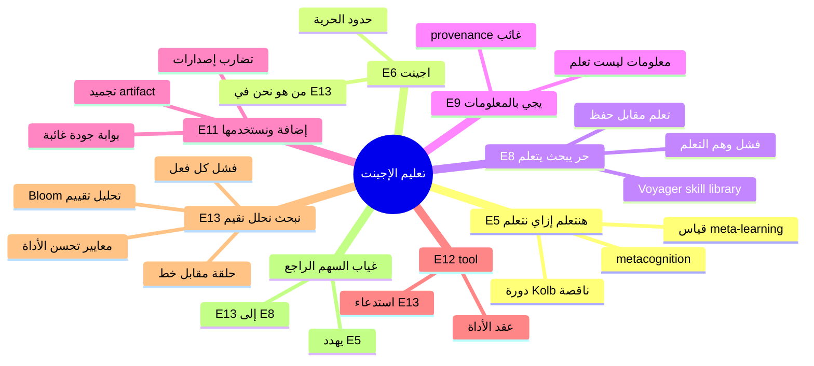

# خريطة: E13 بعين الناقد — البحث والتحليل والتقييم كاختبار حقيقي للتعلّم

## 1. الفكرة في جملة واحدة كما فهمتها

نترك وكيلاً حراً يبحث ويتعلّم ذاتياً، ثم نجمّد ناتج ذلك التعلّم في «إضافة» دائمة تُستخدم لاحقاً كأداة تُعيد ثلاثة أفعال: البحث، التحليل، والتقييم — والفكرة الأعمق (E5) أننا نعلّم الوكيل *كيف* يتعلّم لا *ماذا* يحفظ في موضوع واحد.

## 2. الخريطة

- **الجذر: تعليم الإجينت** [الورقة: E4]
  - **الشعار الميتا: هنتعلم إزاي نتعلّم** [الورقة: E5]
    - **معنى «نتعلّم إزاي نتعلّم» للوكيل** [استنتاج: E5]
      - التعلّم = بناء *إجراءات* قابلة للنقل لا تراكم *حقائق* فقط [استنتاج: E5 + E11]
      - الميتا-هدف: تحسين استراتيجية البحث والتحليل والتقييم عبر دورات [استنتاج: E5 + E13]
      - عند الإنسان: metacognition — مراقبة الذات أثناء التعلّم [بحث: https://en.wikipedia.org/wiki/Metacognition]
      - عند الخبير: انتقال من «قواعد صريحة» إلى «أنماط ضمنية» (Dreyfus) [بحث: https://en.wikipedia.org/wiki/Dreyfus_model_of_skill_acquisition]
      - **خطر الورقة**: E5 يعلّق على العملية لكن لا يوجد عنصر على الورقة يقيس «هل تحسّنت قدرتنا على التعلّم؟» [استنتاج: E5 + غياب سهم راجع]
    - **دورة Kolb كما ينقصها الورقة** [بحث: https://en.wikipedia.org/wiki/Experiential_learning] [استنتاج: E5 + E8–E11]
      - تجربة (E8) → تأمل (غائب) → تجريد (E11) → تجربة جديدة (غائب لأن لا سهم راجع إلى E6)
      - بدون التأمل والتجربة الثانية تبقى E5 شعاراً لا آلية [استنتاج: E5]
  - **الوكيل (صندوق البداية)** [الورقة: E6]
    - **من هو «الوكيل» في الرسم؟** [استنتاج: E6]
      - كيان واحد يمرّ بالمسار — لكن E13 يستخدم «نبحث/نحلل/نقيم» بصيغة الجمع [استنتاج: E6 + E13]
      - احتمال: إنسان + وكيل يتشاركان الأداة بعد التجميد [تخمين: E6 + E13]
      - احتمال: الوكيل بعد التعلّم يصبح «نحن» عبر الإضافة [تخمين: E11 + E13]
    - **ما الذي يُترك «حراً» وما الذي يُقيَّد ضمنياً؟** [استنتاج: E6 + E8]
      - حرية E8 لا تعني غياب موارد أو زمن أو سياسات أمان [استنتاج: E8]
      - حتى البحث «الحر» يحتاج تعريف نطاق: ماذا يُسمح أن يُسأل؟ [استنتاج: E8 + E13 «نبحث»]
  - **نخلي حر يبحث يتعلّم** [الورقة: E8]
    - **«يبحث» كفعل تعلّم لا كفعل أداة** [استنتاج: E8 vs E13]
      - على الورقة: البحث يحدث *قبل* الإضافة؛ في E13 يُعاد كقدرة الأداة — هل هو نفس الفعل؟ [استنتاج: E8 + E13]
      - إن كان مختلفاً: التعلّم = اكتشاف *كيف* تبحث؛ الإضافة = أتمتة ذلك [استنتاج: E8 + E11 + E13]
      - إن كان نفسه: خطر تجميد سلوك استكشافي خام دون تقييم [استنتاج: E8 + E11 + E13]
    - **«يتعلّم» بلا تعريف على الورقة** [استنتاج: E8]
      - تعلّم كتحديث أوزان (غير مذكور) [تخمين: E8]
      - تعلّم ككتابة ذاكرة / مهارات / كود (مثل skill library) [بحث: https://arxiv.org/abs/2305.16291] [استنتاج: E8 + E11]
      - تعلّم كتجميع prompt أو module (DSPy-style) [بحث: https://arxiv.org/abs/2310.03714] [تخمين: E11]
      - **معيار ناقد**: التعلّم الحقيقي يظهر تحت توزيع مهام جديدة وليس فقط إعادة نفس المهمة [استنتاج: E8 + E13]
    - **فشل: وهم التعلّم أثناء الحرية** [استنتاج: E8 + E9]
      - الوكيل يملأ وقت البحث بمصادر مريحة (confirmation bias) [استنتاج: E8 + E13]
      - «يتعلّم» من محتوى غير موثوق ثم يُجمَّد في E11 [استنتاج: E8 + E9 + E11]
      - تعارض مع E5: لم يتعلّم *كيف* يتعلّم بل حفظ مسار واحد [استنتاج: E5 + E8]
    - **مرجع: وكلاء يبنون أدواتهم** [بحث: https://arxiv.org/abs/2302.04761] [استنتاج: E8 + E12]
      - Toolformer: متى يستدعي الوكيل أداة — عكس الورقة: الورقة تبني أداة *بعد* التعلّم [استنتاج: E12]
  - **يجي بـ المعلومات** [الورقة: E9]
    - **«المعلومات» ليست «التعلّم»** [استنتاج: E9 + E11]
      - E9 ينقل حمولة؛ E11 يفترض تحويلاً إلى إضافة — الفجوة = عملية تجميع/تقطير [استنتاج: E9 + E11]
      - فشل: تخزين ملخصات طويلة واعتبارها إضافة [استنتاج: E9 + E11]
    - **ما الذي يجب أن يعود مع المعلومات؟** [استنتاج: E9 + E13]
      - مصادر (provenance) لـ «نبحث» لاحقاً [استنتاج: E9 + E13]
      - افتراضات صريحة لـ «نحلل» [استنتاج: E9 + E13]
      - حدود الثقة ونقاط الضعف لـ «نقيم» [استنتاج: E9 + E13]
      - الورقة لا تذكر أيّاً من ذلك — فقط «المعلومات» [الورقة: E9]
    - **صيغة العودة** [استنتاج: E9 + E11]
      - نصوص، رسوم، كود، جداول قرار، rubrics — كلها مرشّحة لـ «إضافة» [استنتاج: E11]
      - بدون صيغة قابلة للتنفيذ تبقى E11 مجازاً [استنتاج: E11 + E12]
  - **نتاج التعلّم نعمله إضافة ونستخدمها** [الورقة: E11]
    - **«إضافة» كتجميد قابل لإعادة الاستخدام** [الورقة: E11]
      - إضافة = artifact خارج جلسة الوكيل (ملف، skill، MCP tool، قاعدة) [استنتاج: E11 + E12]
      - Voyager: مهارات Minecraft ككود يُستدعى لاحقاً [بحث: https://arxiv.org/abs/2305.16291] [استنتاج: E11]
      - Reflexion: ذاكرة لغوية من تجارب فاشلة — إضافة أخف من كود [بحث: https://arxiv.org/abs/2305.10534] [استنتاج: E11]
    - **«ونستخدمها» — من يستخدم؟ متى؟** [الورقة: E11]
      - استخدام لاحق من نفس الوكيل أو وكيل آخر أو إنسان [استنتاج: E11 + E6]
      - بدون سياسة نسخ/إصدارات تتضارب إضافات [استنتاج: E11]
    - **فشل التجميد (crystallization failure)** [استنتاج: E11 + E13]
      - تجميد معرفة قديمة يمنع التعلّم الجديد (E8 لا يعود) [استنتاج: E11 + غياب سهم راجع]
      - إضافات متعددة تتناقض في التحليل والتقييم [استنتاج: E11 + E13]
      - Goodhart: الإضافة تُحسَّن لمقياس التقييم لا للهدف الأصلي [بحث: https://en.wikipedia.org/wiki/Goodhart%27s_law] [استنتاج: E13]
    - **بوابة جودة غائبة قبل E11** [استنتاج: E11 + E13]
      - لا عنصر على الورقة يقول: «لا تُجمّد حتى يمرّ التقييم» [استنتاج: E9–E11]
      - اقتراح ناقد: E13 يجب أن يسبق E11 في الدورة التالية حتى لو الرسم خطي [استنتاج: E13 + E11]
  - **tool (سهم)** [الورقة: E12]
    - **الإضافة = أداة في واجهة تنفيذ** [استنتاج: E12 + E11]
      - فصل: E11 معنى («ماذا نحتفظ»)؛ E12 شكل («كيف يُستدعى») [استنتاج: E11 + E12]
      - MCP / function calling / script — تنفيذ E13 عند الطلب [تخمين: E12 + E13]
    - **فشل: أداة بلا عقد (contract)** [استنتاج: E12 + E13]
      - مدخلات/مخرجات غير معرّفة → «نحلل» يعني أشياء مختلفة كل مرة [استنتاج: E13 + E12]
      - أداة لا تُسجّل قراراتها → لا يمكن إعادة «نقيم» [استنتاج: E13]
    - **أداة مقابل وكيل فرعي** [تخمين: E12 + E6]
      - إن كانت الإضافة وكيلاً مصغّراً، E6 يتكاثر — حاجة لتنسيق [تخمين: E6 + E12]
  - **نبحث / نحلل / نقيّم (E13 — عين الناقد)** [الورقة: E13]
    - **لماذا ثلاثة أفعال وليس واحداً؟** [استنتاج: E13]
      - Bloom: تحليل ≠ تقييم — التقييم يحتاج معايير وقضاء [بحث: https://cft.vanderbilt.edu/guides-sub-pages/blooms-taxonomy/] [استنتاج: E13]
      - حلقة علمية: observation → interpretation → judgment [استنتاج: E13]
      - OODA: observe–orient–decide — نقابة مع E13 [بحث: https://en.wikipedia.org/wiki/OODA_loop] [تخمين: E13]
    - **1) نبحث — ماذا يتطلّب حقاً؟** [الورقة: E13]
      - **سؤال بحث** قابل للرفض (falsifiable) [استنتاج: E13 + E8]
      - **استراتيجية مصادر**: أولية/ثانوية، تاريخية، خبيرة [استنتاج: E13]
      - **إيقاف**: متى «كفاية»؟ بدونها E8 لا ينتهي [استنتاج: E8 + E13]
      - **تتبع (provenance)**: كل ادعاء يعود لمصدر [استنتاج: E9 + E13]
      - **فشل البحث** [استنتاج: E13]
        - بحث كـ retrieval فقط بدون توليف [استنتاج: E13 + E9]
        - تضخيم إجماع ضعيف (bandwagon) [استنتاج: E13]
        - إضافة تُعيد البحث بنفس الخطأ لأن E11 جمّد استراتيجية سيئة [استنتاج: E11 + E13]
      - **أمثلة مجال-محايدة** [تخمين: E13]
        - طب: مسح أدلة سريرية بمعايير شمول
        - قانون: تتبع سوابق بسلسلة استشهاد
        - هندسة: قراءة RFC وissues قبل تصميم
    - **2) نحلل — ماذا يتطلّب حقاً؟** [الورقة: E13]
      - **تفكيك**: أجزاء، علاقات سببية، متغيّرات خفية [استنتاج: E13]
      - **نماذج**: إطار يفسّر لا يصف فقط [استنتاج: E13]
      - **فصل إشارة/ضجيج** [استنتاج: E13 + E9]
      - **تحليل مقابل تلخيص**: E9 قد يكون تلخيصاً؛ E13 يتطلب بنية [استنتاج: E9 + E13]
      - **فشل التحليل** [استنتاج: E13]
        - تحليل post hoc (إيهام السببية)
        - overfitting لقصة واحدة من E9
        - تحليل بلا حدود — لا يقول ما *ليس* صحيحاً
      - **ارتباط E5**: «نتعلّم إزاي نتعلّم» = تحليل لعملية التعلّم نفسها (meta-analysis) [استنتاج: E5 + E13]
    - **3) نقيّم — ماذا يتطلّب حقاً؟** [الورقة: E13]
      - **معايير صريحة** قبل الحكم [استنتاج: E13]
      - **أوزان**: دقة vs اكتمال vs تكلفة vs أخلاقيات [استنتاج: E13]
      - **مقارنة**: بدائل، خطوط أساس، نسخ سابقة من الإضافة [استنتاج: E11 + E13]
      - **عدم اليقين**: تقدير ثقة لا نعم/لا فقط [استنتاج: E13]
      - **تقييم ذاتي مقابل خارجي**: من يملك الحقيقة؟ الورقة صامتة [استنتاج: E13 + E6]
      - **فشل التقييم** [استنتاج: E13]
        - rubric ضيّق يغفل ما لم يُدرج
        - تقييم لمرة واحدة ثم E11 يجمّد — لا تحسين
        - self-reward hacking في وكلاء [بحث: https://arxiv.org/abs/2212.08073] [تخمين: E13 + E8]
      - **أمثلة مجال-محايدة** [تخمين: E13]
        - تعليم: تقييم حلول طلاب بمعيار نقل
        - استثمار: تقييم فرضيات بسيناريوهات
        - صيانة: تقييم إصلاح بمعدل عودة العطل
    - **ترتيب E13 على الورقة: عمودي** [الورقة: E13]
      - هل هو pipeline ثابت (بحث ثم تحليل ثم تقييم)؟ [استنتاج: E13]
      - أم حلقة؟ التقييم يولّد أسئلة بحث جديدة — يحتاج سهم راجع إلى E8 [استنتاج: E13 + غياب سهم]
      - **ناقد**: بدون حلقة، «نقيم» نهاية مسار — يتعارض مع E5 (تعلّم مستمر) [استنتاج: E5 + E13]
    - **كيف نعرف أن التعلّم حصل وأن الأداة تحسّنت؟** [استنتاج: E8 + E11 + E13]
      - **مستوى 1 — الإضافة**: نجاح الاستدعاء، زمن، تغطية مصادر [استنتاج: E11 + E12]
      - **مستوى 2 — E13**: جودة مخرجات البحث/التحليل/التقييم على benchmark ثابت [استنتاج: E13]
      - **مستوى 3 — التعلّم (E5)**: أداء على مهام *جديدة* بنفس الميزانية — meta-learning [بحث: https://arxiv.org/abs/1703.03170] [استنتاج: E5 + E8]
      - **مستوى 4 — مقارنة زمنية**: إصدار v2 من الإضافة يتفوق على v1 بلا تدخل بشري كبير [استنتاج: E11 + E13]
      - **مؤشرات فشل التحسّن** [استنتاج: E11 + E13]
        - دقة ترتفع على مجموعة التدريب الضمنية لـ E8 فقط
        - الإضافة تطول دون قرارات أفضل
        - تباين عالٍ بين جلسات — لا مهارة مستقرة
    - **E13 كاختبار قبول لـ E11** [استنتاج: E11 + E13]
      - لا تُسمى «نتاج تعلّم» ما لم يمرّ الثلاثة بمعايير [استنتاج: E11 + E13]
      - «نستخدمها» (E11) خطر إن لم يُقيَّم أولاً [استنتاج: E11 + E13]
  - **الشكل الخطي وغياب السهم الراجع** [استنتاج: E6–E13 كرسم]
    - **ما يفترضه الخط**: مرحلة واحدة من حرية ثم تجميد [استنتاج: E8 + E11]
    - **ما يكسره الواقع**: التعلّم دوري؛ الإضافات تتراكم؛ البيئة تتغير [استنتاج: E5 + E11]
    - **سهم راجع مقترح (ليس على الورقة)** [تخمين: E13 → E6 أو E8]
      - بعد «نقيم»: قرار — أعد البحث / حدّث الإضافة / ألغِ الإضافة [تخمين: E13 + E11 + E6]
      - بدون هذا: الفكرة تتحول إلى «سكربت لمرة واحدة» [استنتاج: E8–E11]
    - **Schön: الوكيل كـ reflective practitioner** [بحث: https://en.wikipedia.org/wiki/Donald_Sch%C3%B6n] [استنتاج: E5 + غياب سهم]
      - reflection-in-action غائب بين E9 وE11 [استنتاج: E9 + E11]
  - **عنوان E4 كإطار للناقد** [الورقة: E4]
    - «تعليم» يوحي بمدرّب ومتعلّم — من المدرّب؟ [استنتاج: E4 + E6]
      - إنسان يضبط الحرية والمعايير [تخمين: E4 + E8]
      - نظام تقييم آلي (E13 على الوكيل) [تخمين: E4 + E13]
      - تعليم ذاتي بالكامل — E4 مجاز [استنتاج: E4 + E8]
    - **فشل المشروع ككل** [استنتاج: E4–E13]
      - إضافات بلا تقييم → ضرر أسرع من وكيل بلا ذاكرة
      - حلقة مغلقة خاطئة: E11 يعزّز تحيزات E8
      - E5 يبقى شعاراً بلا قياس meta-learning
      - E13 ثلاث كلمات بلا rubrics → أداة لا يمكن تحسينها
      - لا إدارة لإصدارات الإضافات → فوضى معرفية

### خارج الورقة

- **بنية تحتية سحابية أو نموذج محدد** — غير مذكور [خارج الورقة]
- **تعلّم آلي بتحديث أوزان أثناء الإنتاج** — غير مذكور صراحة [خارج الورقة]
- **تسويق منتج أو مجال صناعة واحد** — الفكرة عامة عمداً [خارج الورقة]
- **أمان/خصوصية كعنصر منفصل** — مرتبط ضمنياً بـ «حر» لكن ليس عنصراً [خارج الورقة]

## 3. رسم الخريطة

## 4. أهم 5 اكتشافات

1. **E13 ليس وصفاً للأداة فقط — هو معيار قبول لـ E11**: ما لم تُعرَّف البحث والتحليل والتقييم بمعايير قابلة للقياس، تحويل «المعلومات» (E9) إلى «إضافة» يجمّد ضجيجاً باسم تعلّم.

2. **تعارض بنيوي بين E5 والرسم الخطي**: «هنتعلم إزاي نتعلّم» يتطلّب دورات وتأملاً وإعادة تجربة، بينما المسار E6→E8→E9→E11→E12→E13 بلا سهم راجع يقرّب الفكرة من خط إنتاج لمرة واحدة لا من تعليم مستمر.

3. **ازدواجية «يبحث» في E8 و«نبحث» في E13**: إن فُهمتا كفعل واحد، الخطر هو أتمتة الاستكشاف قبل نضجه؛ إن فُهمتا كمرحلتين (تعلّم الاستراتيجية ثم تطبيقها)، تظهر حاجة لبوابة تقييم بين E9 وE11 — وهي غائبة على الورقة.

4. **أدبيات الوكلاء (skill libraries، reflexive memory) تُجسّد E11+E12 لكنها تفرض سؤال الإصدار والتقييم**: الاحتفاظ بمهارة كود أو ذاكرة لغوية يحقق «إضافة»، لكن التحسين الحقيقي يحتاج مقارنة إصدارات على مهام جديدة — أي E13 مُطبَّق على الإضافة نفسها، لا على موضوع بحث عابر.

5. **غياب السهم الراجع هو نقطة فشل مركزية لا تفصيلاً**: بدون عودة من «نقيم» إلى «حر يبحث» أو إلى الوكيل، لا آلية لإبطال إضافة خاطئة أو لتحقيق E5؛ الناقد يرى الفكرة مكتملة فقط عند إغلاق الحلقة خارج الورقة.

## 5. أسئلة مفتوحة

- من المعني بـ «نبحث / نحلل / نقيّم» — الوكيل، الإنسان، أم الإضافة ككيان ثالث؟
- ما الصيغة الدنيا لـ «إضافة» (نص، كود، أداة MCP، rubric) التي تبقى قابلة للتحسين؟
- هل ترتيب E13 إلزامي أم يمكن التكرار والرجوع بين الأفعال الثلاثة داخل الأداة؟
- ما شروط «كفاية» لإنهاء مرحلة E8 والانتقال إلى E9؟
- كيف نميّز على الورقة بين جولة تعلّم واحدة وبين منهجية meta-learning مستمرة (E5)؟
- متى تُحذف أو تُستبدل إضافة (E11) بعد «نستخدمها»؟
- هل «tool» (E12) يعني استدعاءً لمرة واحدة أم خدمة دائمة بإصدارات؟
- من يملك الحقيقة في «نقيم» عند غياب ground truth — خاصة في مجالات إبداعية أو استراتيجية؟
- ما علاقة E4 «تعليم» بالتحكم في درجة حرية E8 — تعليم = تقييد تدريجي أم إطلاق كامل؟
- هل يمكن أن تتكاثر عدة إضافات من وكلاء مختلفين وكيف يُحلّ تعارض تقييماتها (E13)؟

## 6. المصادر

| URL | ما أعطاني |
|-----|-----------|
| https://arxiv.org/abs/2305.16291 | Voyager — وكيل يبني مكتبة مهارات قابلة لإعادة الاستخدام (تجسيد E11+E12) |
| https://arxiv.org/abs/2305.10534 | Reflexion — تعلم من التجربة عبر ذاكرة لغوية (نوع خفيف من «إضافة») |
| https://arxiv.org/abs/2302.04761 | Toolformer — تعلم الوكيل متى وكيف يستدعي أدواتاً |
| https://arxiv.org/abs/2310.03714 | DSPy — تجميع خطوط معالجة كـ modules محسّنة (مقاربة لتحويل التعلم إلى artifact) |
| https://arxiv.org/abs/1703.03170 | MAML — meta-learning كإطار لـ «التعلم من few-shot» (قراءة E5) |
| https://cft.vanderbilt.edu/guides-sub-pages/blooms-taxonomy/ | تمييز التحليل عن التقييم في التعلم (E13) |
| https://en.wikipedia.org/wiki/Metacognition | إطار «تعلم كيف تتعلم» (E5) |
| https://en.wikipedia.org/wiki/Experiential_learning | دورة Kolb وتأمل التجربة (فجوة السهم الراجع) |
| https://en.wikipedia.org/wiki/Dreyfus_model_of_skill_acquisition | مراحل مهارة الخبير (معنى «يتعلم» في E8) |
| https://en.wikipedia.org/wiki/OODA_loop | حلقة قرار مرنة (مقارنة مع E13) |
| https://en.wikipedia.org/wiki/Donald_Sch%C3%B6n | الممارس التأملي (غياب التأمل بين E9 وE11) |
| https://en.wikipedia.org/wiki/Goodhart%27s_law | خطر تحسين الإضافة للمقياس لا للغرض (فشل E13) |
| https://arxiv.org/abs/2212.08073 | Constitutional AI / critique — تقييم مخرجات الوكيل (إشارة لـ self-critique في E13) |
